# Raport QA Sentinela 1.2.0

Data: 30–31 października 2026. Wersja: 1.2.0, po przebudowie wyglądu (WP10). Co zmieniło się potem: sekcje „Po raporcie: wersja 1.2.1” i „Po raporcie: wersja 1.2.2”.

## Podsumowanie

1. Wersję 1.2.0 przetestowano wyłącznie przez przeglądarkę: sześciotygodniowy projekt na 30 zadań, oba przykłady w symulatorze i 45 typowych pomyłek użytkownika.
2. Znaleziono 9 poważnych problemów i żadnego blokującego; wszystkie 9 naprawiono, każdy z testem.
3. Prognozy reagują na zdarzenia sensownie, a zatwierdzanie rekomendacji pomaga: szansa wzrosła z 51 do 70 % i z 57 do 87 %.
4. Symulator opowiada czytelną historię: mały przykład kończy 10 dni roboczych wcześniej niż bez reakcji, a średni mieści się w terminie, gdy bez reakcji ma 4 dni spóźnienia.
5. Zostało 7 drobnych uwag i jedno pytanie do specyfikacji; można już robić test z ludźmi.

## Co sprawdzono

- **Przebieg 1:** projekt „Portal klienta” (30 zadań, 11 osób) od kreatora po eksport.
- **Przebieg 2:** symulator, mały i średni przykład, Sentinel kontra „Nikt nie reaguje”.
- **Pomyłki użytkownika:** puste pola, cykle zależności, termin przed startem, błędny CSV, podwójne kliknięcia, „wstecz” w trakcie pracy, dwie karty, zmiana języka, okno telefonu.
- **Automatycznie:** dostępność (axe) na każdym ekranie, w obu językach i motywach, na obu szerokościach: 0 naruszeń.

Skrypt `scripts/qa_run.py` działał tylko przez stronę, jak użytkownik. Dane pomocnicze czytał z JSON-a w tej samej sesji, żeby wiedzieć, co „zrobił zespół”.

**Czego nie sprawdzono:**

- funkcji AI (brak podłączonego modelu),
- prawdziwych telefonów (okno 390 × 844 w Chromium),
- innych przeglądarek niż Chromium,
- wersji demonstracyjnej w internecie.

## Przebieg 1: projekt na żywo

Start 7 września, termin 27 listopada, zespół wklejony listą, zadania z CSV. Dziewięć raportów co 3–4 dni robocze, do 16 października. Po zapisaniu raportu nowa prognoza i analiza były gotowe po 2–4 sekundach.

**Plan: 70 %, „Wymaga uwagi”.** Najbardziej prawdopodobny koniec 24 listopada, zły scenariusz 8 grudnia.

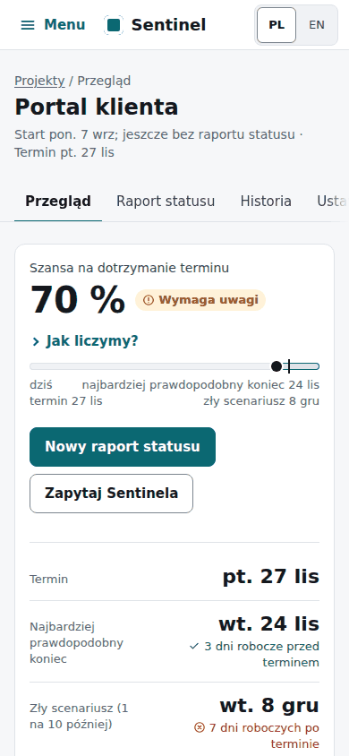

**10 września: zmiana automatyczna i cofnięcie.** Sentinel sam przesunął terminy (pozwalało na to ustawienie). Użyto **Cofnij**, a potem ustawienia „Tylko doradzaj”, żeby każda zmiana czekała na decyzję. Zrzuty: [przed](shots/run1/015_c1_auto_before_undo.png), [po](shots/run1/016_c1_after_undo.png).

**21 września: pierwsza nieobecność.** Cezary Wójcik do 2 października: 73 → 66 %. Sentinel nie miał lepszego ruchu niż obecny plan.

**30 września: nowe zadanie.** „Audyt bezpieczeństwa”, 4 dni: 79 → 51 %.

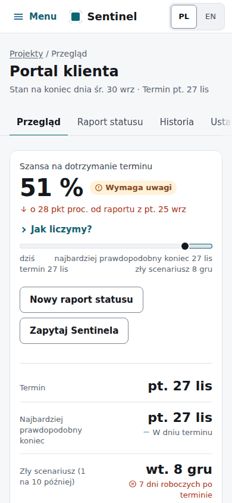

Rekomendacja: osoba tymczasowa i nowa kolejność zadań, 51 → 71 %, koszt +8 jednostek. **Zatwierdzono.** Prognoza po zatwierdzeniu: 70 %, czyli prawie dokładnie tyle, ile obiecano.

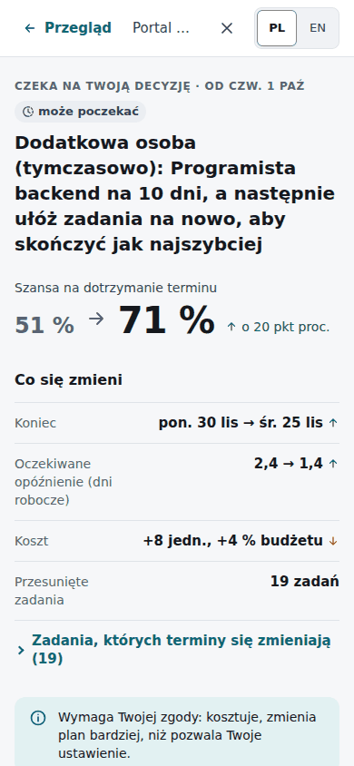

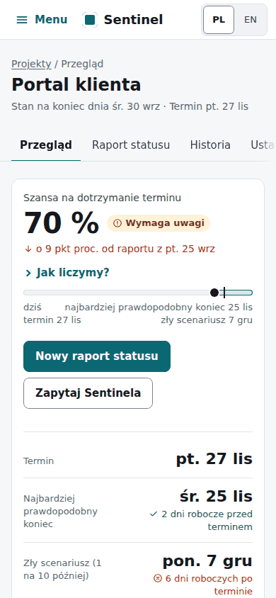

**8 października: dwa zdarzenia naraz.** „Logowanie i konta” urosło o 4 dni, Hanna Pawlak nieobecna bez daty powrotu: 79 → 46 %, „Termin zagrożony”. Rekomendacja: nowa kolejność zadań, 46 → 55 %. **Odrzucono** ([panel odrzucenia](shots/run1/041_c7_reject_panel.png)). Plan został bez zmian, szansa też.

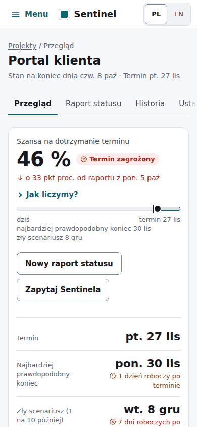

**13 października: decyzja odłożona.** 57 %, rekomendacja 57 → 73 %. **Zdecyduj później:** karta została na przeglądzie z napisem „Odłożone”.

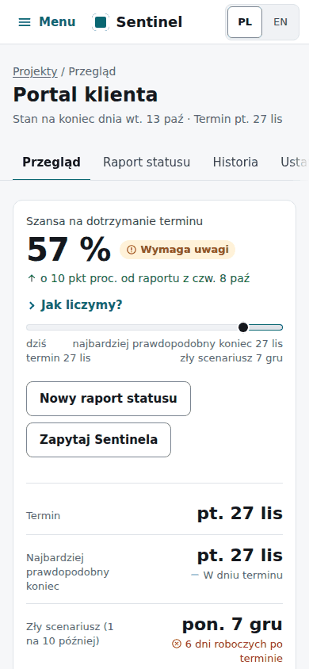

**16 października: koniec przebiegu.** Nowa rekomendacja zastąpiła odłożoną: osoba tymczasowa, 57 → 83 %. **Zatwierdzono.** Prognoza: 87 %, „Na dobrej drodze”. Cena: oczekiwany koszt 113 % budżetu.

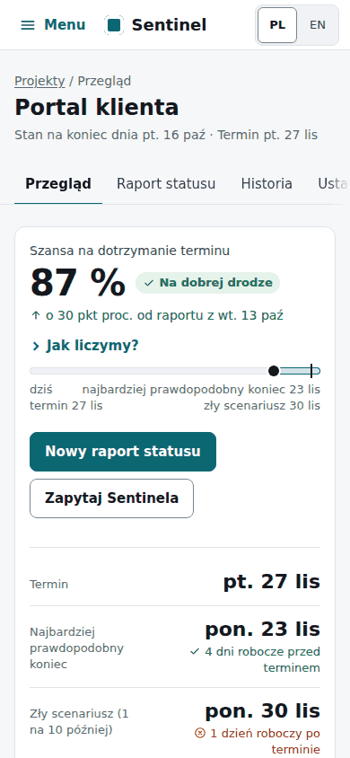

**Eksport i historia.**

- Plan w CSV: 31 wierszy ([plik](shots/run1/plan.csv)).
- Nowy raport dla zespołu: jedna strona do druku lub wysłania ([cały raport](shots/run1/056_report.png)).
- Historia: 27 wpisów. Skrypt potwierdził każdy raport, zatwierdzenia, odrzucenie, odłożenie, cofnięcie, obie nieobecności, wydłużenie i nowe zadanie.

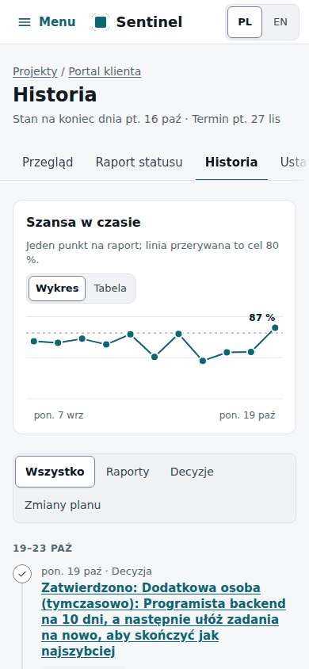

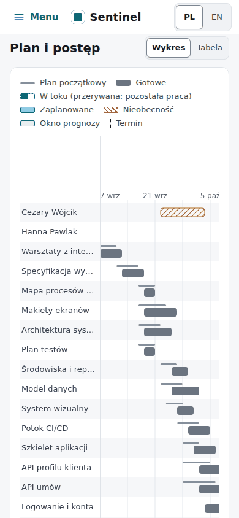

Wszystkie kroki są w [shots/run1](shots/run1/001_start_empty.png) (numerowane zrzuty), a liczby w [run1-log.json](run1-log.json).

## Przebieg 2: symulator

**Mały przykład.** Start 2 s, +1 dzień 2 s, +5 dni 6 s, +10 dni 10 s, do końca 40 s (strona zapowiadała około pół minuty, teraz „poniżej minuty”).

Wynik: „Z Sentinelem projekt skończył się 10 dni roboczych wcześniej niż bez reakcji, ale wciąż 8 dni roboczych po terminie.” Koszt prawie ten sam: +10 jednostek przy około 3 590.

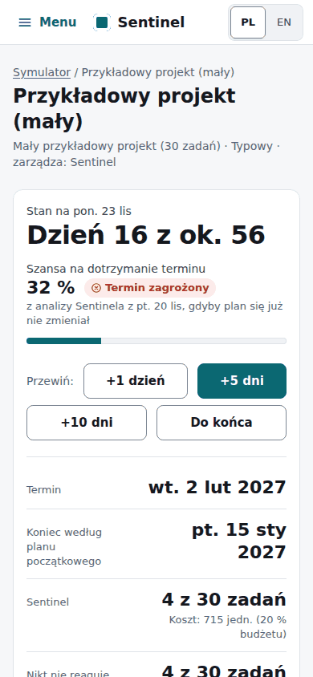

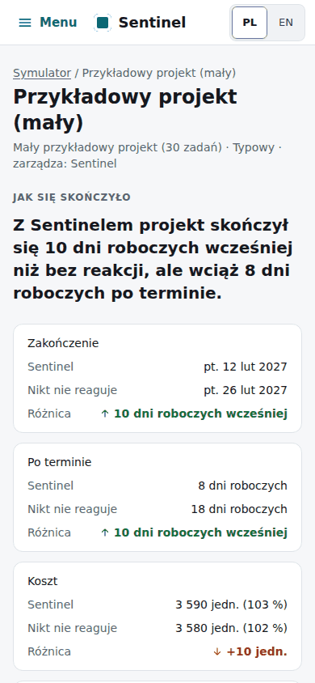

**Średni przykład.** Start 2 s, +5 dni 20 s, +10 dni 30 s, do końca 2 min 12 s (strona zapowiadała „minutę lub dwie”, teraz „2–3 minuty”).

Wynik: „Sentinel dotrzymał terminu; bez reakcji te same zdarzenia opóźniły projekt o 4 dni robocze.” Koszt nawet niższy o 46 jednostek.

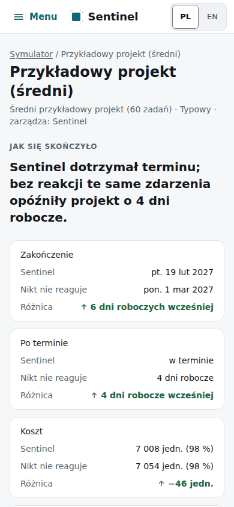

Zdanie na górze wystarcza, żeby zrozumieć wynik, a tabela z kolumną „Różnica” je potwierdza. Wszystkie kroki: [shots/run2](shots/run2/001_small_setup.png), liczby: [run2-log.json](run2-log.json).

## Problemy znalezione i naprawione

Wszystkie poważne. Każdy ma test regresyjny i osobny commit `WP10 fix`.

**QA-01. Komunikat o zapisanym raporcie znikał.**

- Kroki: zapisz raport na projekcie z terminem.
- Oczekiwane: „Raport zapisany. Szansa: 79 % → 51 %”.
- Było: analiza przeładowywała stronę i komunikat znikał, zanim dało się go przeczytać.
- Teraz: komunikat przetrwa przeładowanie ([zrzut](shots/run1/029_c5_overview.png)).

**QA-02. Daty ISO w komunikatach błędów.**

- Kroki: zgłoś start zadania, którego ludzie są zajęci.
- Oczekiwane: data słownie.
- Było: „Dnia 2026-09-16 brakuje wolnych osób…” ([zrzut przed](shots/before/022_c3_refused.png)).
- Teraz: daty słownie we wszystkich komunikatach, a komunikat podpowiada późniejszą datę startu.

**QA-03. Strona symulacji zawieszała się.**

- Kroki: „Do końca”, potem wstecz i ponowne otwarcie, albo otwarcie gotowej symulacji po restarcie serwera.
- Oczekiwane: strona otwiera się od razu.
- Było: ponad 30 s pustego oczekiwania (po restarcie ponad minuta).
- Teraz: pasek postępu, **Anuluj** i informacja, że można wyjść ([zrzut](shots/wrong/028_sim_again.png)).

**QA-04. „Zmiana nie jest potrzebna” przy 9 % szansy.**

- Kroki: projekt w tarapatach, Sentinel nie ma lepszego ruchu.
- Oczekiwane: uczciwy komunikat.
- Było: „Zmiana nie jest potrzebna: plan wciąż jest najlepszy” ([zrzut przed](shots/before/053_c9_overview.png)).
- Teraz: „Żadna sprawdzona możliwość nie jest wyraźnie lepsza od obecnego planu, więc plan pozostaje.”

**QA-05. Rekomendacja „3 % → 3 %” bez powodu do działania.**

- Kroki: otwórz rekomendację, która nie podnosi szansy.
- Oczekiwane: widać, co zyskujesz.
- Było: tylko „najmniej zmienia plan” ([zrzut przed](shots/before/026_c4_recommendation.png)).
- Teraz: wiersz „Oczekiwane opóźnienie 2,4 → 1,4” i to samo porównanie w uzasadnieniu.

**QA-06. Literówka w dacie raportu psuła projekt na zawsze.**

- Kroki: wpisz rok 2030 w dacie raportu.
- Oczekiwane: pytanie przed zapisem.
- Było: zapis od razu, a każdy kolejny raport musiał mieć datę po 2030.
- Teraz: data ponad tydzień od dziś wymaga potwierdzenia ([zrzut](shots/wrong/035_check-in_far_in_the_future.png)).

**QA-07. Wyjście z formularza kasowało wpisane dane.**

- Kroki: wypełnij pół raportu, kliknij zakładkę albo zmień język.
- Oczekiwane: pytanie przed wyjściem.
- Było: dane znikały bez słowa.
- Teraz: przeglądarka pyta. Dotyczy raportu i ustawień projektu; zapis i „Anuluj” nie pytają.

**QA-08. „Raport” był badawczym kokpitem.**

- Kroki: „Pokaż raport” albo eksport z ustawień.
- Oczekiwane: strona dla kierownika.
- Było: daty ISO, „0.09” zamiast 9 %, zadania jako numery, NOOP, P(C ≤ D), identyfikatory instancji.
- Teraz: nowy raport w języku aplikacji, działający po zapisaniu na dysk ([zrzut](shots/run1/056_report.png)). Kokpit został dla badań (API i `sentinel dashboard`).

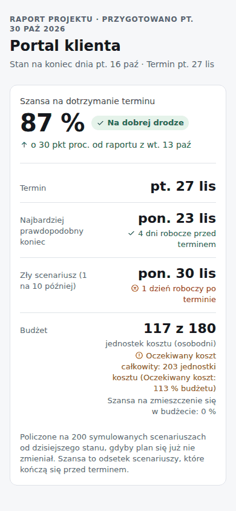

**QA-09. „0 %” przez tygodnie, a potem koniec w terminie.**

- Kroki: średni przykład w symulatorze, Sentinel.
- Oczekiwane: wiadomo, co ta liczba znaczy.
- Było: nigdzie nie pisało, że prognoza zakłada brak dalszych zmian.
- Teraz: „gdyby plan się już nie zmieniał” w symulatorze i pod „Jak liczymy?”.

**Naprawione przy okazji (drobne):**

- typowanie „150 %” pokazuje od razu 99, czyli to, co się zapisze;
- import bez pliku mówi „Najpierw wybierz plik”, a nie „Plik jest pusty”;
- oczekiwany koszt ponad budżet ma ostrzeżenie w kafelku Budżet;
- strona zapowiada realny czas symulacji;
- wykres na przeglądzie nie przewija się już wewnątrz karty, która chowała zagrożone zadania.

**Zachowało się dobrze:** puste pola, termin przed startem, cykle (w CSV i ręcznie, z nazwami zadań), błędny CSV z numerem wiersza, podwójne kliknięcia (jeden raport, jedna decyzja), Enter w polu, starszy raport w drugiej karcie, kod HTML w nazwie projektu, brak przewijania w bok na telefonie. Wszystkie przypadki: [wrong-log.json](wrong-log.json).

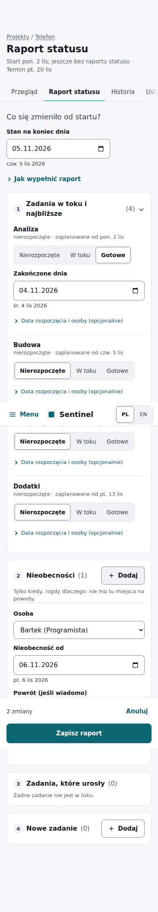

## Problemy pozostawione, z propozycją

Stan przy wersji 1.2.0; wszystkie naprawiono w 1.2.1. Wszystkie drobne. Pełny dziennik wszystkich problemów (po angielsku, z krokami i zrzutami): [problems.md](problems.md).

- **Raport sprzed startu projektu zapisuje się bez słowa** (specyfikacja na to pozwala, [zrzut](shots/wrong/034_check-in_before_the_project_starts.png)). Propozycja: łagodna informacja.
- **Błędy CSV używają surowych nazw kolumn i identyfikatorów** („duration_days”, „T9”, [zrzut](shots/wrong/009_csv_unknown_predecessor_and_role.png)). Propozycja: nazwy po polsku i numer wiersza.
- **Dwie karty w ustawieniach: wygrywa ostatni zapis, bez ostrzeżenia.** Propozycja: wykrycie zmiany i pytanie.
- **Rekomendacja ma datę następnego dnia roboczego** (raport z 30 września, „od czw. 1 paź”, [zrzut](shots/run1/030_c5_recommendation.png)). Propozycja: pokazywać datę raportu.
- **Wpis „Bez zmian” po każdym raporcie zaśmieca historię** ([zrzut](shots/run1/057_history.png)). Propozycja: zwijać takie wpisy albo dołączać do raportu.
- **Wydłużenia nie da się zgłosić dla zadania oznaczonego „W toku” w tym samym raporcie;** lista pokazuje tylko wcześniej rozpoczęte. Propozycja: aktualizować listę od razu.
- **„Działania remisują we wszystkim”** brzmi dziwnie, gdy szansa rośnie z 46 do 55 %: zdanie dotyczy porównania z następną możliwością ([zrzut](shots/run1/039_c7_recommendation.png)). Propozycja: pisać „z następną w kolejności”.

**Pytanie do specyfikacji:** lista „Co zagraża terminowi” pokazuje ostatnie zadania planu („Uruchomienie produkcyjne: 9 na 10”), gdy choć jedno wymagane zadanie nie ma następnika. Tu była to „Mapa procesów klienta”. Reguła „zadań strukturalnych” (§11.4) przestaje je wtedy odfiltrowywać, a kierownik nic z tym nie zrobi ([zrzut](shots/run1/061_overview_final.png)). Trzy kolejne pytania dotyczą przebudowy, a nie testów; są w [raporcie WP10](../reports/WP10.md).

## Po raporcie: wersja 1.2.1

Cztery odpowiedzi na pytania do specyfikacji i naprawa wszystkich 7 drobnych uwag.

**Co zagraża terminowi.** Zadania są teraz ułożone według różnicy: jak często decydują o terminie w scenariuszach z opóźnieniem, minus jak często w tych kończących się w terminie. Na liście są tylko zadania z różnicą co najmniej 10 pkt proc. „Uruchomienie produkcyjne” zniknęło z listy. Zdanie jest takie jak wcześniej, więc liczby nie muszą maleć w dół listy.

**Bez zmian:** „Bez zmian” zostaje na końcu porównania, słownictwo §11.7 i napis symulatora zostają.

**Skutek, który warto znać: lista jest teraz prawie zawsze pusta.** W tym samym projekcie zadania pojawiają się tylko w 1 z 9 raportów (10 września). W pozostałych strona pisze, że ryzyko rozkłada się na cały plan, nawet przy spadku 79 → 46 % po wydłużeniu jednego zadania i nieobecności jednej osoby.

- Największa różnica w tych ośmiu raportach to 7 pkt proc.
- Te same zadania leżą na łańcuchu wyznaczającym koniec i gdy projekt się spóźnia, i gdy zdąża. Spóźnienie bierze się najpewniej z ich długości, a nie z tego, które to zadania.
- Przykładowy projekt z demo też pisze teraz, że ryzyko rozkłada się na cały plan.
- Próg 5 pkt proc. dałby listę w około 5 z 9 raportów.

**Naprawione drobne uwagi:**

- data sprzed startu projektu ma łagodną informację, a raport nadal się zapisuje;
- błędy CSV podają kolumnę słowami i jej nazwę z pliku, a „T9” nazywają identyfikatorem;
- drugi zapis ustawień w innej karcie najpierw pyta i zachowuje to, co wpisano;
- rekomendacja podaje stan na koniec dnia z raportu, a osobno pierwszy dzień, który zmiana obejmuje;
- „Bez zmian” po raporcie to wiersz w tym raporcie, a nie osobny wpis (27 wpisów → 23);
- zadanie oznaczone jako „W toku” można od razu zgłosić jako wydłużone;
- zamiast „działania remisują we wszystkim”: „we wszystkim poza prostotą remisuje z następną w kolejności możliwością”.

## Po raporcie: wersja 1.2.2

Druga zmiana listy „Co zagraża terminowi”, bo w 1.2.1 była prawie zawsze pusta. Na liście są teraz zadania, które leżą na łańcuchu wyznaczającym koniec w co najmniej połowie scenariuszy z opóźnieniem, bez tych, które leżą na nim w co najmniej 95 % wszystkich scenariuszy. Kolejność: od najczęstszego, najwyżej trzy. Zdanie jest takie jak wcześniej, a „ryzyko rozkłada się na cały plan” pojawia się tylko wtedy, gdy żadne zadanie nie spełnia warunków.

Przebieg 1 jeszcze raz, ten sam zespół i te same szanse. Pogrubiona jest liczba zadań na liście, a liczba przy zadaniu to „w ilu na 10 scenariuszy z opóźnieniem”.

- 10 wrz, 68 %: **2**: szkolenie użytkowników 7, testy akceptacyjne 7
- 15 wrz, 73 %: **3**: szkolenie użytkowników 8, testy akceptacyjne 8, testy interfejsu 6
- 21 wrz, 66 %: **3**: szkolenie użytkowników 8, testy akceptacyjne 8, architektura systemu 5
- 25 wrz, 79 %: **2**: szkolenie użytkowników 7, testy akceptacyjne 6
- 30 wrz, 51 %: **3**: szkolenie użytkowników 9, testy akceptacyjne 8, testy wydajności 5
- 5 paź, 79 %: **3**: szkolenie użytkowników 7, testy akceptacyjne 6, testy interfejsu 5
- 8 paź, 46 %: **2**: szkolenie użytkowników 7, testy akceptacyjne 6
- 13 paź, 57 %: **2**: szkolenie użytkowników 7, testy akceptacyjne 7
- 16 paź, 57 %: **3**: uruchomienie produkcyjne 9, szkolenie użytkowników 8, testy akceptacyjne 7

Lista nie jest już pusta w żadnym z 9 raportów. **Dwa skutki, które warto znać:**

- **Uruchomienie produkcyjne wraca raz.** 16 października jest pierwsze, bo leży na łańcuchu w 189 z 200 scenariuszy (94,5 %), o jeden scenariusz poniżej progu. W pozostałych ośmiu raportach to 190–195 z 200, a 10 września dokładnie 190. Próg leży w granicach losowego rozrzutu tej liczby, więc to się będzie powtarzać. Próg 93 % utrzymałby je poza listą we wszystkich 9 raportach (kolejne zadanie ma najwyżej 92 %); to jedna stała.
- **Lista prawie się nie zmienia.** Szkolenie użytkowników i testy akceptacyjne są w każdym z 9 raportów, choć częściej decydują w scenariuszach kończących się w terminie niż w tych z opóźnieniem. Lista mówi więc, które zadania zwykle wyznaczają koniec, a nie co spóźnia projekt. 8 października, przy spadku 79 → 46 % po wydłużeniu „Logowania i kont” o 4 dni i nieobecności jednej osoby, są na niej te same dwa zadania, co 5 października, a „Logowanie i konta” leży na łańcuchu tylko w 25 % scenariuszy z opóźnieniem.

## Obserwacje UX, oczami kierownika projektu

**Czy prognozy zmieniały się sensownie?** Tak. Każdy duży ruch ma jasną przyczynę w raporcie: nowe zadanie 79 → 51 %, wydłużenie z nieobecnością 79 → 46 %, dobry postęp 66 → 79 %.

**Czy rekomendacje były zrozumiałe i wiarygodne?** Tak, choć nie od pierwszego słowa. Liczby po zatwierdzeniu zgadzały się z obietnicą (71 i 70 %, 83 i 87 %). Długie nazwy działań („Dodatkowa osoba (tymczasowo): …, a następnie ułóż zadania na nowo…”) wymagają wczytania się, a „19 przesuniętych zadań” może niepokoić.

**Czy zatwierdzanie pomagało?** Tak, projekt skończył przebieg z 87 %. Ceną były dwie osoby tymczasowe i budżet: oczekiwany koszt 113 %.

**Czy symulator opowiada jasną historię?** Tak. Jedno zdanie na górze i tabela z różnicą wystarczą.

**Gdzie kierownik się zawaha:**

- Szansa skacze: 79, 46, 57, 87 % w dwa tygodnie. Strona mówi „o ile”, ale nie „dlaczego”. Warto dopisać przy zmianie jej główną przyczynę.
- Status mówi tylko o terminie. Koszt ponad budżet ma teraz ostrzeżenie, ale to nadal drobny napis.
- Odłożona propozycja może wrócić jako inna: 13 października była to nowa kolejność zadań, 16 października osoba tymczasowa.
- Po odrzuceniu Sentinel może zaproponować to samo przy następnym raporcie; strona uprzedza o tym przy odrzuceniu.

## Rekomendacja dla testu z ludźmi

Test można robić już teraz, według [protokołu](../usability/protocol-pl.md): 5 osób, 20 minut. Etykiety w protokole i przewodnikach są zaktualizowane.

Warto uważnie obserwować:

- czy uczestnik odróżnia szansę od obietnicy (czy „87 %” brzmi jak „zdążymy”),
- czy czyta długą nazwę działania, czy od razu szuka liczb,
- czy znajduje **Więcej ustawień** i **Porównaj wszystkie możliwości**, które są teraz zwinięte,
- czy zauważa ostrzeżenie o budżecie przed zatwierdzeniem kolejnej osoby tymczasowej.

Warto dodać jedno zadanie na telefonie (zapisanie raportu), bo układ telefonu sprawdzono tylko w emulacji. Funkcje AI warto przetestować osobno, z podłączonym modelem.
