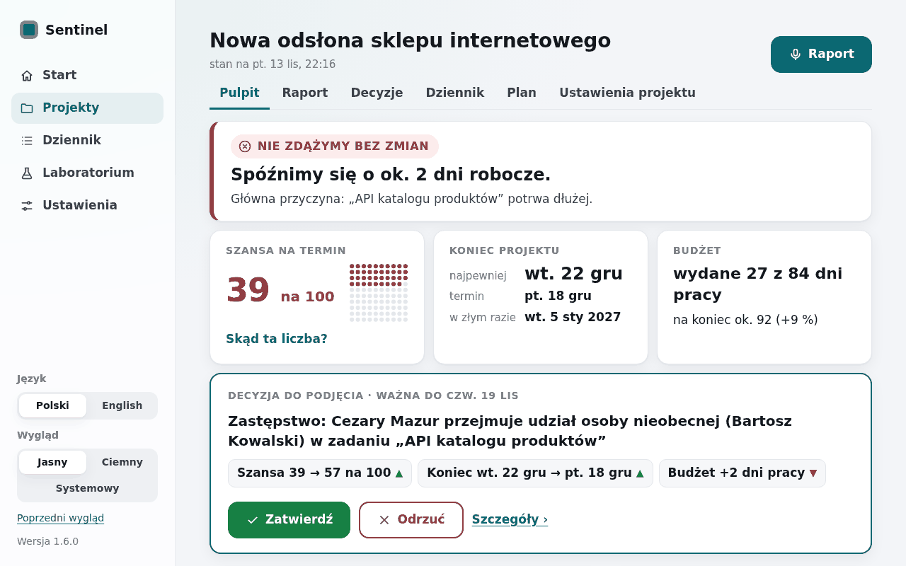
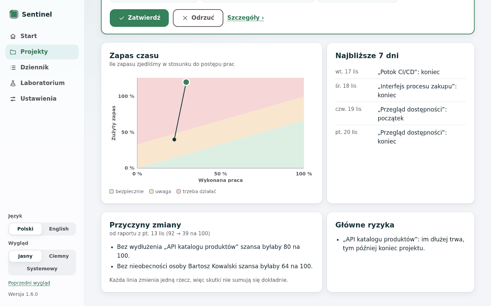
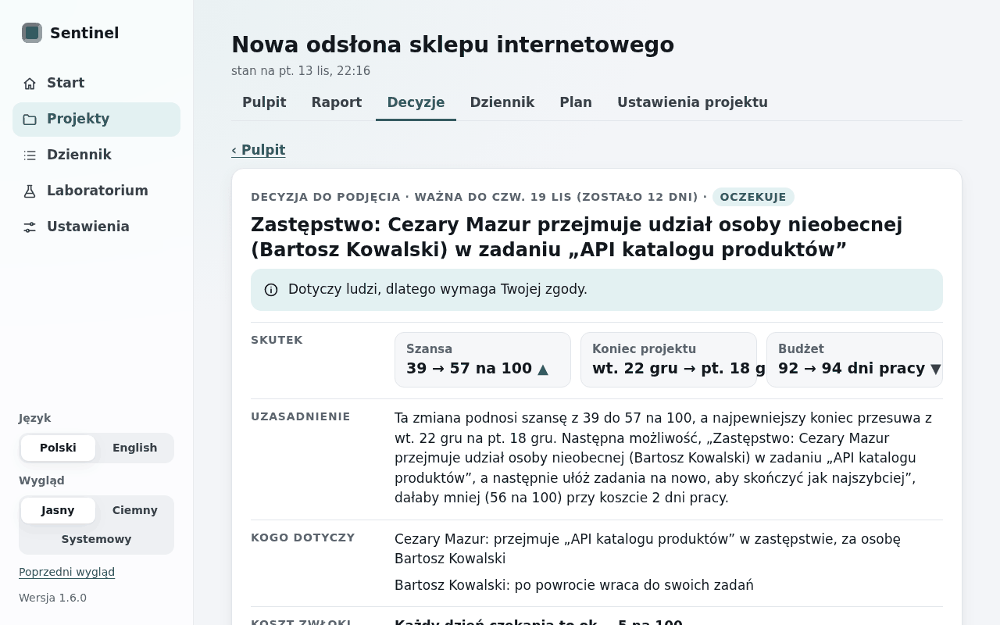
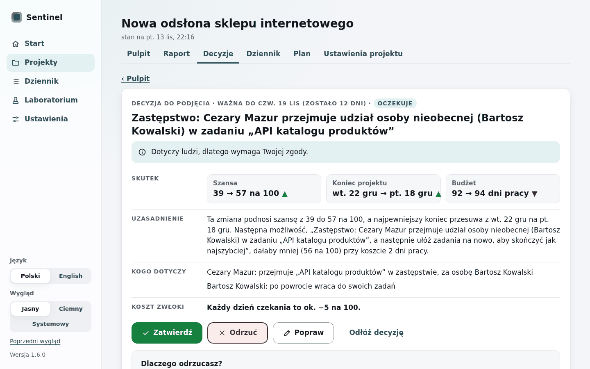
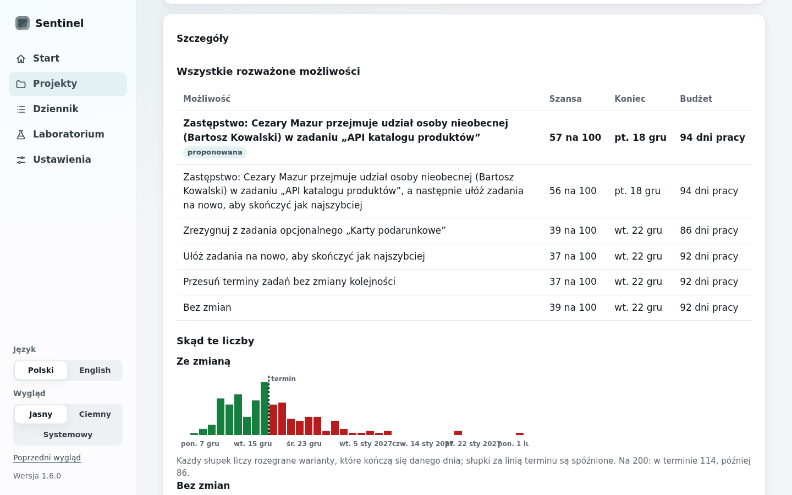
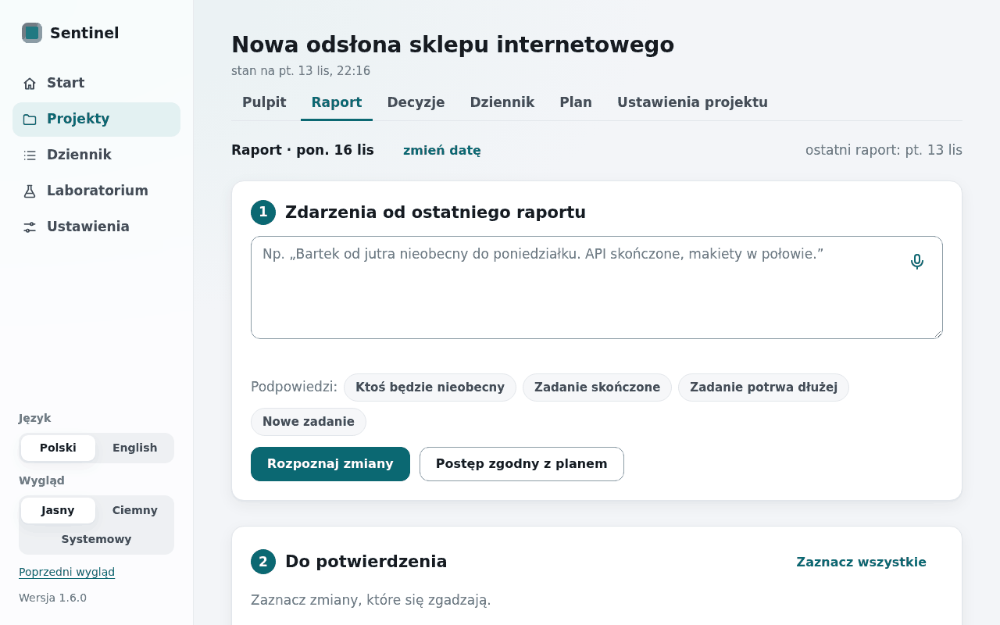
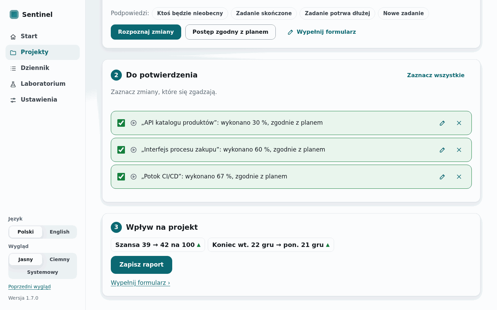

# WP15 report — Interface v2, part 1: Start, Pulpit, Raport with live voice, Decyzja, wizard

- Date: 2026-11-08
- Commit(s): 88ada71 (shell, visual system), a47a8e5 (Pulpit, spec §11.8), f36a6df (Decyzja and
  the decision model), 5494bfd (Raport and voice), 9af60f7 (Start), dfea54a (wizard, ADR-0034),
  c2784a8 (tests, screenshots, 1.6.0), the commit of this report

## Summary

A second interface runs at `/v2` on the same services, beside the first one at `/`, which keeps
working unchanged apart from one link "Nowy wygląd (v2)". Start lists the decisions of every
project by validity date; Pulpit answers "will we make it?" at a glance ("Nie zdążymy bez zmian ·
Spóźnimy się o ok. 2 dni robocze · 39 na 100") with the pending decision in place; Raport is
written or dictated with a live grey preview, read into cards to confirm and shown as a dry-run
"Wpływ na projekt"; Decyzja explains in code-written contrastive sentences and offers approve,
reject with a reason, adjust and postpone. Every v2 deliberation runs with every action approved;
a decision's lifecycle, validity date and cost of delay are events of the log (spec v2.4.0,
§11.8). Version 1.6.0.

## Acceptance criteria

| # | Criterion | Command | Result |
| --- | --- | --- | --- |
| 1 | `/v2` Start, Pulpit, Raport, Decyzja and the wizard in normal and demo mode, PL and EN, light and dark, the spec's rules and labels | `uv run pytest -q tests/test_v2_text.py tests/test_v2_pages.py tests/test_v2_report.py`; `uv run python scripts/ui_v2_screenshots.py` | PASS (every v2 page in PL and EN without internal terms, missing texts, raw codes or ISO dates; the glossary's 50 labels exactly; the showcase's overview reads as the wireframe of §8.2: 92 → 39 na 100, "Bez wydłużenia „API katalogu produktów” szansa byłaby 80 na 100", "Bez nieobecności … 64 na 100"; 104 screenshots in `docs/ui/v2/`, normal mode; demo mode in the e2e test below) |
| 2 | The demo path e2e in demo mode, voice with live preview and the promised numbers after approval | `uv run pytest -q -m e2e tests/test_v2_e2e.py` | PASS (Start → showcase Pulpit → Raport → 🎤 with Chromium's fake microphone: grey preview, Enter, text in the box → "Rozpoznaj zmiany" → two cards unchecked → "Zaznacz wszystkie" → "Szansa 39 → …" → "Zapisz raport" → Pulpit, Sentinel's new decision → Szczegóły → Zatwierdź → Pulpit shows the decision's chance and end; reader and Whisper scripted) |
| 3 | No action changes a live project without approval; lifecycle, validity date and cost of delay stored and shown | `uv run pytest -q -m slow tests/test_v2_decisions.py tests/test_v2_pages.py` | PASS (a v2 deliberation at Λ = 0 even for a project set to 3, no "auto"; the log holds `recommendation`, `validity`, `decision` with reason and brief, `correction`, `expiry`; the showcase decision "ważna do czw. 19 lis", "Każdy dzień czekania to ok. −5 na 100"; postponed, expired after its date, rejected with "Inny powód" and words; a correction keeps its promise) |
| 4a | Quality gate | `uv run ruff check .`, `uv run ruff format --check .`, `uv run mypy src`, `uv run pytest -q` | PASS (clean; mypy 151 files; 680 passed, 87 deselected, 89.3 s) |
| 4b | Data and slow tests | `uv run pytest -q -m "data or slow"` | SLOW_RESULT |
| 4c | Browser tests with the accessibility scan | `uv run pytest -q -m e2e` | E2E_RESULT |
| 4d | Research results unchanged | `uv run sentinel reproduce --check` | REPRO_RESULT |
| 4e | 1.6.0 zip from a clean tree, not tagged | `uv run sentinel release --version 1.6.0` | ZIP_RESULT |
| 4f | Pushed, clean tree | `git push`; `git status --short` | PUSH_RESULT |

## What was built, per screen

**Shell and visual system** (`app/ui/v2/shell.py`, `templates/v2/base.html`, `_sidebar.html`,
`_project_head.html`, `_banner.html`, `_macros.html`, `static/sentinel-v2.css`, `sentinel-v2.js`;
ADR-0033). Light theme by default, dark and system, the choice in the cookie `sentinel_theme`
rendered into `<html data-theme>` (no flash); a glass sidebar (solid under
`prefers-reduced-transparency`) with Start · Projekty · Dziennik · Laboratorium · Ustawienia and
the language, theme and version at the bottom; project tabs Pulpit · Raport · Decyzje · Dziennik
· Plan · Ustawienia projektu, the WP16 ones a calm "Wkrótce" with a link to the first interface's
page; the live banner polling every 20 s for a new decision, a change of state or a move of ≥ 10
in 100; the state badge (colour + icon + word), the 10 × 10 dot grid, the effect chips with ▲/▼,
buttons ≥ 44 px, body 17 px, hero numbers 46 px with tabular figures.

**Pulpit** (`app/ui/v2/overview.py`, `status.py`, `numbers.py`). At 1280 × 800 above the fold:
the verdict, the three numbers (chance with dot grid and "Skąd ta liczba?", project end, budget
in work-days) and the pending decision with Zatwierdź / Odrzuć in place (rejection asks one of the
four reasons) or "Nic nie czeka na Twoją decyzję. Następny raport: …". Below: "Zapas czasu",
"Najbliższe 7 dni", "Przyczyny zmiany", "Główne ryzyka" (polled while their job runs).




**Decyzja** (`app/ui/v2/decision.py`, `templates/v2/decision.html`, `decisions.html`,
`_decide.html`, `_distribution.html`, `_explain.html`). "Decyzja do podjęcia · ważna do czw. 19
lis (zostało 12 dni)", the people/money/scope/plan notice, Skutek (39 → 57 na 100 ▲, wt. 22 gru →
pt. 18 gru ▲, 92 → 94 dni pracy ▼), Uzasadnienie written by code from the comparison ("Ta zmiana
podnosi szansę z 39 do 57 na 100 … Następna możliwość, „…”, dałaby mniej (56 na 100) przy koszcie
2 dni pracy."), Kogo dotyczy, Koszt zwłoki, the four buttons, and Szczegóły: every option with
"Bez zmian", the finish-day distribution with and without the action, the AI explanation on
request. The tab "Decyzje": the pending ones, then the archive with time, actor, fate, reason and
the brief as it was.





**Raport** (`app/ui/v2/report.py`, `voice.py`, `templates/v2/report.html`, `_cards.html`,
`_impact.html`, `_voice.html`). "Raport · {date} (zmień datę)", "ostatni raport: …"; the text box
with the voice component, hint chips that insert a sentence start, "Rozpoznaj zmiany" (the WP14
reader), "Postęp zgodny z planem" (the plan's progress by the report date); cards unchecked by
default with ✎ (editing the report a card carries) and ✕; amber questions that block saving;
"Nierozpoznane fragmenty" with "Dodaj ręcznie"; "Wpływ na projekt" as a debounced dry-run
forecast with "Liczę…" and the warning "N zadań w toku bez wieści — czy od … nic się nie
zmieniło?"; "Zapisz raport" enabled by a ticked card or "Postęp zgodny z planem". The voice
component: red dot, time, level meter, ✓/Enter and ✕/Esc, a grey preview at the cursor about
every 3 s, the whole recording written out again on ✓, the dictated span removed on ✕, 5 minutes
with a warning at 4:30, previews outside the demo's AI cap, plain errors.




**Start** (`app/ui/v2/start.py`, `templates/v2/start.html`, `_tiles.html`): "Projekty · {today}",
"Decyzje do podjęcia (n)" sorted by validity date (unknown dates last), the tiles, "Ostatnie
zdarzenia" from the log with "Ty"/"Sentinel", and on a first visit "Zacznij od pierwszego
projektu" with "Zaimportuj arkusz", "Opisz projekt głosem", "Otwórz projekt przykładowy" (a copy
of the showcase in the visitor's language).

**Nowy projekt** (`app/ui/v2/wizard.py`, `templates/v2/wizard.html`, `_wizard_tasks.html`):
Podstawy (name, start, deadline with examples and hints; "Więcej" → company days off),
Zespół (paste or dictate "Anna, programistka; Bartek, programista"; the absence note), Zadania
(three cards: a CSV with "Pobierz przykładowy arkusz", words or voice read by the AI as cards to
confirm, a table), Gotowe ("Plan gotowy: zdążymy w N na 100", "Budżet z planu: B dni pracy ·
Zmień").

## Changes

- `src/sentinel/app/ui/v2/` (new): `__init__.py`, `shell.py`, `numbers.py`, `status.py`,
  `overview.py`, `decision.py`, `report.py`, `voice.py`, `start.py`, `wizard.py`, `text.py`;
  `templates/v2/` (19 templates); `static/sentinel-v2.css`, `static/sentinel-v2.js`.
- `src/sentinel/app/decisions.py` (new): validity date and cost of delay, corrections, the brief.
- `src/sentinel/app/events.py`: `Decided.reason`, `.note`, `.brief`; `Brief`, `Corrected`,
  `Validity`, `Expired`; status "expired"; `RecommendationEntry.corrected`, `.validity`.
- `src/sentinel/app/services.py`: `autonomy` on `checkin`, `recommend`, `decide` (reason, note,
  brief); `validity_job`, `correction_options`, `correct`, `expire`, `distribution`, `dry_run`,
  `forecast_of`, `chance_of`; `transcribe` with `preview` and without a project.
- `src/sentinel/app/planning.py`: `sentinel_params` and `recommend` take `autonomy`.
- `src/sentinel/app/llm.py`: `transcribe(preview=…)` outside the cap; `messages.py`:
  `status_expired`; `ui/core.py`: mounts v2; `ui/icons.py`: home, list, flask, pencil, person,
  calendar, upload; `ui/templates/start.html`, `ui/text.py`: the link "Nowy wygląd (v2)".
- Tests (new): `tests/test_v2_text.py`, `test_v2_numbers.py`, `test_v2_pages.py`,
  `test_v2_decisions.py`, `test_v2_report.py`, `test_v2_e2e.py`; `tests/test_app_api.py` (1.6.0).
- `scripts/ui_v2_screenshots.py` (new); `docs/ui/v2/` (104 PNG, 4.2 MB).
- Docs: `docs/spec/model.md` v2.4.0 (§4 note, §11.8); `docs/spec/architecture.md`;
  `docs/adr/0033-v2-interface-beside-v1.md`, `docs/adr/0034-team-absence-default-from-zus.md`,
  ADR-0031 update; `docs/notes/WP15.md`; `docs/roadmap.md`; `README.md`, `CHANGELOG.md`,
  `docs/deploy.md`, `pyproject.toml`, `uv.lock`, `docker-compose.yml` (1.6.0).

## Decisions

- v2 lives beside v1 on the same services; its texts have their own catalogue, falling back to
  v1's for shared formats (ADR-0033).
- The gate: every deliberation v2 asks for (after a report, a discarded approval, a correction)
  runs at `Λ = 0`; the project's autonomy setting applies only to deliberations v1 asks for, so
  the first interface and its tests are unchanged (spec §11.8, §4 note).
- The lifecycle is derived from the log: `recommendation` (Sentinel), `validity` (Sentinel),
  `decision` with reason, words and brief (Ty), `correction` (Ty), `expiry` (Sentinel); a
  correction keeps the status "open" with a flag, so v1 shows it as a pending recommendation.
  Validity and expiry do not count as project changes (forecast caches stay).
- Validity date and cost of delay with the §6 rollouts that approve `δ` days later on the
  forecast's worlds; for the showcase `p(0)` = 0.57 equals the card's figure. The cost of delay
  is the mean daily drop over the days evaluated (the first failing day included).
- An action that never gains `ε_D` (chosen by a later component) has no validity date and never
  expires.
- "Wygasa jutro" when the validity date is the next working day; "zostały N dni" in calendar
  days; postponed shows "odłożona" until the next calendar day, then "oczekuje" again.
- "N na 100": half up, 0 and 100 only when exact (as the per cent of §11.5 item 5); the verdict's
  days clamped at 0 in the good and amber states ("bez zapasu czasu").
- "Zapas czasu" zones split by `y = 2x/3` and `y = 1/3 + 2x/3` (a third each at half the work);
  one dot per report, as the spec says (no dot for the plan).
- "Najbliższe 7 dni" from the later of today and the status day; "Następny raport" on the first
  Thursday after the latest report (the default reminder day of §8.9).
- Report date: today, or the first working day after the latest report if that is later.
- Rejection "Inny powód": the manager's words are kept (at most 300 characters) in the decision
  event, with a hint not to give anyone's absence reasons; the four reasons are a closed list.
- Corrections offered per action type (what the model can evaluate; spec §11.8):

  | Action | "Popraw" changes | Notes |
  | --- | --- | --- |
  | SUBST (single or SUBST-ALL) | the substitute: another idle, present person of the replaced member's role | with several replaced members, the first substitute; only accepted options listed (the engine's `rehearse`) |
  | OVERTIME (OT + RESEQ-M) | the role, the number `u ≤ max(1, ⌊0.2 R_k⌋)` and the window `H ∈ {5, 10, 15, 20}` working days (and the proposed `H`) | the model supports days, so they are offered; the plan part is planned again on approval |
  | DESCOPE | another unstarted optional task whose only successor is the end | |
  | SHIFT, RESEQ alone | nothing: "Tej zmiany nie da się poprawić: ona tylko porządkuje plan." | |

  The showcase's substitution has no other eligible developer, so its "Popraw" says "Nie ma tu
  innej możliwości do wyboru."; a project with two idle developers is tested.
- Absence default: `λ_A = 0.014` per person and working day (4.0 % of days, `E[L] = 3`), from
  ZUS, *Absencja chorobowa w 2025 roku* (14.76 days per insured person), stored as the project's
  advanced rate by the wizard (ADR-0034).
- ADRs created: ADR-0033, ADR-0034; ADR-0031 updated.

## Deviations

- "Wypełnij formularz" opens the first interface's per-task form, not restyled (WP16).
- The report's example says "Bartek od jutra nieobecny do poniedziałku" instead of the
  wireframe's "chory": an example must not invite a reason for an absence (invariant 7).
- A report dated in the future is not confirmed as in v1; the date is shown at the top with
  "zmień datę".
- The wizard's table has one role per task and one predecessor (the first interface's table
  remains for richer crews); Polish feminine and masculine role names ("programistka",
  "programista") are different roles, as in v1.
- No live AI or Groq call was made in this WP (0 USD): the demo path ran with the scripted reader
  and Whisper; the live preview against Groq is for the owner's check below.
- Screenshots show the date of capture (Start "sob. 7 lis"); the showcase's own dates are fixed.

## Spec questions

- SPEC-Q: §11.8 fixes `Λ = 0` for v2's deliberations only; whether v1 should also stop applying
  actions automatically is the owner's choice when the interfaces are merged.
- SPEC-Q: the validity evaluation applies the action in each world `δ` days later (§6 rollouts);
  at `δ = 0` it agreed with the card's figure in every case seen, but the two evaluators (§11.5
  item 3 applies the action on the observation, §6 in each world) are not identical in general.

## Numbers

| What | Value |
| --- | --- |
| Default `pytest -q` | 680 passed, 87 deselected, 89.3 s (without the v2 tests 84 s; 9 v2 tests marked `slow`) |
| v2 tests | 48 (text 5, numbers 19, pages 13, decisions 5, report 3, e2e 3) |
| Pulpit of the showcase, first render | 1.6 s (forecasts of the two report states, then cached) |
| Validity of the showcase decision | 0.9 s (5 evaluations of 200 worlds) |
| Dry-run "Wpływ na projekt" | 0.26 s |
| Showcase validity | p(δ) = 0.57, 0.515, 0.46, 0.44, 0.38 for δ = 0…4, NOOP 0.39 → valid to day 12 (Thu 19 Nov), −5 in 100 a day |
| Screenshots | 104 PNG (PL/EN × light/dark × 1440/1280 × 13 screens), 4.2 MB |
| AI and Groq cost of the WP | 0 USD (scripted) |

## Commands for the owner

```bash
# Restart the public demo on 1.6.0 (it runs the old Python but reads this tree's templates:
# until the restart the v1 start page shows a missing text for the new v2 link and /v2 is 404)
scripts/run_demo.sh stop && scripts/run_demo.sh start && scripts/run_demo.sh check
# One live check of the voice preview with Groq (about 0.01 USD): open https://<demo>/v2,
# open the showcase, Raport, 🎤, speak ~20 s, watch the grey preview, press Enter.
```

## Open issues / next steps

- WP16: Dziennik, Plan, Laboratorium, Kalendarz, Ustawienia; "Wypełnij formularz" restyled;
  the global Dziennik ("Cały dziennik" links to the placeholder).
- The banner reports events of other tabs and background jobs; a decision saved in the same page
  is not repeated, but two open tabs both show it.
- Live preview cost under Groq's free tier (ADR-0031 update): long dictations may reach the
  hourly audio limit; only the preview stops then.
