# WP16 report — Interface v2, part 2: Dziennik, Plan, Laboratorium, Kalendarz, Ustawienia; polish

- Date: 2026-11-08
- Commit(s): ec97c56 (Wypełnij formularz), 040ed18 (Dziennik), cfc7c32 (Plan), 89eef85
  (Laboratorium), d65ff4b (Ustawienia), 35cdf0a (Kalendarz, ADR-0035), d3c81ca (e2e, accessibility,
  "Co jeśli?" start day), b885a12 (polish, architecture, guides), 75100c0 (1.7.0,
  screenshots), the commit of this report

## Summary

The v2 interface at `/v2` now has all ten screens of `docs/design/v2-spec.md`. Dziennik shows
who did what, day by day, with each decision's brief and fate, the chance over time and a CSV;
Plan shows the current plan as a Gantt chart with the forecast's band and the main risks, the
tasks (a task not started can be corrected) and the team's absences and workload, never
performance; Laboratorium tries a scenario on a project without saving it and passes it to a
report, and runs the simulator against "Bez reakcji" with one sentence for the board;
Ustawienia sets the look, the language and the AI model in plain words, and the project
settings hold the basics, the team, days off, the report reminder, exports, "Jak Sentinel
podejmuje decyzje", "Usuń projekt" and a revocable secret link to a calendar feed (ADR-0035).
Research semantics are unchanged; version 1.7.0.

## Acceptance criteria

| # | Criterion | Command | Result |
| --- | --- | --- | --- |
| 1 | All ten v2 screens in normal and demo mode, PL and EN, light and dark | `uv run pytest -q tests/test_v2_pages.py tests/test_v2_lab.py tests/test_v2_text.py`; `uv run pytest -q -m e2e tests/test_v2_e2e.py`; `uv run python scripts/ui_v2_screenshots.py` | PASS (normal mode: every v2 page and the new tabs in PL and EN without internal terms, missing texts, raw codes or ISO dates, the glossary's labels exactly, empty states, the demo's settings without keys; demo mode: the e2e tests and the accessibility scan of every screen in the light and the dark theme; 208 screenshots, 26 screens and states × PL/EN × light/dark × 1440/1280, in `docs/ui/v2/`) |
| 2 | The WP15 demo path still passes; new e2e tests: Dziennik (a decision's fate), Laboratorium ("Co jeśli?" → "Dodaj do raportu"), the calendar feed | `uv run pytest -q -m e2e tests/test_v2_e2e.py` | PASS (the WP15 demo path unchanged in demo mode; a rejection with "Za drogo" shows in the Dziennik with its fate "odrzucona" and "Powód: Za drogo", a dot of "Szansa w czasie" opens its entry, the CSV has the rejection; "Co jeśli?" with Anna absent from the pre-filled first day lowers the chance, saves nothing, and "Dodaj do raportu" opens the Raport with the card ticked and its effect; the calendar link is created, copied to the clipboard, read by a request without the visitor's session and parsed by `icalendar`, then revoked and answers 404) |
| 3a | Quality gate | `uv run ruff check .`, `uv run ruff format --check .`, `uv run mypy src`, `uv run pytest -q` | PASS (clean; mypy 157 files; 688 passed, 97 deselected, 82.9 s) |
| 3b | Data and slow tests | `uv run pytest -q -m "data or slow"` | PASS (66 passed, 719 deselected, 12 min 12 s, on 75100c0) |
| 3c | Browser tests with the accessibility scan | `uv run pytest -q -m e2e` | PASS (45 passed in 9 min 15 s: the v1 suites, the usability tasks, the replays and the v1 accessibility scan unchanged, the v2 demo path, the three new v2 tests, and the v2 axe scan of 16 screens and states plus a simulation in the light and the dark theme with no serious violation) |
| 3d | Research results unchanged | `uv run sentinel reproduce --check` | PASS (117 of 117 files identical, 54 s) |
| 3e | 1.7.0 zip from a clean tree, not tagged | `uv run sentinel release --version 1.7.0` | PASS (`dist/sentinel-1.7.0.zip`, 39.9 MB, 1,425 files, from the clean tree of 75100c0; not tagged) |
| 3f | Pushed, clean tree | `git push`; `git status --short` | PASS (the report commit pushed to `origin/main`; `git status --short` empty) |

## What was built, per screen

**Wypełnij formularz** (WP15 leftover; `ui/v2/report.py`, `templates/v2/_form_body.html`,
`_scenario.html`, `_form_result.html`). The Raport's "Wypełnij formularz" opens the per-task form
in place: the tasks in progress and the next ones ("Nierozpoczęte" · "W toku" with the share done
· "Gotowe" with the date), and rows for a person absent, a task taking longer and a new task.
"Dodaj do raportu" reads the fields with the first form's reader (same validation and messages)
and adds them as ticked cards to step 2, where "Wpływ na projekt" and "Zapisz raport" work as
for any card; "Dodaj ręcznie" of the unrecognised parts opens it too.

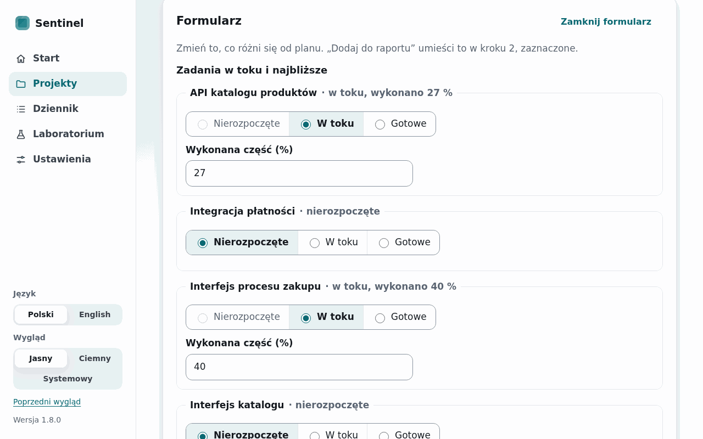

**Dziennik** (`ui/v2/log.py`, `templates/v2/log.html`). Global (sidebar, with a project filter
when there are several) and per project (tab): "Wszystko" · "Decyzje" · "Raporty" · "Zmiany
planu", grouped by day, newest first; time · "Ty"/"Sentinel" · one sentence · the effect chip
("Szansa 92 → 39 na 100 ▼"); ▸ expands a report to its items and a decision to "Decyzja w tamtej
chwili" (chance, end and budget before → after, "ważna do …", the cost of delay) and its "Stan
decyzji" with the reason and the manager's words. "Szansa w czasie": the plan's chance, then a
dot per report and approved decision (zones green/amber/red, the number on each dot); a dot
scrolls to its entry and opens it. "Pobierz dziennik (CSV)" (ISO dates, chances in 100, no cell
a spreadsheet would read as a formula). Start's "Ostatnie zdarzenia" now come from the same log.

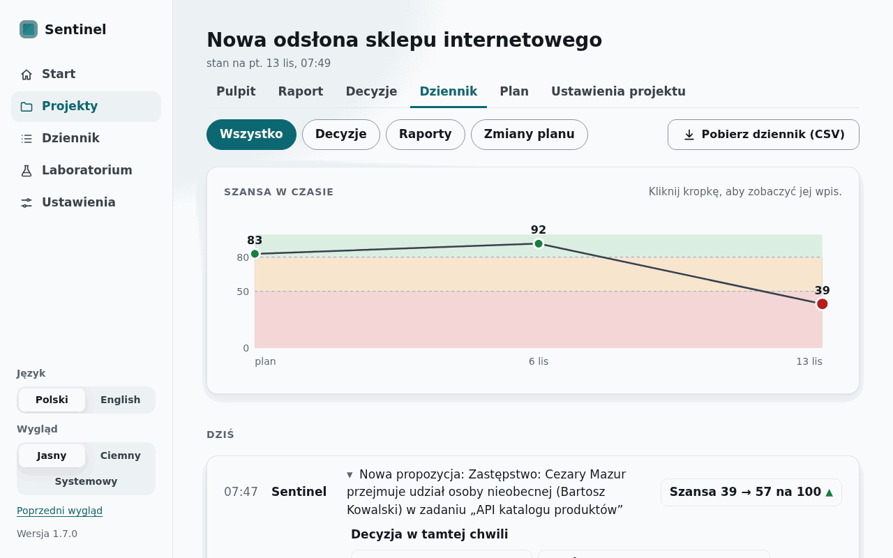
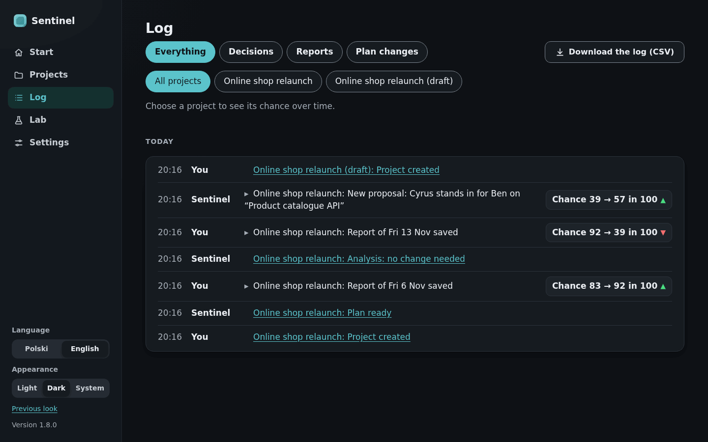

**Plan** (`ui/v2/plan.py`, `templates/v2/plan.html`, `_gantt.html`, `_plan_chart.html`).
"Harmonogram": the current plan as a Gantt chart drawn from the first interface's layout with
v2 styles — "Stan na 13 lis" and "Dziś" lines, the deadline in red, the forecast's band from
"najpewniej" to "w złym razie", done tasks grey, running blue, planned light blue, the main risks
amber with ⚠ and "ryzyko", absences hatched with "Nieobecność", flags at 14 px. "Zadania": task,
state with the share done, end, people, dependencies; a task not started is corrected in place
("Popraw": days, people per role, dependencies, optional), saved as a definition change the log
names ("Poprawiono „Integracja płatności”: szacunek 5 → 7 dni"). "Zespół": absences by dates,
current tasks, the next tasks of the role and next week's workload ("ok. 5 z 5 dni", or
"nieobecność cały tydzień"), with the note that Sentinel measures nobody's performance.
"Pobierz plan (CSV)".

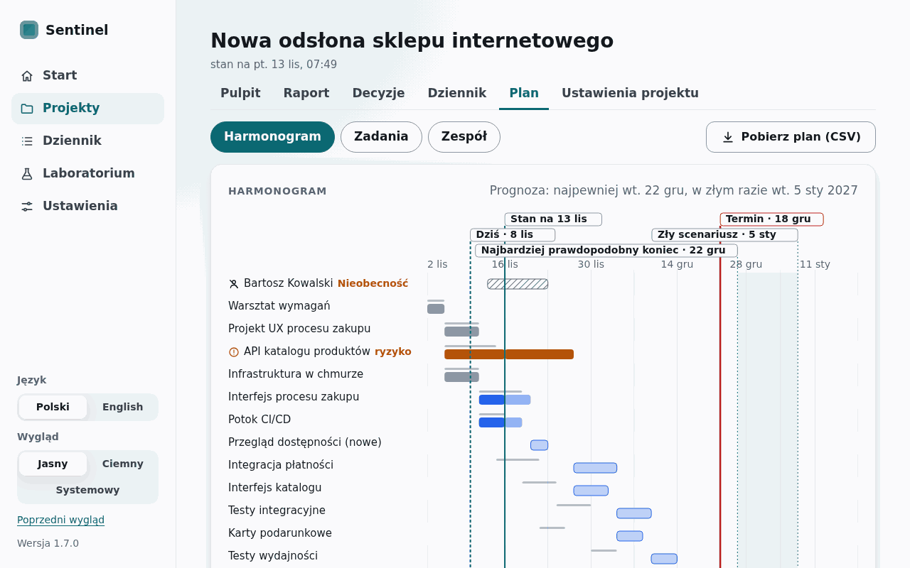
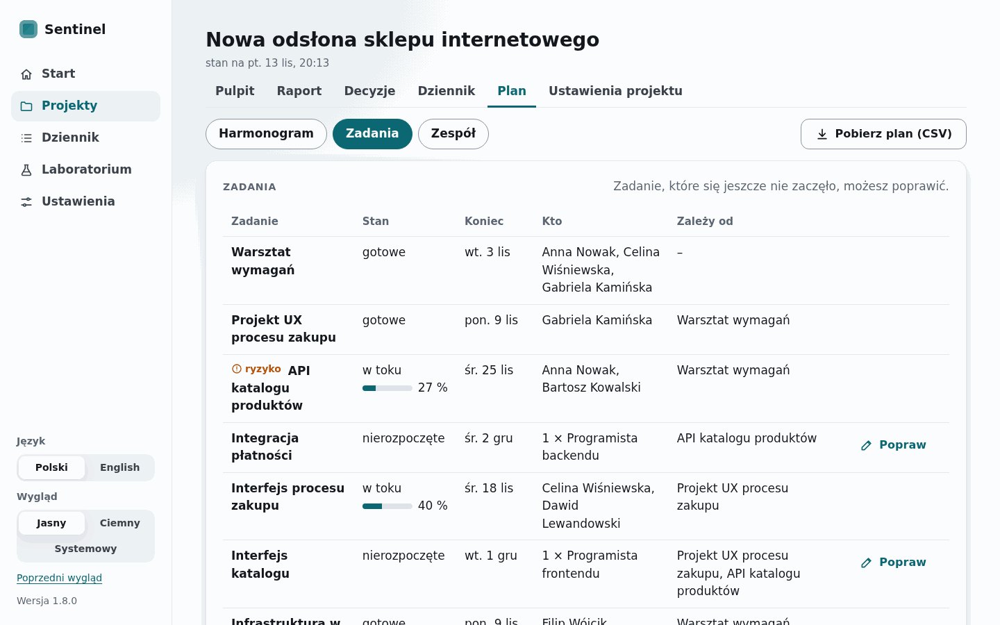
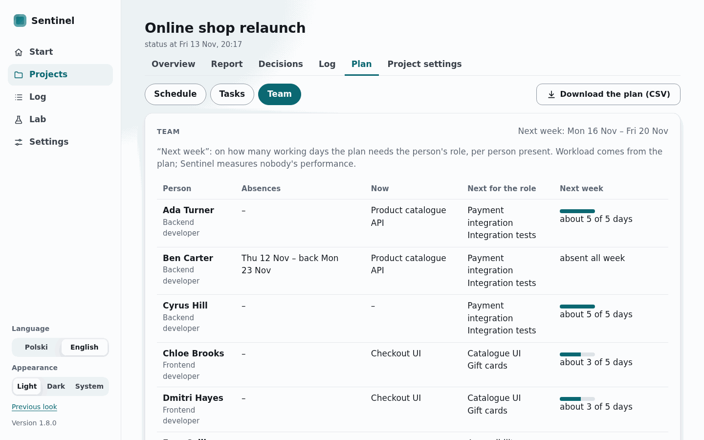

**Laboratorium** (`ui/v2/lab.py`, `templates/v2/lab.html`, `lab_sim.html`, `_lab_impact.html`,
`_lab_wait.html`). "Co jeśli?" on a chosen project: "Osoba nieobecna" (kto, od, wraca), "Zadanie
potrwa dłużej" (które, o ile dni), "Nowe zadanie" (nazwa, dni, po czym, kto); "Sprawdź wpływ"
shows "Wpływ na projekt" (chance, end, budget) from the Raport's dry run dated at the latest
report, "Nic nie zostało zapisane."; "Dodaj do raportu" opens the Raport with these items ticked
and their effect computed at once. "Symulator": "Mało zakłóceń" / "Dużo zakłóceń", Sentinel
against "Bez reakcji" on the same events, "+1 dzień" · "+5 dni" · "Do końca" with "Dzień 5 z ok.
56" and a progress bar, both sides' tasks, cost and plan changes, "Co się wydarzyło", and at the
end "Wynik": one sentence and the comparison table.

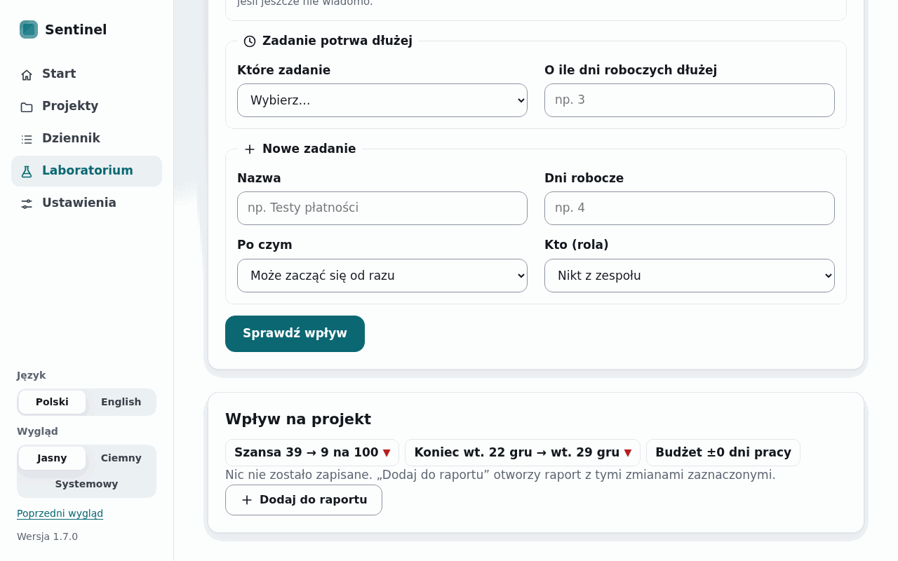
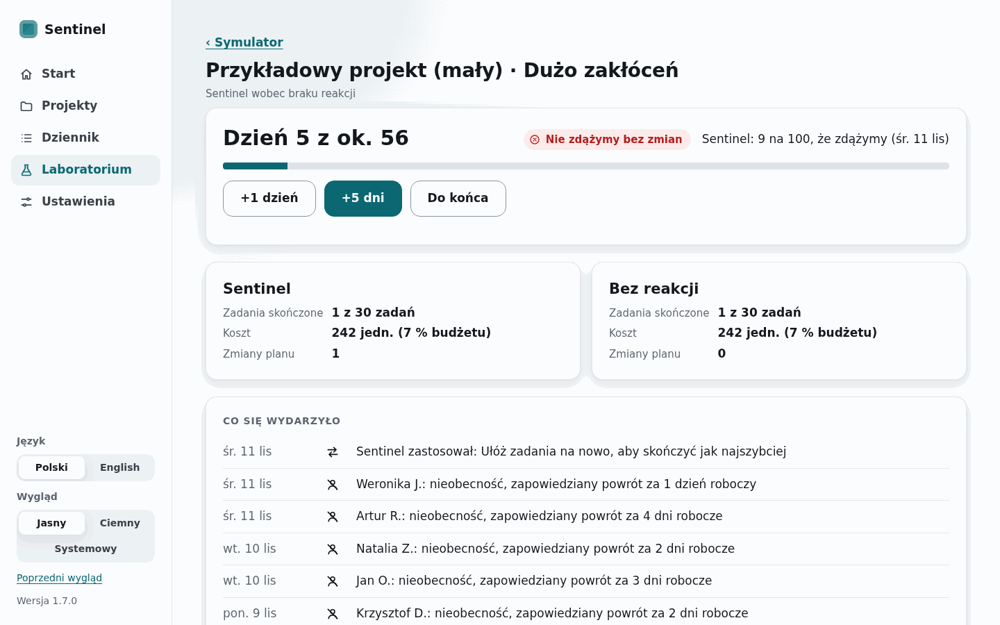
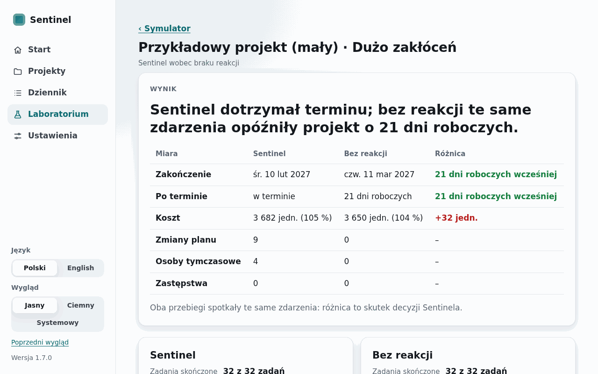

**Ustawienia** (`ui/v2/settings.py`, `templates/v2/settings.html`, `project_settings.html`).
Application: "Wygląd" (Jasny, domyślny · Ciemny · Systemowy), "Język", "Model AI": "Chmura
(zalecany) — Dokładniejszy" · "Lokalny — Dane nie wychodzą z firmy; wolniejszy" · "Bez AI", the
cloud key, the local address and the dictation key (never shown again; in the demo only the note
that its owner sets the model). Project: "Podstawy" (name, deadline, budget), "Zespół", "Dni
wolne w firmie" (added or removed by date until the first report, then fixed), "Kalendarz" with
"Przypomnienie o raporcie" (day and hour; "Następny raport" on the Pulpit follows it), "Eksport"
(plan CSV, log CSV, project JSON, the printable report), "Jak Sentinel podejmuje decyzje" and
"Usuń projekt" in a red zone with "Usunąć „…”? Tego nie da się cofnąć." · "Usuń na zawsze".

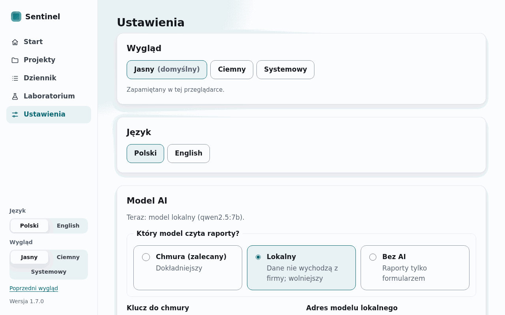
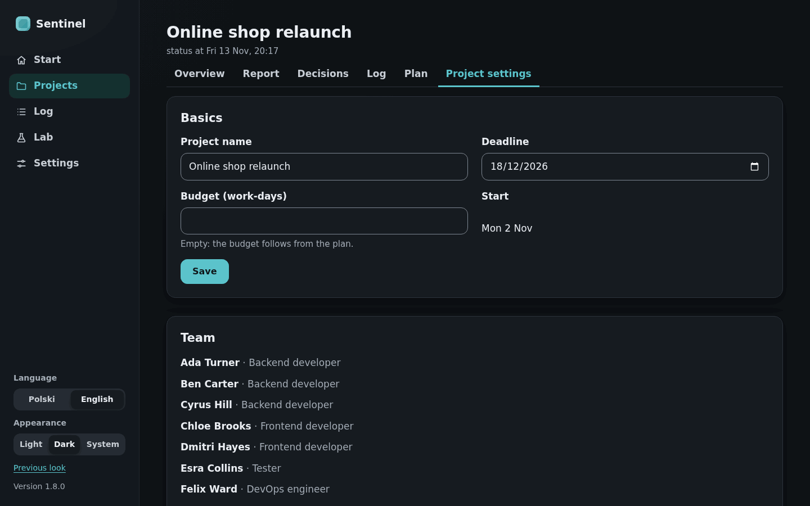

**Kalendarz** (`app/feed.py`, `ui/v2/calendar.py`, `templates/v2/_calendar.html`; ADR-0035).
"Utwórz link do kalendarza" → the link, "Kopiuj link do kalendarza", "Unieważnij link", three
steps each for Google Calendar and iCloud, and the warning "Kto ma ten link, widzi imiona osób i
daty nieobecności.". The feed (`/calendar/{project}/{token}.ics`): the deadline, starts and ends
of the plan's tasks, "Nieobecność: {imię}" over its dates, "Decyzja ważna do dziś: …" and
"Raport tygodniowy" every Thursday 17:00 (or as set).

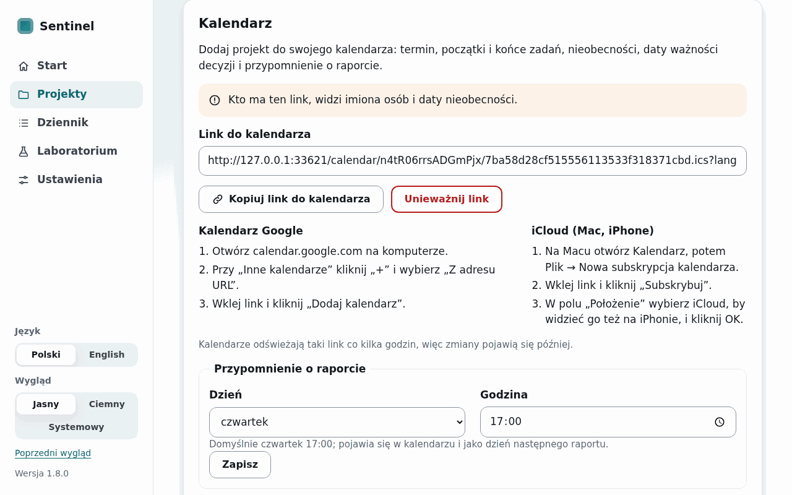

**The screens of WP15, as at 1.7.0** (unchanged but for the shared log and the reminder day):
Start, Pulpit, Raport, Decyzja, the project's Decyzje and Nowy projekt.

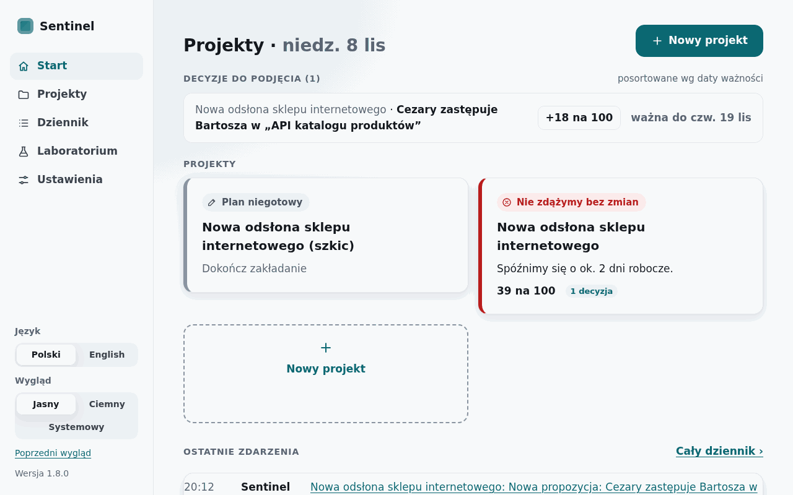
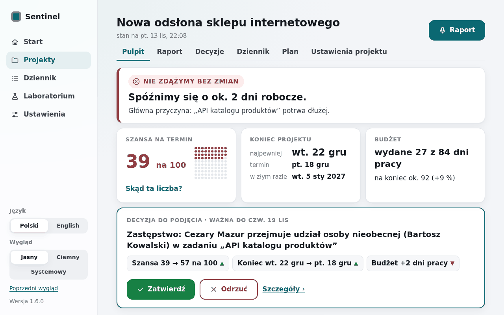
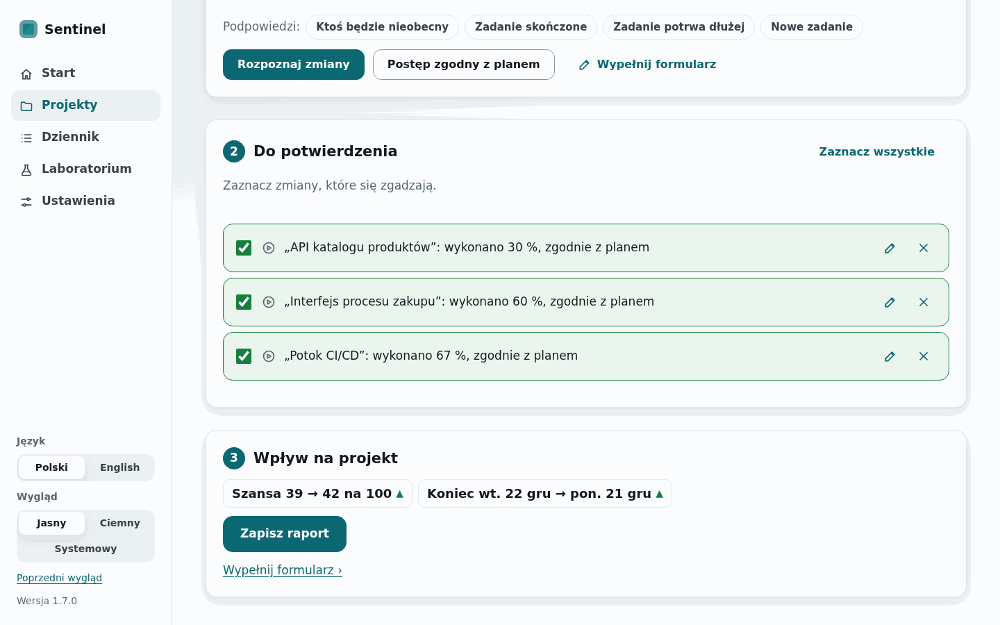
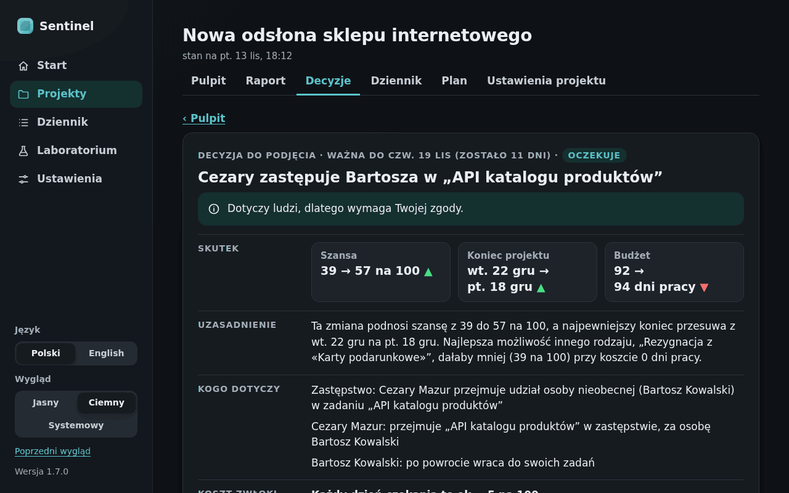
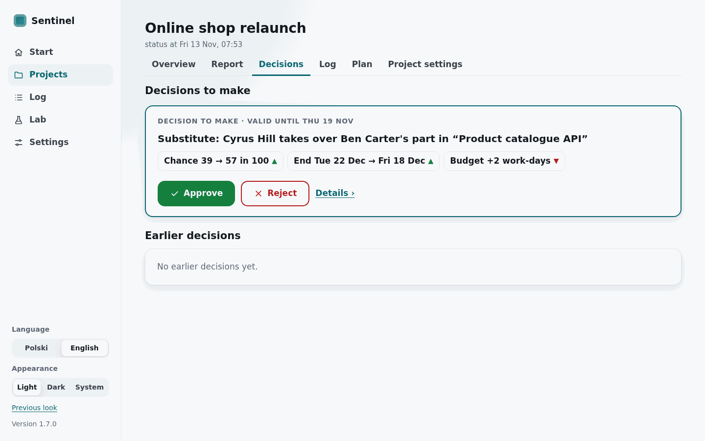
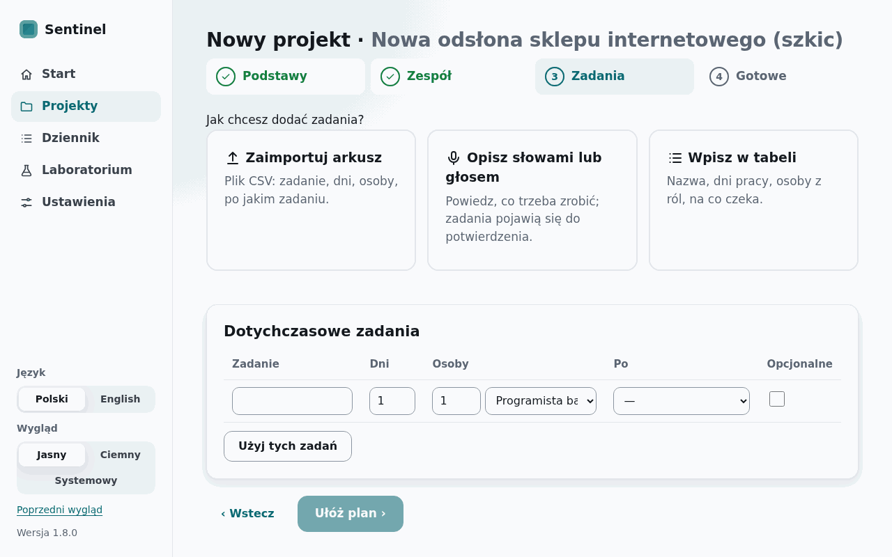

**Polish.** "Wkrótce" and its code are gone; the live banner is on every v2 page; the sidebar
shows 1.7.0; screenshots use an octree palette that keeps the small status colours; the
architecture lists the v2 and WP14 modules; the user guides have a chapter "Nowy wygląd (v2)" /
"The new look (v2)".

## Changes

- `src/sentinel/app/ui/v2/` (new): `log.py`, `plan.py`, `lab.py`, `settings.py`, `calendar.py`;
  changed: `report.py` (the per-task form, items from the Laboratorium), `start.py` (the log's
  entries), `overview.py` (the next report follows the reminder day), `shell.py` (no
  placeholders), `text.py` (about 300 new texts), `__init__.py`.
- `src/sentinel/app/ui/templates/v2/` (new): `log.html`, `plan.html`, `_gantt.html`,
  `_plan_chart.html`, `lab.html`, `lab_sim.html`, `_lab_impact.html`, `_lab_wait.html`,
  `settings.html`, `project_settings.html`, `_calendar.html`, `_scenario.html`, `_form_body.html`,
  `_form_result.html`; changed `report.html`, `_cards.html`, `_macros.html`; removed `soon.html`.
- `src/sentinel/app/ui/static/sentinel-v2.css`, `sentinel-v2.js` (form panel, copy link, dots).
- `src/sentinel/app/feed.py` (new): the iCalendar text. `security.py`: `calendar_token`,
  `calendar_valid`. `store.py`: migration 4, table `calendars`, `CalendarRow`, `calendar`,
  `calendar_feed`, `save_calendar`. `api.py`: the feed makes no sandbox.
- `src/sentinel/app/ui/charts.py`: a flag width parameter (v2 flags at 14 px; v1 unchanged).
  `ui/icons.py`: download, link, trash.
- Tests (new): `tests/test_v2_lab.py`, `tests/test_v2_calendar.py`; changed:
  `test_v2_pages.py` (Dziennik, Plan, settings, calendar feed with `icalendar`, empty states,
  demo), `test_v2_report.py` (the form), `test_v2_text.py` (glossary and key families),
  `test_v2_e2e.py` (three new browser tests, the scan of every screen and a simulation),
  `test_app_api.py` (1.7.0); three research tests marked `slow` (`test_forecast_study.py`,
  `test_baseline_policies.py`).
- `scripts/ui_v2_screenshots.py` (new screens, two seeded simulations, fills, octree palette);
  `docs/ui/v2/` (208 PNG).
- Docs: ADR-0035 in `docs/adr/` (the calendar feed); `docs/spec/architecture.md`;
  `docs/user-guide-pl.md`, `docs/user-guide-en.md`; `docs/notes/WP16.md`; `docs/roadmap.md`;
  `README.md`, `CHANGELOG.md`, `docs/deploy.md`, `pyproject.toml` (1.7.0, dev `icalendar`),
  `uv.lock`, `docker-compose.yml`.

## Decisions

- "Wypełnij formularz" adds ticked cards instead of saving on its own: one save path, with
  "Wpływ na projekt" and the v2 gate, for words, voice, the plan's progress, the form and the lab;
  its fields keep the first form's names, so its reader validates them alike.
- A share shown in whole per cent is compared as shown, so an untouched form reports nothing.
- Dziennik groups entries by the day they were recorded (the showcase's log was recorded at once,
  so its entries fall on one day) and labels the chart's dots with the report dates; consecutive
  saves of the project's details are one entry.
- Workload is the plan's demand on a person's role next week, per person present ("ok. 5 z 5
  dni"): the plan is resource-feasible, so nobody ever has two tasks at once, and a count of
  tasks "naraz" would always be one. It is the same for everyone in a role and measures no one.
- "Następne dla roli": the unstarted tasks of the person's role by planned start (people are
  assigned to a task only when it starts).
- "Co jeśli?" is dated at the latest report, so no working day passes in the dry run; "Od" is
  pre-filled with the first day an absence counts (spec §11.3) and a later start is explained.
- The simulator always runs Sentinel against "Bez reakcji"; "Mało zakłóceń" and "Dużo zakłóceń"
  are the first interface's calm and turbulent presets.
- Team and company days off are read only after the first report (the model fixes the team and
  the calendar once tracking starts); before it, the days off change by date and the team in the
  wizard.
- "Model AI": "Chmura" keeps Groq if it was chosen, else OpenRouter (the recommended
  gpt-oss-120b); "Bez AI" is offered as a third choice so that a manager can switch it off.
- One primary button per screen state: the form's and the lab's "Dodaj do raportu" and the
  calendar's buttons are secondary; the Raport keeps WP15's two, one per stage ("Rozpoznaj
  zmiany", and "Zapisz raport", disabled until a card is ticked).
- Calendar link: HMAC token over a stored nonce, made on request, revoked by clearing the nonce;
  the feed's dates come from the plan and the log, its reminder at a floating 17:00 (ADR-0035).
- The feed starts the validity job of a pending decision if it has not run, so a later fetch
  carries "Decyzja ważna do dziś".
- Screenshots are reduced with an octree palette, which keeps the small blue, amber and red marks
  that median cut merged into grey.
- Default test budget: three 2–4 s research tests moved to `slow` (as in WP12), the new page
  tests share the module's showcase.
- ADRs created: ADR-0035.

## Deviations

- The spec's example of workload, "3 zadania naraz w przyszłym tygodniu", is shown as days of
  the role's demand ("ok. 5 z 5 dni"), see Decisions: a feasible plan never puts one person on
  two tasks at once.
- The team cannot be edited after the first report (the model fixes it); v1 behaves the same.
- No live AI or Groq call was made (0 USD); the e2e tests use the scripted reader and Whisper.

## Spec questions

- SPEC-Q: §11.3 "An absence that starts after `t` waits for a later check-in" makes an announced
  absence next week invisible to the forecast, in a report and in "Co jeśli?" alike (the showcase:
  Anna absent from 17 Nov leaves 39 in 100 unchanged; from 16 Nov it gives 14). Interpretation
  kept as specified; the lab pre-fills the first counted day and says so. Whether an announced
  future absence should enter the forecast (as `L_low` from its first day) is the owner's choice.
- SPEC-Q (open from WP15): v1's automatic actions when the interfaces are merged.

## Numbers

| What | Value |
| --- | --- |
| Default `pytest -q` | 688 passed, 97 deselected, 82.9 s (WP15: 680 in 89.3 s; three 2–4 s research tests moved to `slow`, the v2 tests take 8.5 s of it) |
| v2 tests | 66 collected (WP15: 48): pages 22, report 4, lab 2, calendar 2, numbers 7, decisions 5, text 5, e2e 5 (+ parametrised themes and languages) |
| `-m "data or slow"` / `-m e2e` | 66 passed in 12 min 12 s / 45 passed in 9 min 15 s |
| Screenshots | 208 PNG (26 screens and states × PL/EN × light/dark × 1440/1280), 7.7 MB, octree palette; 7 min 36 s to take, with two seeded simulations per language |
| Dziennik of the showcase, first render | 0.75 s (the forecasts of the log's three states, then cached; later 0.03 s) |
| Plan, "Harmonogram" | 1.6 s the first time (the main risks' job, 50 futures in the test; in the app a background job the page polls), then 0.01 s |
| "Co jeśli?" dry run | 0.3–0.8 s; showcase: Anna absent 16–23 Nov 39 → 14 in 100; with "Integracja płatności" +2 days and a new 3-day task, 39 → 3 |
| Simulator (small example, many disruptions) | +5 days 5.8 s, to the end 86.6 s in-process; "Sentinel dotrzymał terminu; bez reakcji … opóźniły projekt o 21 dni roboczych" |
| Calendar feed of the showcase | 20 events (deadline, starts, ends, one absence, one validity date, the weekly reminder), 177 lines, every line ≤ 75 octets |
| `reproduce --check` | 117 of 117 files identical, 54 s |
| Release zip | 39.9 MB, 1,425 files (1.6.0: 36.4 MB, 1,298) |
| AI and Groq cost of the WP | 0 USD (scripted) |

Environment: the server of `docs/infra/environment.md`, load average about 1 during the runs.

## Commands for the owner

```bash
# Restart the public demo on 1.7.0 (it runs the old Python but reads this tree's templates:
# until the restart the new v2 pages 404 and the old ones may miss texts)
scripts/run_demo.sh stop && scripts/run_demo.sh start && scripts/run_demo.sh check
# On the demo: Ustawienia projektu → Utwórz link do kalendarza → add it in Google Calendar
# ("Inne kalendarze" → "+" → "Z adresu URL"); it refreshes within hours.
# One live check of the voice preview with Groq (about 0.01 USD), as after WP15.
```

## Open issues / next steps

- The banner reports events of other tabs and background jobs; two open tabs both show a
  decision saved in one of them (from WP15).
- Announced future absences and the forecast (SPEC-Q above).
- The live Groq preview check (WP15) and the calendar link in a real Google Calendar, on the
  restarted demo.
- When the owner switches to v2: `/` can redirect to `/v2` and the first interface's files go
  (ADR-0033).
