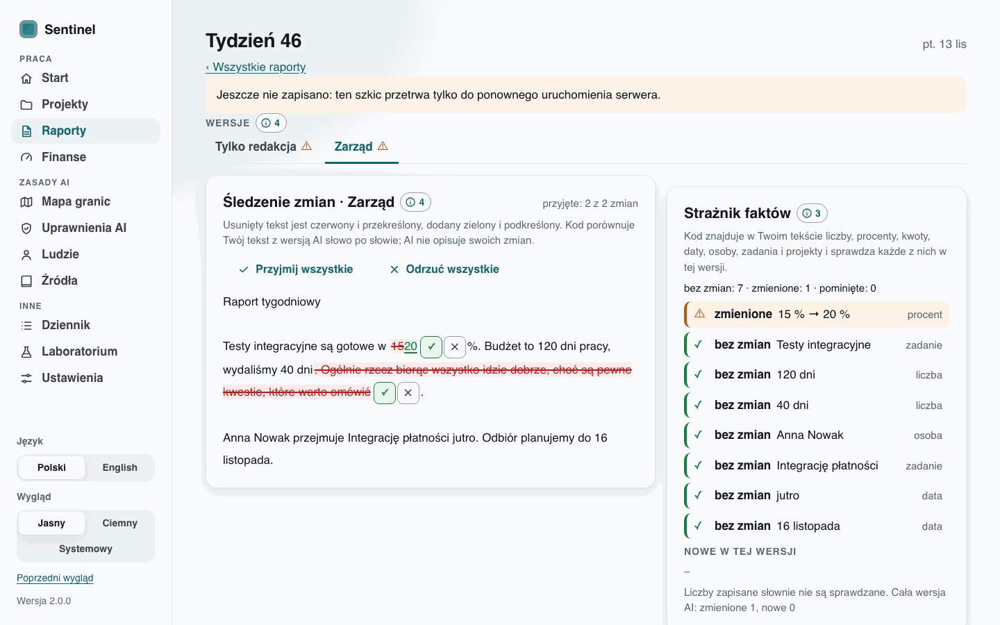
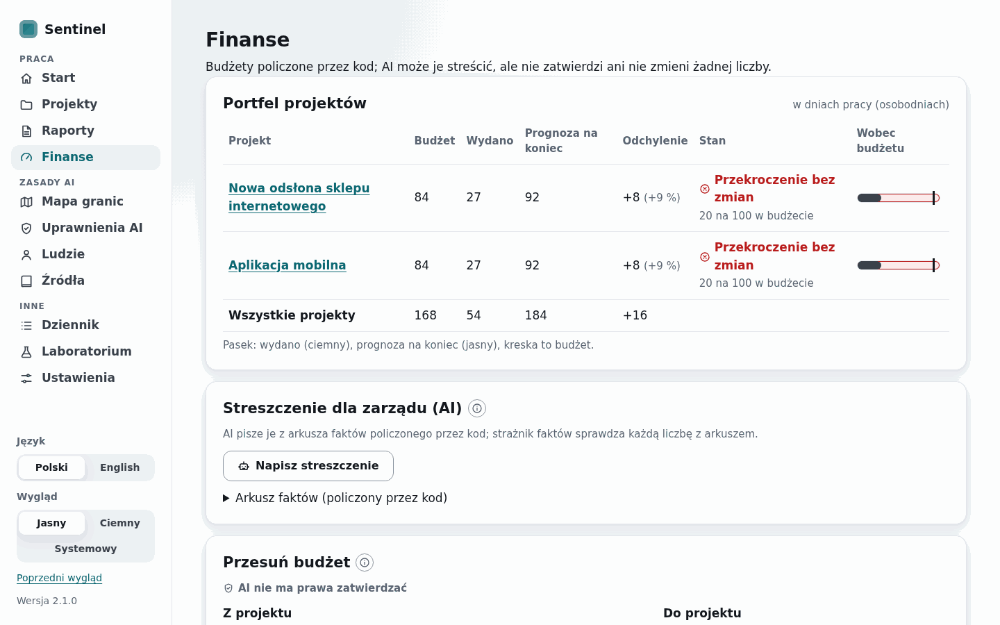
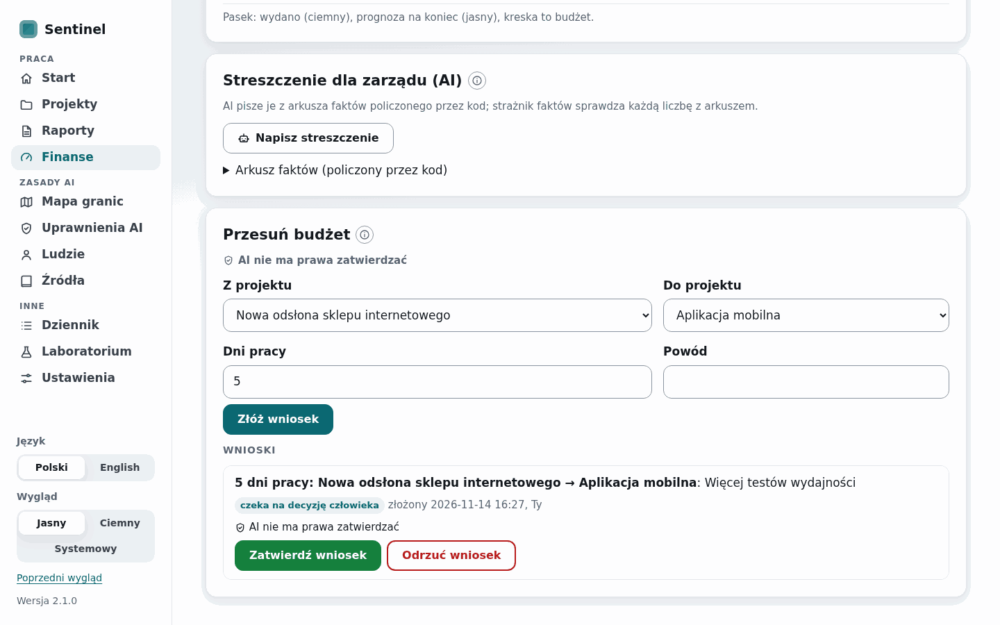

# WP20 report — v3 part 2: Raporty, Finanse, the RQ6 experiment, survey import (release 2.0.0)

- Date: 2026-11-14
- Commit(s): 91a7728 (role 4, diff, fact guard, spec), cd354c4 (RQ6), 98bccc8 (Raporty), 638a5d3 (Finanse), 6376acb (survey), 76301e9 (e2e, screenshots, 2.0.0 docs), the commit of this report

## Summary

The v3 interface is complete. **Raporty** lets a person paste or dictate a report. AI edits it
for "Tylko redakcja", "Zarząd", "Finanse" or "Zespół" (a fourth narrow LLM role that returns
the edited text only). Code computes the tracked changes word by word, and the person accepts
or rejects each change. A **fact guard** in code marks every number, percentage, amount, date
and name of the original as "bez zmian", "zmienione" or "pominięte" and lists "Nowe w tej
wersji". **Finanse** shows the portfolio computed by code and a board summary checked against
its fact sheet. Its **budget requests** change nothing until a person approves them. The
**survey import** turns on Mapa granic's comparison with what people answered. **RQ6** ("Does
AI editing for audiences preserve the facts?") is built and smoke-tested; its full run needs
the server's models and is the owner's (below), so there is no RQ6 table yet and no RQ6
evidence item.







## Acceptance criteria

| # | Criterion | Command | Result |
| --- | --- | --- | --- |
| 1a | Raporty and Finanse per the spec, PL and EN; the diff and the fact guard are code and tested; no budget change without a person's approval | `uv run pytest -q tests/test_tracked_facts.py tests/test_redaction.py tests/test_v3_work_pages.py` | PASS (35 diff and guard tests incl. "15 %", "1,5 mln zł", "3 tys.", "do 16 listopada", relative dates, inflected names; 11 page tests: clean pages in PL and EN, tracked changes, rejecting a change restores the fact, the confirmation before saving and exporting with ⚠, Markdown and print export, nothing stored before saving, the summary's guard, a request changes no budget until approved and confirmed, a request the source cannot afford is recorded as not applied) |
| 1b | Normal and demo mode, light and dark; e2e of the Raporty path and of the Finanse request; accessibility | `uv run pytest -q -m e2e` | PASS for WP20's tests, with two v1 failures specific to the Mac (50 tests: 47 passed at first. The WP16 wide-window test failed because the two new links pushed the sidebar's foot out of a 2096 px window; fixed with 36 px links, and the re-run of the changed tests passed 6 of 6: the Raporty path (paste → Zarząd → reject one change → the guard shows 15 % → 20 % → export confirmed), the Finanse request (filed, "AI nie ma prawa zatwierdzać", approved after confirmation, in Dziennik), axe on the editor and the finance page with a request, the new screens in light and dark, the layout tests. The two v1 keyboard tests press `Control+a` and ArrowDown on a `<select>`, which macOS Chromium handles differently; they test v1 pages this WP did not change; confirm on the server) |
| 2 | RQ6 runs reproducibly with the measures (smoke in the session; full run given) | `uv run python -m sentinel.experiments.rq6_study --config configs/wp20_rq6.toml --out <dir> --backend fake --limit 3`; `uv run pytest -q -m slow tests/test_rq6_study.py` | PASS for the smoke (24 edits on the scripted editor: changed, new and omitted facts, length, the model's list against the diff, bootstrap intervals, the figure; a pinned fake full run of 240 edits generates `paper/generated/rq6/` and regenerates byte for byte). **Full run not done**: this Mac has no `qwen2.5:7b` and no OpenRouter key; the command is below |
| 3 | The survey import works on a synthetic CSV and turns on the Mapa granic switch | `uv run pytest -q tests/test_survey.py` | PASS (6 tests: counts only, no free text, small demographic cells merged, the script refuses an export without the twelve processes, no switch before the import, the switch, the agreement and the honest note in PL and EN) |
| 4a | Quality gate | `uv run ruff check .`, `uv run ruff format --check .`, `uv run mypy src`, `uv run pytest -q` | PASS (clean; mypy 178 files; 778 passed, 107 deselected, 43.3 s on the Mac) |
| 4b | Data and slow tests | `uv run pytest -q -m "data or slow"` | PASS but for the repository's reproduce check (73 passed, 1 failed, 6 min 3 s on the Mac; the failure is `test_reproduce_check_passes_on_the_repository`: figure images, see 4c) |
| 4c | Research results unchanged | `uv run sentinel reproduce --check` | PASS on everything but figure images, as before WP20 (96 of 117 files identical on the Mac. All 21 that differ are PNG/PDF figures of 10 runs, the same set the Mac showed on the commit before WP18; every summary, LaTeX table and the 26 files of `paper/generated/` are identical. RQ6: no run pinned yet. WP19 got 117 of 117 on the server; confirm there) |
| 4d | 2.0.0 zip from a clean tree, not tagged; pushed; clean tree | `uv run sentinel release --version 2.0.0`; `git push`; `git status` | PASS (`dist/sentinel-2.0.0.zip`, 42,981,299 bytes, 1,571 files, from the clean tree of 76301e9; not tagged); pushed with this report; tree clean |

## Changes

- **Interpretation layer** (`src/sentinel/interpret/`): `redaction.py` (role 4: prompts, the
  schema `Redaction` and the RQ6 variant `RedactionWithChanges`, lengths checked in code),
  `tracked.py` (the word-level diff with accept/reject), `facts.py` (extraction and the check);
  prompts `redact.v1.txt`, `redact_format*.v1.txt`, `redact_style_{edit,board,finance,team,summary}.v1.txt`.
- **Experiments**: `report_corpus.py` (the corpus and its check), `rq6_study.py` (the runner,
  summaries, table, figure), `paper_rq6.py` (macros, table and figure in `paper/generated/rq6/`,
  `pin`); `reproduce.py` (RQ6 run and artifacts when pinned; the main tree check leaves `rq6/`
  to its own generator); `cli.py` (`sentinel paper --pin-rq6`).
- **Configs and scripts**: `configs/wp20_rq6.toml`, `configs/wp20_rq6_corpus.json` (30
  reports, 959 facts), `scripts/make_rq6_corpus.py`, `scripts/import_survey.py`,
  `scripts/ui_v3_screenshots.py` (Raporty and Finanse).
- **Evidence**: `src/sentinel/evidence/survey.py` (the aggregate, `data/survey.json` once
  imported).
- **Application** (`src/sentinel/app/`): `reports.py` (drafts in memory, versions, export),
  `finance.py` (portfolio lines, budget requests), `services.py` (Raporty, Finanse and the
  request lifecycle), `llm.py` (`redact`, role "edit"), `store.py` (migration 5: `reports`,
  `budget_requests`), `events.py` (`DefinitionChanged.request`), `messages.py` (new codes).
- **Interface** (`src/sentinel/app/ui/v2/`): `reports.py`, `finance.py`, `text_v3_work.py`,
  `evidence.py` (the survey view, links to Raporty and Finanse), `log.py` (the applied request),
  `__init__.py` (routes, filters); templates `reports.html`, `report_new.html`,
  `report_draft.html`, `_report_editor.html`, `_report_tabs.html`, `_report_wait.html`,
  `_report_confirm.html`, `report_confirm.html`, `report_print.html`, `finance.html`,
  `_fin_summary.html`, `_fin_confirm.html`, `map.html` (the switch), `_sidebar.html`,
  `_voice.html` (`box_max`); `sentinel-v2.css`, `sentinel-v2.js` (`data-print`).
- **Tests**: `test_tracked_facts.py`, `test_redaction.py`, `test_rq6_study.py`,
  `test_v3_work_pages.py`, `test_survey.py`; `test_v2_e2e.py` (the two paths, the new screens
  in the axe scan, the scripted model edits reports); `test_v2_pages.py` (every decision has
  its point); `test_paper.py` (the commands count once RQ6 is pinned); `test_app_api.py`.
- **Docs**: `docs/spec/model.md` v2.6.0 (§10 pointer, §11.9), ADR-0038, CLAUDE.md (four roles),
  `docs/spec/architecture.md`, `docs/research/survey.md`, user guides (PL, EN: a v3 chapter),
  README, CHANGELOG, `docs/notes/WP20.md`, `docs/ui/v3/` (20 new PNG), roadmap; version 2.0.0.

## Decisions

- Role 4 answers the edited text only; the application never asks a model for its changes.
  RQ6 adds a second condition that asks for the list, to measure whether it can be trusted
  (ADR-0038).
- Changes start accepted, as the model proposed them, and each can be rejected. The WP's e2e
  path ("reject one change") assumes that order; the confirmation before saving or exporting a
  version with ⚠ keeps the person's look.
- A confirmation is asked for a changed fact (⚠) **and** for a new fact (a possible
  invention), not only for ⚠.
- A fact changed in one place is "zmienione" even if the same value survives elsewhere
  (changed wins over unchanged): a missed change is the dangerous error.
- Drafts and the board summary live in the server's memory only (50 at most, none after a
  restart); the editing job's database row holds the draft's id, never text.
- The board summary uses role 4 with a fifth style, *summary*, on a fact sheet that code wrote;
  the fact guard compares the summary with the sheet.
- A budget request is applied as two definition changes that carry the request
  (`DefinitionChanged.request`), so Dziennik shows it; it is not applied when a project is gone
  or has no plan, or when the source would keep less than it has spent.
- RQ6's paper artifacts have their own config and folder (`configs/paper_rq6.toml`,
  `paper/generated/rq6/`), so the existing 117 files stay byte for byte; the config is written by
  `sentinel paper --pin-rq6` once the full run exists.
- The corpus is a committed file written by a script that may read the application's names (the
  showcase and the simulator's Polish words); research code reads only the file.
- Lengths of the role-4 schema are checked in code: a `maxLength` became a grammar that Ollama
  could not build.
- The survey's columns are recognised by distinctive words of their labels; the summary keeps
  counts only, merges demographic answers under three and makes no cross-tabulation; it lives
  in `src/sentinel/evidence/data/survey.json` (ADR-0037's place for it).
- ADR created: ADR-0038 (the fourth LLM role).

## Deviations

- **RQ6 full run, its table and the registry item (tasks 4 and 6)** are not done: the WP asks
  for both models, and this Mac has neither `qwen2.5:7b` nor an OpenRouter key (the full run is
  480 edits, over 10 minutes anyway). There is therefore no RQ6 table in this report and no
  "own" evidence item; both follow the owner's run (commands below).
- **The machine**: the WP ran on the owner's M1 MacBook, not on the WSL2 server.
  `reproduce --check` differs there on figure images only, as before WP20 (see 4c).
- **Spec §10** gained one sentence pointing to the fourth role in §11.9, beyond "Spec §11", so
  that §10 no longer says the LLM has three roles.
- **The sidebar's links are 36 px high** (were 40): with Raporty and Finanse the foot no longer
  fitted a 2096 × 1165 window at 1.4 zoom (the WP16 layout test).
- **The demo has one project**, so "Przesuń budżet" says that it needs two projects until the
  visitor creates a second; the e2e adds the showcase a second time to the visitor's sandbox.

## Spec questions

None open. §11.9 (v2.6.0) describes Raporty and Finanse as built. A limit is noted there: the
fact guard checks figures, not the words around them. A deviation's direction in words ("ponad
budżet") and numbers written as words are not checked.

## Numbers

| What | Value |
| --- | --- |
| Fact guard: kinds / tests | 7 kinds (number, percent, amount, date, person, task, project) / 35 unit tests, 0.05 s |
| RQ6 corpus | 30 synthetic reports (10 showcase, 20 simulator-named), 959 facts, 6,678 words; the guard finds exactly the recorded facts in all 30 |
| RQ6 full run (planned) | 30 × 4 audiences × 2 models × 2 conditions = 480 edits |
| RQ6 smoke runs | scripted editor: 3 reports, 24 edits, under 1 s; `qwen2.5:3b` on the Mac (prompt check only, not a result): 2 edits, 61 s, both valid |
| Default `pytest -q` | 778 passed, 107 deselected, 43.3 s on the Mac (WP19 measured 88.2 s on the server for 722; the new default tests take about 1 s here, the RQ6 runs and the full corpus check are `slow`) |
| `-m "data or slow"` / `-m e2e` | 73 passed, 1 failed (figures), 6 min 3 s / 47 of 50 at first in 6 min 21 s; after the sidebar fix the 6 changed tests passed in 61 s |
| `reproduce --check` | 96 of 117 identical on the Mac (21 figure images differ, as before WP20) |
| Screenshots | 20 new PNG in `docs/ui/v3/` (5 screens × PL, EN × 1440, 1280; light) |
| Release zip | 42,981,299 bytes, 1,571 files |

Machine: Apple M1 MacBook (8 cores, 8 GB, macOS), uv 0.12.2.

## Commands for the owner

- **RQ6 full run** (in tmux on the server; about 4.5 h for Ollama, at about 66 s per edit as
  measured there (corrected in 2.0.1, see the hotfix below), 20 min for OpenRouter, estimated
  0.15 USD for gpt-oss-120b by the provider's price list):
  ```
  uv run python -m sentinel.experiments.rq6_study --config configs/wp20_rq6.toml --out ~/rq6-ollama --backend ollama
  uv run python -m sentinel.experiments.rq6_study --config configs/wp20_rq6.toml --out results/wp20 --replay ollama=data/llm_cache/rq6/ollama.jsonl
  uv run sentinel paper --pin-rq6 results/wp20/<run_id>
  uv run sentinel reproduce --check
  git add results/wp20/<run_id> configs/paper_rq6.toml paper/generated/rq6 && git commit -m "WP20: RQ6 full run" && git push
  ```
  The Ollama pass writes outside the repository so that the second run starts from a clean
  tree. Then add the RQ6 result to the registry as an "own" item with the stance the numbers
  give (a follow-up of this WP).
- **On the server**: `uv sync --locked`, `uv run pytest -q` (check the 90 s limit there),
  `uv run pytest -q -m e2e` and `uv run sentinel reproduce --check`, to confirm what this Mac
  cannot (the figures, the two v1 keyboard tests).
- **The survey** (after 22 November): `docs/research/survey.md`.
- Optional: `git tag -a v2.0.0 -m "Sentinel 2.0.0" 76301e9ee32e && git push origin v2.0.0`. The
  public demo was not restarted: `scripts/run_demo.sh stop; scripts/run_demo.sh start` serves
  2.0.0.

## Open issues / next steps

- RQ6: the full run, its table and figure in the papers, the registry item.
- The survey's import once it closes; a phone layout for the survey table.
- The default test run on the server: WP19 measured 88 s of 90 s; this WP adds about 1 s on
  the Mac (an estimated 2 s on the server); if it passes 90 s, move older tests to `slow`.
- Raporty's audience styles are prompt files; making them editable in Ustawienia is open.

## Hotfix 2.0.1 (2026-11-14): RQ6 survives a failed edit

- Date: 2026-11-14
- Commit(s): d359a43 (the fix, tests, 2.0.1), the commit of this section

### Summary

The owner's full Ollama run of `configs/wp20_rq6.toml` stopped after 67 of 240 edits: Ollama
answered HTTP 500 "prediction aborted, token repeat limit reached" (qwen2.5:7b looping on R09,
Zarząd, plain) and the `LlmError` left `execute()`. Now an edit the backend cannot answer, or
whose answer violates its schema, is a row with outcome `model_error` and a short error kind,
and the run goes on. The summaries and both tables report the model-error rate per backend and
condition (and per audience) as a measure of its own; the fact measures are over the
successful edits, with their count. The request parameters are unchanged, so the 67 edits in
the cache are hits and the rerun resumes from them.

### Acceptance criteria

| # | Criterion | Command | Result |
| --- | --- | --- | --- |
| 1 | A failed edit (LlmError or schema) is a `model_error` row with a short kind, no text; the run goes on | `uv run pytest -q tests/test_rq6_study.py` | PASS (fake backend: an HTTP 500 for Zarząd/plain and an empty text for Zespół/self_report give 8 rows, 2 `model_error` (`http_500`, `schema`), no message text in `results.csv`, `n_model_errors` 2 in the manifest; the summaries regenerate byte for byte; the kinds of `LlmError` subclasses; a rate limit still stops the run with exit status 3 and no run directory) |
| 2 | Failure rate per backend and condition as its own measure; fact measures over the successful edits with their count | same, and `-m slow` | PASS ("Model errors" section with kinds; per-condition tables with Edits, Model errors (% with interval) and Successful edits; run table and paper `tab_rq6.tex` with `n` and Errors per condition; macros `RQsix[Self]Edits/Errors/Successful…`; a measure with no successful edit has no macro and prints "--": tested on a run with model errors renamed to Ollama, pinned and generated) |
| 3 | Request parameters unchanged (cache hits) | `git show d359a43 --stat` | PASS (no change to `sentinel.llm`, `sentinel.interpret.redaction`, the prompts or the config's values; only comments in the config) |
| 4 | Time estimate corrected | `configs/wp20_rq6.toml`, this report | PASS (about 66 s per Ollama edit on the server, about 4.5 h for 240 edits) |
| 5 | Quality gate within 90 s | `uv run ruff check . && uv run ruff format --check . && uv run mypy src && uv run pytest -q` | PASS (781 passed in 54.7 s on the Mac) |
| 6 | Data and slow tests | `uv run pytest -q -m "data or slow"` | PASS but for the repository's reproduce check, as in WP20 (74 passed, 1 failed `test_reproduce_check_passes_on_the_repository`: figure images, 7 min 7 s on the Mac) |
| 7 | `reproduce --check` 117/117 | `uv run sentinel reproduce --check` | **Not confirmed on this machine**: 96 of 117 identical on the Mac, the same 21 PNG/PDF figures of 10 runs as in WP20 (Mac rendering); every summary, LaTeX table and the 26 files of `paper/generated/` identical; RQ6 not pinned. The fix touches none of those runs; confirm 117/117 on the server |
| 8 | Version 2.0.1, no tag, pushed | `git log`, `git tag` | PASS (no tag) |

### Changes

- `src/sentinel/experiments/rq6_study.py`: `error_kind`, `error_row`; `execute` catches
  `LlmError` (re-raises `QuotaExhausted`), prints each model error and counts them; columns
  `outcome`, `error` replace `valid`; every row has every column; summary section "Model
  errors", per-table Edits/Model errors/Successful edits; run table with `n` and Errors per
  condition; figure over successful edits; manifest `n_model_errors`.
- `src/sentinel/experiments/paper_rq6.py`: macros for edits, model errors and successful
  edits; measures without a successful edit skipped; `tab_rq6.tex` grouped by condition with
  `n` and Errors (PL and EN).
- `tests/test_rq6_study.py`: error kinds, the error path on the fake backend, the rate limit,
  paper artifacts of a run with model errors (slow).
- `configs/wp20_rq6.toml` (comments), `pyproject.toml`, `uv.lock`, `tests/test_app_api.py`,
  `README.md` (2.0.1), `CHANGELOG.md`, `docs/notes/WP20.md`, this report, `docs/roadmap.md`.

### Decisions

- `QuotaExhausted` (rate limit, missing credits) is not caught: it is not a failure of one
  edit, and turning it into rows would record the rest of an OpenRouter run as errors instead
  of stopping it for a resume.
- Error kinds are codes only (`http_<status>`, `timeout`, `transport`, `too_large`,
  `cache_miss`, `backend`, or the schema violation's `empty`/`json`/`truncated`/`schema`):
  an error message can quote the answer.
- A failed edit is not cached (the LLM layer is unchanged), so the two-backend command that
  replays Ollama from its cache records it as `cache_miss`: the same rate, the original kind
  stays in the Ollama run's `results.csv`. Caching failures would change the LLM layer for
  every study.
- A schema-invalid answer, recorded as `valid = 0` before, is now a model error too: a missing
  `facts` key in such a row would have crashed the summary (latent bug, fixed by giving every
  row every column).
- ADRs created: none.

### Deviations

- `reproduce --check` could only be run on the Mac (96 of 117, figures only, as in WP20);
  117/117 needs the server.

### Spec questions

None.

### Numbers

| Measure | Value |
| --- | --- |
| Crashed Ollama run | 67 of 240 edits cached |
| Ollama time per edit (server) | about 66 s; 240 edits about 4.5 h; the remaining 173 about 3.2 h |
| `pytest -q` | 781 passed, 54.7 s (Mac M1) |
| `pytest -q -m "data or slow"` | 74 passed, 1 failed (figures), 7 min 7 s (Mac M1) |
| `reproduce --check` | 96 of 117 on the Mac (21 figure images) |

### Commands for the owner

- **On the server**, after `git pull && uv sync --locked`: `uv run sentinel reproduce --check`
  (expect 117 of 117).
- **Resume the Ollama run** (in tmux; about 3.2 h left, the 67 edits are cache hits; each model
  error prints `model error (<kind>): …` and the run goes on):
  ```
  uv run python -m sentinel.experiments.rq6_study --config configs/wp20_rq6.toml --out ~/rq6-ollama --backend ollama
  ```
  then the two-backend run, pin, check and commit as in "Commands for the owner" above.

### Open issues / next steps

- The article should state the model-error rate beside the fact measures (a model that fails
  on hard reports would otherwise look more faithful).
- If qwen2.5:7b loops on many edits, the rate is a finding; a change of decoding parameters
  would be a new run (new cache keys), not part of this fix.

## RQ6 result (full run, 2026-11-14)

"Does AI editing for audiences preserve the facts?" The full run is committed and pinned:
`results/wp20/20261114-125202-a9deafbe` (two backends; Ollama replayed from its cache, see
"The one model error" below), paper artifacts in `paper/generated/rq6/` (`configs/paper_rq6.toml`).
30 synthetic Polish reports, 964 facts as the guard counts them (the corpus records 959 by
meaning; in 7 reports the guard's count differs by one), 4 audiences × 2 models
× 2 conditions = 480 edits, 1 model error. Models: `qwen2.5:7b` on the server's Ollama (live
run 3 h 7 min, about 65 s per edit) and `openai/gpt-oss-120b` through OpenRouter (11 min). Shares
in %, per 100 facts, with the 95 % cluster-bootstrap interval over reports.

| Model | Audience | n | Errors | Changed fact (versions) | Changed /100 | New fact (versions) | Omitted /100 | Length | n (list) | Errors (list) | Diff listed |
| --- | --- | --- | --- | --- | --- | --- | --- | --- | --- | --- | --- |
| qwen2.5:7b | Editing only | 30 | 0.0 | 0.0 [0.0, 0.0] | 0.0 | 0.0 [0.0, 0.0] | 0.0 | 0.95 | 30 | 0.0 | 73.5 [55.3, 89.7] |
| qwen2.5:7b | Board | 30 | 0.0 | 0.0 [0.0, 0.0] | 0.0 | 0.0 [0.0, 0.0] | 0.9 | 0.93 | 29 | 3.3 | 48.9 [36.6, 60.4] |
| qwen2.5:7b | Finance | 30 | 0.0 | 0.0 [0.0, 0.0] | 0.0 | 0.0 [0.0, 0.0] | 15.2 | 0.70 | 30 | 0.0 | 67.4 [54.6, 82.6] |
| qwen2.5:7b | Team | 30 | 0.0 | 0.0 [0.0, 0.0] | 0.0 | 0.0 [0.0, 0.0] | 8.3 | 0.77 | 30 | 0.0 | 63.7 [52.7, 74.0] |
| qwen2.5:7b | All four | 120 | 0.0 | 0.0 [0.0, 0.0] | 0.0 | 0.0 [0.0, 0.0] | 6.1 | 0.84 | 119 | 0.8 | 60.8 [54.2, 66.8] |
| gpt-oss-120b | Editing only | 30 | 0.0 | 0.0 [0.0, 0.0] | 0.0 | 6.7 [0.0, 16.7] | 0.2 | 0.82 | 30 | 0.0 | 84.8 [79.0, 90.0] |
| gpt-oss-120b | Board | 30 | 0.0 | 0.0 [0.0, 0.0] | 0.0 | 6.7 [0.0, 16.7] | 7.2 | 0.70 | 30 | 0.0 | 89.5 [82.7, 95.3] |
| gpt-oss-120b | Finance | 30 | 0.0 | 3.3 [0.0, 10.0] | 0.1 | 3.3 [0.0, 10.0] | 7.9 | 0.66 | 30 | 0.0 | 91.6 [85.4, 96.2] |
| gpt-oss-120b | Team | 30 | 0.0 | 0.0 [0.0, 0.0] | 0.0 | 10.0 [0.0, 20.1] | 8.8 | 0.66 | 30 | 0.0 | 97.8 [95.6, 99.5] |
| gpt-oss-120b | All four | 120 | 0.0 | 0.8 [0.0, 2.5] | 0.0 | 6.7 [1.7, 13.3] | 6.0 | 0.71 | 120 | 0.0 | 91.3 [88.4, 93.9] |

The columns up to "Length" are the application's prompt (condition `plain`); the last three are
the condition that also asks for the model's list of its changes (`self_report`). "Diff listed":
the share of the changes found by the code diff that the model's list covers. The table is
`paper/generated/rq6/tab_rq6.tex` with the length ratio added from the run's `summary.md`.

The model's own list against the code diff (condition `self_report`, all four audiences):

| Model | Changes per version (code) | Listed per version | Diff listed | Listed, not in the diff |
| --- | --- | --- | --- | --- |
| qwen2.5:7b | 5.62 [5.08, 6.10] | 6.83 [5.98, 7.75] | 60.8 [54.2, 66.8] | 54.5 [48.3, 60.4] |
| gpt-oss-120b | 15.22 [14.32, 16.07] | 4.22 [3.68, 4.86] | 91.3 [88.4, 93.9] | 14.2 [11.4, 17.2] |

### Findings

- **Changed facts are near zero for both models.** qwen2.5:7b changed no fact in 120 versions
  (119 with the list); gpt-oss-120b changed one fact in 1 of 120 versions in each condition
  (0.8 % [0.0, 2.5]; 0.0 per 100 facts overall, 0.1 in the finance versions). With the list, that
  one changed fact was in gpt-oss-120b's own list.
- **New facts appear in some cloud versions.** gpt-oss-120b added a fact absent from the report
  in 8 of 120 versions (6.7 % [1.7, 13.3]; 19 new facts) and in 11 of 120 with the list
  (9.2 % [1.7, 18.3]; 25); qwen2.5:7b in none of 120 and in 1 of 119 with the list. A new fact
  may be an invention or a correct inference (a sum); the guard marks it either way.
- **Omissions concentrate in the shorter audiences.** qwen2.5:7b left out 15.2 [11.2, 19.8]
  facts per 100 for finance (length 0.70 of the report) and 8.3 for the team (0.77), against 0.9
  for the board (0.93) and 0.0 for "Editing only" (0.95); gpt-oss-120b 7.2 to 8.8 for the
  board, finance and the team (0.66 to 0.70), against 0.2 for "Editing only" (0.82).
- **The local model edits far less.** The code diff found 5.62 changes per version of
  qwen2.5:7b against 15.22 of gpt-oss-120b (with the list); for "Editing only" 1.13 against 11.20;
  the length ratio over all audiences is 0.84 against 0.71.
- **The models' own lists of changes cannot be trusted.** qwen2.5:7b's list covered 60.8 % of
  the changes the code found, and 54.5 % of what it listed is in no change of the diff or cannot
  be found in the texts (for "Editing only" it listed 7.07 changes per version against 1.13 made,
  87.7 % of them not in the diff). gpt-oss-120b's list covered 91.3 %, with 14.2 % not in the
  diff, while listing 4.22 items for 15.22 changes (one listed item can span several changes).

### Stance in the evidence registry

Two own items of the same run (an item has one stance), their figures checked by
`tests/test_evidence.py` against `paper/generated/rq6/numbers.tex`: **E53 supports D14 and
D15**: the changes to accept are computed by code (a model's own list misses real changes and
names ones that did not happen), and the fact guard is needed although changed facts are rare
("rarely" is not "never"). **E54 nuances D16**: a version for an audience is more than an edit
of the author's text: the cloud model added facts, and the shorter the version, the more facts
it leaves out, so each version is reviewed with its new and omitted facts.

### Caveats

- Synthetic corpus of 30 Polish reports generated from templates, no report written by a
  person; one edit per report, audience, model and condition; intervals over 30 reports are
  wide (new-fact versions of gpt-oss-120b 1.7 to 13.3 %).
- A fact is what the guard recognises (numbers, percentages, amounts, dates, people, tasks,
  projects); a changed meaning without a changed figure, a direction in words ("ponad budżet")
  and numbers written as words are not counted (spec §11.9).
- A listed change that cannot be located in the two texts counts as not in the diff.
- The cloud answers came from `openai/gpt-oss-120b` served by Groq through OpenRouter; a live
  rerun would not return the same text, so the bundle in the run directory is the reference.

### The one model error (`cache_miss`)

The one model error (qwen2.5:7b, R09, Zarząd, with the list) has the kind `cache_miss` in the
committed run. That run is the two-backend command, which replays Ollama from
`data/llm_cache/rq6/ollama.jsonl` (`--replay ollama=…` in its manifest; 239 calls, 239 cache hits,
no call to Ollama). A failed call is not cached (decision of hotfix 2.0.1), so the edit that
failed in the live Ollama run has no recorded answer, and its replay is a cache miss. In the
live run (`~/rq6-ollama/20261114-093536-04403e18` on the server, outside the repository) the
same row has the kind `http_500`; Ollama's message on the console was "token repeat limit
reached" (qwen2.5:7b repeating itself, as in the crash before 2.0.1 on the same report and
audience in the plain condition, an edit that succeeded when the run resumed). The other 239
Ollama rows of the two runs are identical in every column but latency. Nothing was rerun: the
rate (0.8 % of the Ollama edits with the list) is the same, only the kind's name differs. The
run's `summary.md` still says `cache_miss: 1`: it is pinned by its SHA-256 in
`paper/generated/rq6/MANIFEST.json`, and results are never edited by hand.

## Follow-up 2.0.2 (2026-11-14): the draft page while an edit runs; RQ6 in the registry

- Date: 2026-11-14
- Commit(s): 6c005e9 (fix, registry, report), the commit of this line

### Summary

Opening a report draft while its editing job is still running rendered the wait notice
without the `now` value it uses (jinja2 `UndefinedError`, HTTP 500): the e2e report path failed
on this server and passed on the Mac only because the scripted editor finished first. The draft
page now passes the audience being edited (or an empty string), as the polled wait route does,
and a page test renders the draft with a running job. Our RQ6 result is in the evidence
registry as two own items (E53 supports D14 and D15, E54 nuances D16), and the RQ6 section above
gives its table and findings. The one Ollama model error reads `cache_miss` because the
committed run replays Ollama from its cache, where the edit that failed live ("token repeat
limit reached", `http_500` in the live run) has no answer; it is explained above, nothing was
rerun, and the run's own `summary.md` is unchanged (pinned).

### Acceptance criteria

| # | Criterion | Command | Result |
| --- | --- | --- | --- |
| 1 | The draft page renders with a running job; a page test, independent of timing | `uv run pytest -q tests/test_v3_work_pages.py -k renders_while` | PASS (2 passed: a running job before and after it names its audience; both fail without the fix with the 500) |
| 2 | RQ6 in the registry as own evidence, figures checked against `paper/generated/rq6/numbers.tex`; stance per decision | `uv run pytest -q tests/test_evidence.py` and `-m "data or slow" tests/test_evidence*.py` | PASS (E53: D14, D15 `wspiera`; E54: D16 `niuansuje`; 16 figures equal their macros, the file's SHA-256 and the run id of `configs/paper_rq6.toml` checked; decisions, catalogue table and criteria lists agree) |
| 3 | `cache_miss` explained without rerunning | this report (RQ6 section), `docs/notes/WP20.md` | PASS (live run's row `http_500`; the other 239 Ollama rows identical but for latency) |
| 4 | RQ6 section with the table and findings in this report | this report | PASS |
| 5 | Quality gate within 90 s | `uv run ruff check . && uv run ruff format --check . && uv run mypy src && uv run pytest -q` | PASS (774 passed in 82.0 s on the server, after moving nine 1–2 s research tests to `slow`; 98.4 s before, and 101.2 s at HEAD 368aa23 in a worktree) |
| 6 | Data and slow tests | `uv run pytest -q -m "data or slow"` | PASS after one fix (82 passed, 1 failed in 12 min 36 s: `test_reproduce_check_passes_on_the_repository`, RQ6's `numbers.tex` named the absolute config path; fixed, then that test and the touched modules: 10 passed) |
| 7 | End-to-end tests | `uv run pytest -q -m e2e` | PASS (50 passed in 9 min 25 s; `test_the_report_path` again after the last edit: passed) |
| 8 | `reproduce --check` 117/117 plus the pinned RQ6 files identical | `uv run sentinel reproduce --check` | PASS (128 of 128: the 117, the RQ6 run's 4 summary files and the 7 files of `paper/generated/rq6/`; 41 s) |
| 9 | Version 2.0.2, no tag, pushed | `git log`, `git tag` | PASS (no tag) |

### Changes

- `src/sentinel/app/ui/v2/reports.py`: `working_on` (the audience label of a running job), used
  by the wait route and by `draft_page`, which now passes `now`.
- `src/sentinel/evidence/model.py`: own items may cite `paper/generated/rq6/numbers.tex`
  (`RQ6_NUMBERS_FILE`, `NUMBERS_FILES`).
- `src/sentinel/evidence/data/registry.json` (E53, E54), `decisions.json` (D14, D15, D16),
  `boundary-map.json` (criteria 2 and 3 list E53, E54); `docs/research/decisions.md`,
  `docs/research/boundary-criteria.md`.
- `src/sentinel/experiments/paper_rq6.py`: `numbers.tex` names the config as `MANIFEST.json`
  does (relative to the working directory).
- `tests/test_v3_work_pages.py` (the draft page with a running job), `tests/test_evidence.py`
  (each own item against its numbers file and paper config; 54 items); nine tests marked
  `slow` in `test_baseline_policies.py`, `test_forecast_study.py`, `test_forecast_study_data.py`,
  `test_rcpsp_benchmark.py`, `test_sentinel_identity.py`, `test_simulation_study.py`.
- `pyproject.toml`, `uv.lock`, `README.md`, `tests/test_app_api.py` (2.0.2), `CHANGELOG.md`,
  `docs/notes/WP20.md`, this report, `docs/roadmap.md`.

### Decisions

- Two own items, not one: an item has one stance, and RQ6 supports D14 and D15 but nuances D16
  (as RQ4 gave E50 and E52). Both cite the same run and caveats; criteria 2 (verifiability) and
  3 (language work or figures).
- The model is extended rather than the RQ6 macros copied into `paper/generated/numbers.tex`:
  RQ6 has its own pinned paper artifacts since WP20.
- The explanation of `cache_miss` is in this report and the notes, not in the run's
  `summary.md`: that file is pinned by its SHA-256 in `paper/generated/rq6/MANIFEST.json`, and
  results are never edited by hand.
- ADRs created: none.

### Deviations

- `paper_rq6.py` was fixed although the WP did not ask: the `-m "data or slow"` acceptance check
  failed on it (a WP20 bug that shows only once RQ6 is pinned). The committed files are
  unchanged.
- Nine default tests moved to `slow`: the default run was over 90 s on this server already at
  HEAD (WP20's new tests were timed on the Mac).

### Spec questions

None.

### Numbers

| Measure | Value |
| --- | --- |
| `pytest -q` (server) | 101.2 s at HEAD 368aa23 (worktree; 3 version checks fail there against the 2.0.2 environment), 98.4 s with this change, 82.0 s after nine tests to `slow` (774 passed) |
| `pytest -q -m "data or slow"` | 82 passed, 1 failed (fixed), 12 min 36 s |
| `pytest -q -m e2e` | 50 passed, 9 min 25 s |
| `reproduce --check` | 128 of 128, 41 s |
| Registry | 54 items, 8 own (E53, E54 new); 24 decisions |

Machine: the WSL2 server (i5-6600K, 4 cores), no Ollama running.

### Commands for the owner

- The public demo: `scripts/run_demo.sh stop; scripts/run_demo.sh start` to serve 2.0.2.
- Optional, not created by the tooling: the live Ollama run in `~/rq6-ollama` can be kept or
  removed; it is not needed by `reproduce --check`.

### Open issues / next steps

- The article: RQ6 table and findings (the macros are in `paper/generated/rq6/`), with the
  model-error rate beside the fact measures.
- The boundary map's cells for P01 and P02 (report editing, versions for departments) could
  cite E53 and E54; not done here.
