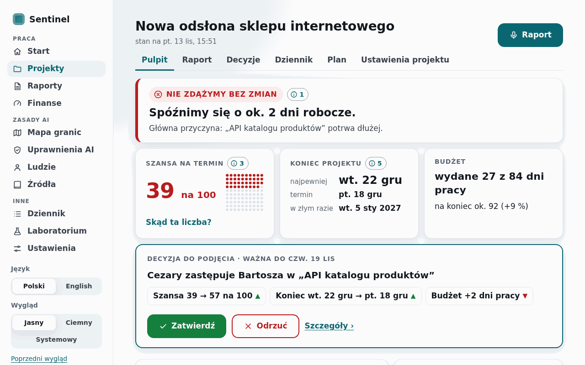
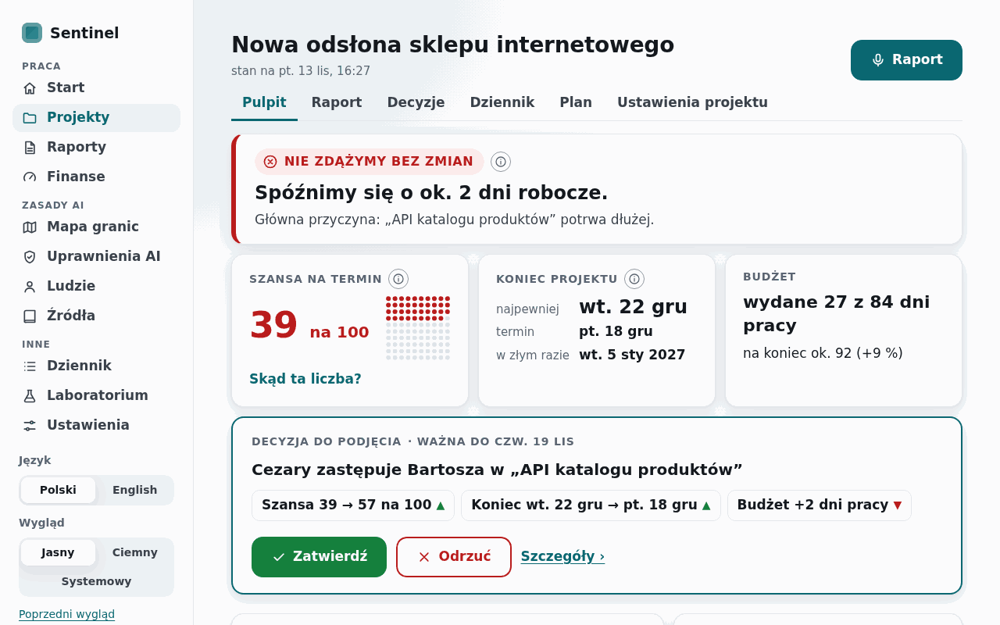
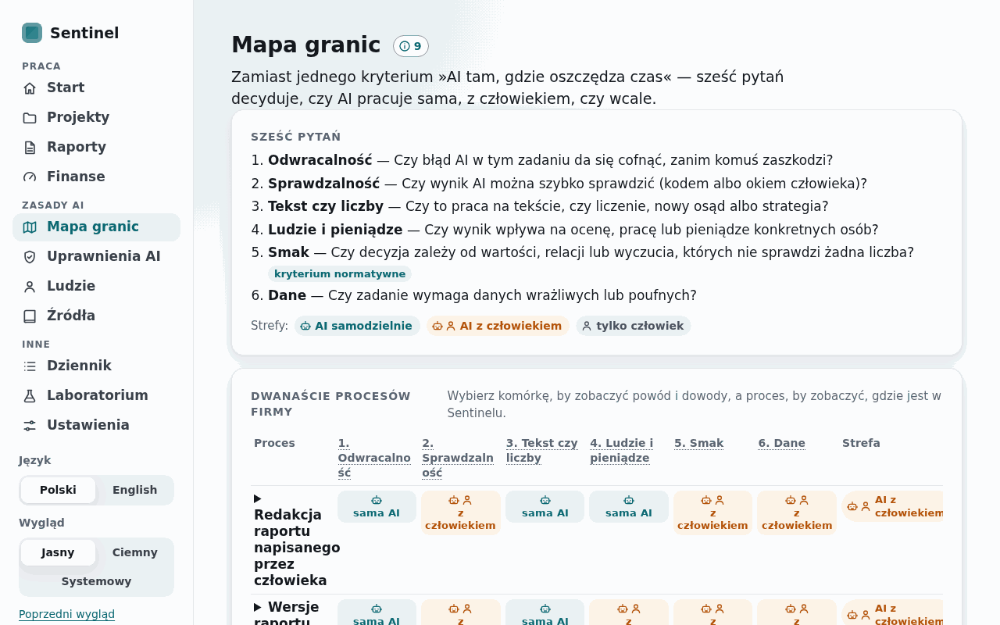
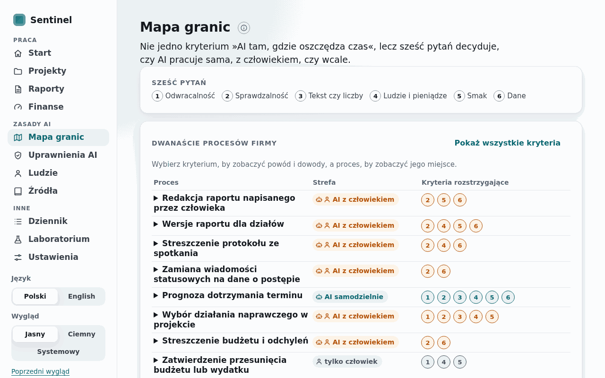
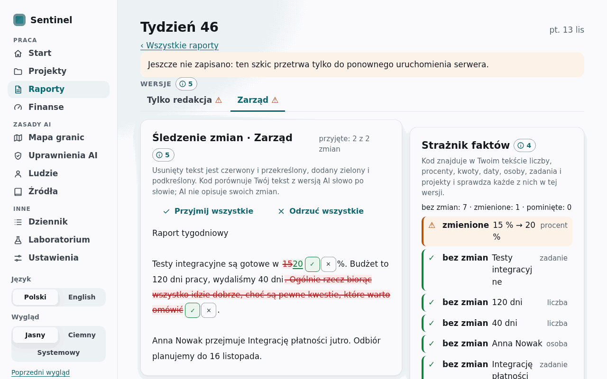
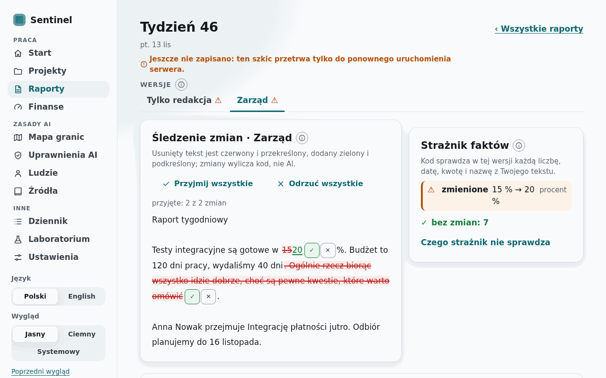
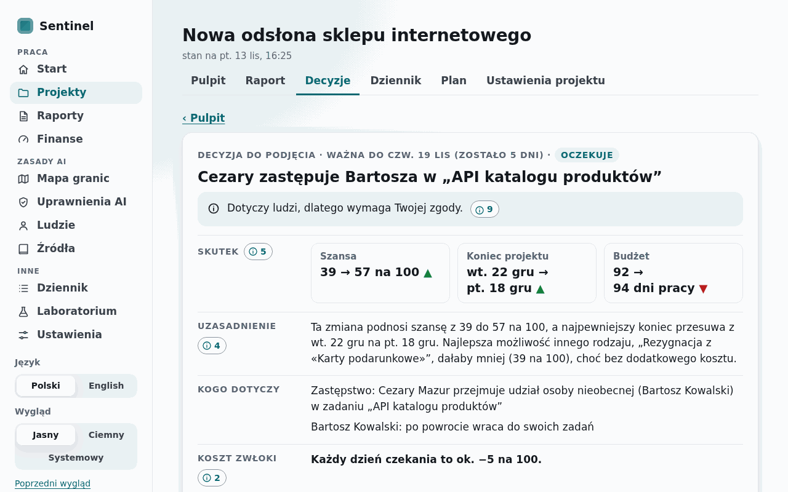
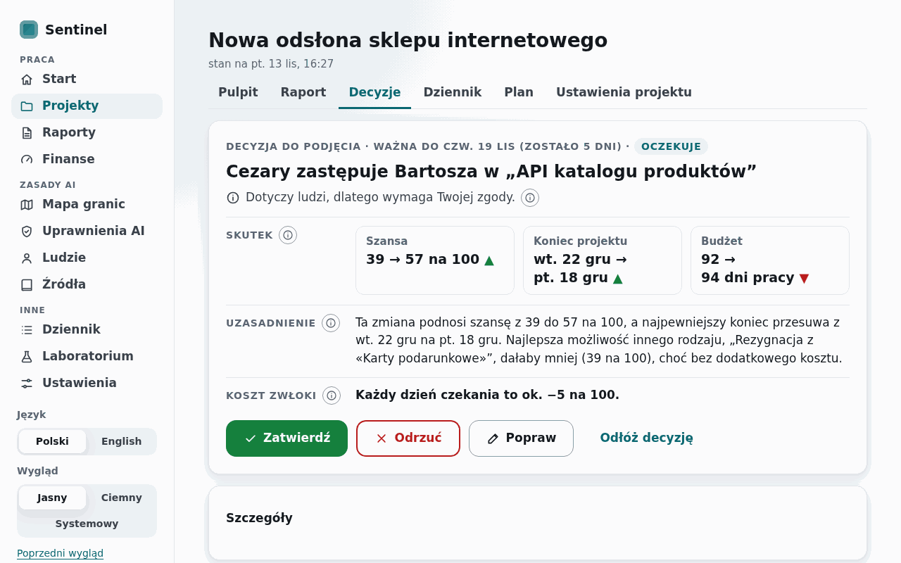
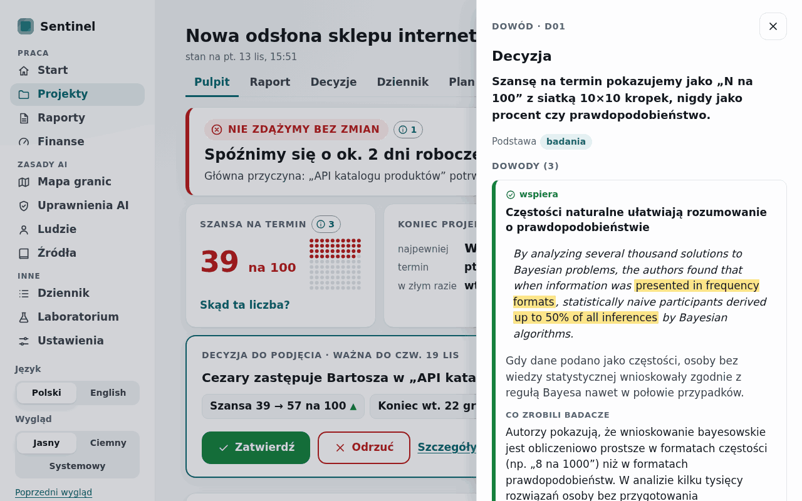
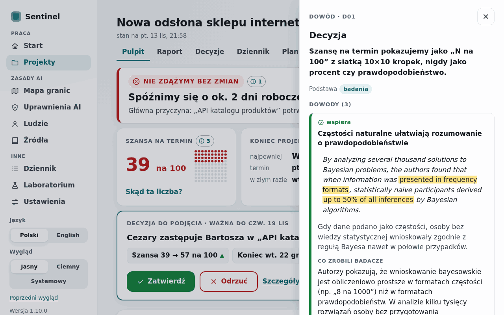

# WP21 report: calm screens (release 2.1.0)

- Date: 2026-11-14
- Commit(s): f915c7d (panel, points, dashes, budget tests), cd21c95 (screens, spec section 10, e2e, screenshots, 2.1.0), 57bdfd8 (a test fix), the commit of this report

## Summary

Every screen now shows less at once. The "Dowód" panel stays fixed to the window and scrolls
inside itself; the page behind no longer moves and nothing is cut off. It opens short: one line
counts the evidence, each card shows its stance, title, quote and gloss, and "Szczegóły badania"
opens the rest in one click. Points are a quiet grey "ⓘ", one per block. Pulpit, Mapa granic,
Raporty and Decyzja were redesigned in a look-and-fix loop. The text budget is written down (v3
spec section 10, ADR-0039) and tested, and no dash is used as a pause anywhere in our text. No
research semantics or number changed.

## Before and after (1280×800, Polish)

| Before (2.0.2) | After (2.1.0) |
| --- | --- |
|  |  |
|  |  |
|  |  |
|  |  |
|  |  |

## Acceptance criteria

| # | Criterion | Command | Result |
| --- | --- | --- | --- |
| 1 | The panel scrolls inside itself and nothing is cut off; the page behind stays put | `uv run pytest -q -m e2e tests/test_v2_e2e.py -k long_panel` | PASS (D03's panel from Decyzja and E08's decision from an opened Źródła item, every card opened, at 1440×900 and 1280×800: the dialog stays at 0 to the window's height, the page's scroll position does not change, the body scrolls to its end and the panel's last line is in view. Before the fix the same measurement showed the dialog itself scrolling and the page moving 686 px) |
| 2 | No "—" anywhere in our text (test), quotes untouched | `uv run pytest -q tests/test_v2_text.py -k "dash or budget"`; every page test through `tests/ui_check.py`; `uv run pytest -q -m "data or slow" tests/test_evidence*.py` | PASS (no em dash and no pause en dash in the v1 and v2 catalogues, the messages, the registry's own fields, decisions, the map and both user guides; every rendered page of the page tests clean; ranges such as "1–5" and "pt. 13 lis – pt. 20 lis" kept; the registry's quote and highlight tests pass, no quote, highlight or citation edited) |
| 3a | Text budget on every screen; at most about four blocks above the fold at 1280×800 | `uv run pytest -q tests/test_v2_text.py -k budget`; `uv run pytest -q -m e2e tests/test_v2_e2e.py -k text_budget`; screenshots | PASS (90 heading texts at most 6 words, 110 helper texts one sentence of at most 20 words; on 22 screens at 1280×800 no visible paragraph over 3 lines and at most four content blocks starting above the fold; the pairs above and 84 screenshots in `docs/ui/v3/`) |
| 3b | Points quiet and at most one per block; the panel opens short with details one click away | `uv run pytest -q tests/test_v2_pages.py -k point`; `-m e2e -k presentation` | PASS (every decision with a screen still has a point; a merged point's N is the number of distinct items of its decisions; the presentation path checks "3 dowody: wszystkie wspierają", details hidden, one click opens all three cards' details) |
| 3c | Accessibility, light and dark, panel open | `uv run pytest -q -m e2e tests/test_v2_e2e.py -k accessibility` | PASS (no serious or critical axe violation on 29 screens and states, with the panel open from Pulpit, the compact map, the full map and Źródła; one finding fixed on the way: the map's number marks now start their name with the visible number, WCAG 2.5.3) |
| 4a | Quality gate | `uv run ruff check .`, `uv run ruff format --check .`, `uv run mypy src`, `uv run pytest -q` | PASS (clean; mypy 178 files; 776 passed, 119 deselected, 84.5 s on the server) |
| 4b | Data and slow tests | `uv run pytest -q -m "data or slow"` | PASS (83 passed in 12 min 35 s, the registry's quote tests and the repository's reproduce test among them) |
| 4c | End-to-end tests | `uv run pytest -q -m e2e` | PASS (52 passed in 9 min 46 s, the two new tests among them) |
| 4d | Research results unchanged | `uv run sentinel reproduce --check` | PASS (128 of 128 files identical, 41 s) |
| 4e | 2.1.0 zip from a clean tree, not tagged; pushed; clean tree | `uv run sentinel release --version 2.1.0`; `git push`; `git status` | PASS (`dist/sentinel-2.1.0.zip`, 44,731,840 bytes, 1,628 files, from the clean tree of 57bdfd8; not tagged); pushed with this report; tree clean |

## Changes

- **The panel** (`templates/v2/_dowod.html`, `_ev.html`, `v2/evidence.py`, `sentinel-v2.css`,
  `sentinel-v2.js`): merged decisions (`idents`, `evidence_of`, `Panel.lines`), the one-line
  count, the first item of each stance with "Więcej dowodów (N)", cards collapsed behind
  "Szczegóły badania" (Źródła shows them whole), the details synchronised while the panel is
  open; the dialog a flex column with `overflow: hidden`, the body the only scroller,
  `html:has(.dowod[open])` locking the page.
- **Points** (`_macros.html`): a quiet 26 px outline, N on hover and focus; merged points on
  Uprawnienia AI (one per column), Ludzie (one for the four cards), Decyzja's header (D03 with
  D21) and the new-report form (D16 with D15); the doubled point on Start and the heading points
  of Finanse and Uprawnienia AI removed.
- **Screens**: Pulpit (`overview.html`, `_insights.html`, `_pending.html`: four folding
  sections, remembered in `localStorage`); Mapa granic (`map.html`, `full` view; the compact
  default with numbered deciding criteria, the full grid icon-only, the six questions as a
  legend); Decyzja (`decision.html`: one header line, "Kogo dotyczy" in "Szczegóły", no back
  link); Raporty (`_report_editor.html`, `report_draft.html`, `report_new.html`, `reports.html`:
  the guard's kept facts folded, the draft's state in its header, times in words);
  Finanse, Laboratorium, Dziennik, Źródła, Ludzie, project settings, `_distribution.html`.
- **Texts** (`v2/text.py`, `v2/text_v3.py`, `v2/text_v3_work.py`, `ui/text.py`,
  `messages.py`): 41 entries rewritten (dashes out, helpers to one sentence), new keys for the
  panel, the map, the guard, the log and `value.none` / `common.no`; dash placeholders in v1
  and v2 templates and code (`setup.py`, `sim.py`, `project.py`, `v2/finance.py`, `v2/log.py`,
  `v2/wizard.py`) replaced by words.
- **Tests**: `tests/ui_check.py` (`pauses`, part of `problems`), `tests/test_v2_text.py` (the
  dash test over all our texts, the text budget), `tests/test_v2_e2e.py` (a long panel scrolls
  inside itself, the budget at 1280×800, the presentation path, the axe scan with the full map
  and Źródła's panel), updated pins in `test_v2_pages.py`, `test_v3_work_pages.py`,
  `test_v2_lab.py`, `test_v2_report.py`, `test_ui_text.py`, `test_ui_ai_e2e.py`,
  `test_app_api.py`.
- **Docs**: `docs/design/v3-spec.md` (section 10 and the WP21 amendments of sections 2 to 5),
  ADR-0039, both user guides, `docs/notes/WP21.md`, CHANGELOG, README, roadmap;
  `scripts/ui_v3_screenshots.py` (seven more screens), `docs/ui/v3/` (84 screenshots) and
  `docs/ui/v3/before/` (five of 2.0.2); version 2.1.0.

## Decisions

- One point per block: a block's decisions merge into one point (`D05+D24`; a "+" in a query
  arrives as a space, so both are read); N is the number of distinct items; the panel lists the
  decisions, then their evidence once.
- "Remembered while the panel is open" is read as: one click on "Szczegóły badania" opens the
  details of every card (also those behind "Więcej dowodów") until the panel closes.
- "The first challenging item always visible": a panel with more than three items shows the
  first item of each stance; three or fewer are all shown.
- The deciding criteria of a process are the cells whose zone equals the process's zone, which is
  the strictest-zone rule of the map, computed in the template from the data.
- A block above the fold counts when it starts at least 48 px above the window's bottom; the
  page's heading and navigation are not blocks of content.
- A missing value reads "brak" / "none" instead of a lone dash; the fact guard's "omitted" icon
  is "○".
- Pulpit's folds are kept in the browser (`localStorage`), never on the server.
- ADR created: ADR-0039 (calm screens: a tested text budget, one point per block, a short panel).

## Deviations

- **Evidence titles are content, not headings of ours**: 36 of 54 Polish registry titles have
  more than six words; they are the research's one-line claims, and shortening them risks their
  meaning, so section 10 exempts them (as project, task, report and decision titles).
- **"One helper per block" is held by review and the screens' rewrite, not by a test**: the test
  checks each helper text (one sentence, at most 20 words); a form field keeps its own hint.
- **The v1 interface ("Poprzedni wygląd") was cleaned too**: its dash pauses and lone-dash
  placeholders failed the shared page check; its layout is unchanged.
- **Decyzja lost its "‹ Pulpit" link** (the project's tabs lead there) to fit its actions above
  the fold.
- Design documents, reports and ADRs keep their own punctuation; the dash rule covers what the
  application and its user guides show.

## Spec questions

None. `docs/spec/model.md` is unchanged; the design specification (`docs/design/v3-spec.md`)
gained section 10 and dated amendments, as the WP asked.

## Numbers

| What | Value |
| --- | --- |
| Points on Uprawnienia AI / Ludzie / Finanse / Start | 12 → 4 / 6 → 2 / 3 → 2 / 3 → 2 |
| Panel of D03 (9 items) / D13 (5 items), height | 7,092 → 1,383 px / 3,903 → 800 px (fits the window) |
| Page height at 1280×800: Pulpit / Decyzja / Mapa granic | 1,582 → 1,414 / 1,076 → 860 / 2,085 → 1,082 px |
| Texts under test | 90 headings, 110 helpers; dash rule over the catalogues (v1, v2, v3), messages, 54 items × 10 own fields, 24 decisions, 6 criteria, 12 processes with 72 cells, 2 guides |
| Default `pytest -q` | 776 passed, 119 deselected, 84.5 s (87.6 s on an earlier run the same afternoon; 774 in 82–84 s at 2.0.2) |
| `-m "data or slow"` / `-m e2e` | 83 passed, 12 min 35 s / 52 passed, 9 min 46 s |
| `reproduce --check` | 128 of 128 identical, 41 s |
| Screenshots | 84 PNG in `docs/ui/v3/` (21 screens × PL, EN × 1440, 1280; light), 5 before shots |
| Release zip | 44,731,840 bytes, 1,628 files |

Machine: the WSL2 server (i5-6600K, 4 cores).

## Commands for the owner

- **Restart the public demo.** It was running during the WP (started 15:10 today, 2.0.2) and
  was not restarted. The WP was built in a separate worktree, so the demo served 2.0.2 unchanged
  until the merge; it reads templates from the working tree, so it now renders 2.1.0's
  templates with 2.0.2's code. Checked right after the merge with a fresh visitor: all 23 v2
  pages answer 200, none fails, but six show the new texts as ⟦key⟧ markers (Mapa granic,
  Uprawnienia AI, Ludzie, the new-report form, Plan's team view, the panel's "Szczegóły"), the
  full map's switch does nothing and the merged points open no panel. To serve 2.1.0:
  `scripts/run_demo.sh stop; scripts/run_demo.sh start` (a few seconds).
- Optional, to tag the release: `git tag -a v2.1.0 -m "Sentinel 2.1.0" 57bdfd8d08bb && git push origin v2.1.0`.
- Optional, after a wording change: `uv run python scripts/ui_v3_screenshots.py` (about 4 min).

## Open issues / next steps

- The registry's long titles could get a short form for the panel (a new field), if the owner
  wants every heading within six words.
- "One helper per block" could be tested on the rendered pages with an HTML parser.
- The phone layout of the compact map was checked for sideways scrolling only.
