# Sentinel — a guide for project managers

Sentinel watches the deadline and the budget of your project. After every check-in it works
out whether the deadline is at risk and, if so, proposes a concrete change: a substitute, a
temporary person, moved dates or a new order of tasks. Before it proposes anything, it tries
every option on hundreds of simulated futures of the project. Changes that affect people,
money or scope always wait for your decision.

This guide is for the person who runs the project. Installation for IT is at the
[end](#10-installation-for-it). Polish version: [user-guide-pl.md](user-guide-pl.md).

**Contents:**
[1. What Sentinel is](#1-what-sentinel-is) ·
[2. Your first project](#2-your-first-project) ·
[3. Reading the overview](#3-reading-the-overview) ·
[4. Check-ins](#4-check-ins) ·
[5. Recommendations and autonomy](#5-recommendations-and-autonomy) ·
[6. The simulator](#6-the-simulator) ·
[7. Privacy](#7-privacy) ·
[8. The new look (v2)](#8-the-new-look-v2) ·
[9. Frequently asked questions](#9-frequently-asked-questions) ·
[10. Installation for IT](#10-installation-for-it)

## 1. What Sentinel is

Projects rarely go to plan: someone falls ill, a task turns out bigger, new work appears.
Sentinel takes your plan and what you report at check-ins and plays out **200 possible futures
of the project**, with absences and surprises at the pace you choose when you set the project
up. From these futures come:

- the **chance of meeting the deadline** (e.g. "39 %": the project ends on time in 78 of the
  200 futures),
- the **most likely finish** and the **bad case** (one in ten finishes even later),
- **what threatens the deadline**: the tasks whose duration goes most clearly with the finish
  date, at most three, read on 1,000 futures whose first 200 are these,
- a **recommendation**: the best change, tried on the same futures as the forecast.

Sentinel does not guess: every number on the screen comes from the same simulations, so "no
change" on a recommendation is exactly the chance on the overview. Artificial intelligence (AI)
is optional: it can read a description of the project or a message from the team and explain a
decision in its own words, but it never decides.

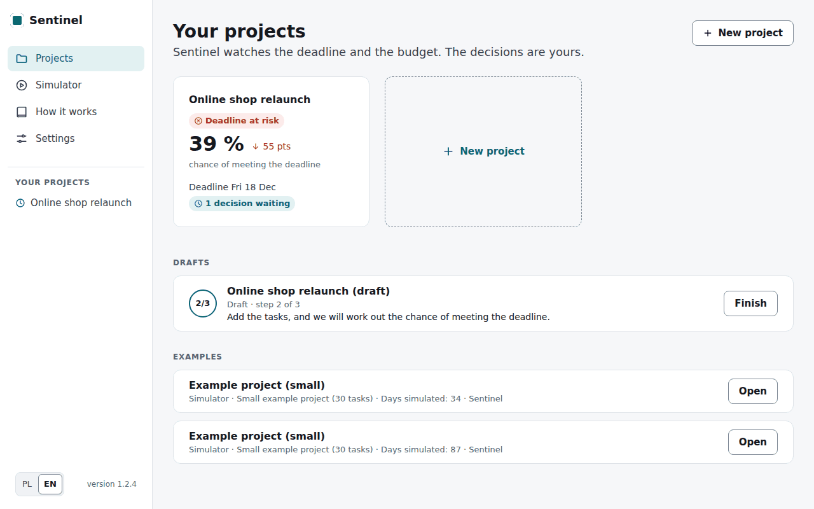

*The start page: your projects with their chance of meeting the deadline and the decisions
waiting for you.*

## 2. Your first project

Click **New project** (**Create a project** for your first). The wizard has three steps and hides
the menu meanwhile; the team and the tasks are saved as you go, so you can stop with **Save and
exit** and come back with **Finish** under *Drafts* on the start page.

### Step 1: Basics

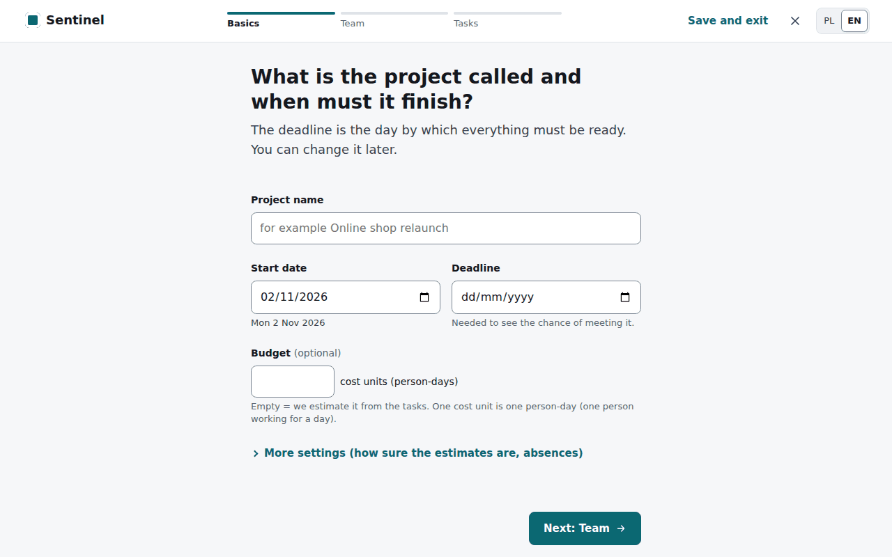

- **Project name**, **Start date** and **Deadline**, the last day by which all work should be
  done. Without a deadline Sentinel shows the forecast dates, but no chance and no
  recommendations.
- **Budget (optional)** in cost units: by default one cost unit is one person-day (one person
  working for a day). Leave it empty and Sentinel estimates it from the tasks (with a 10 %
  reserve).
- Under **More settings** (usually fine as they are):
  - **How sure are the time estimates?** *Quite sure*, *Usual* or *Rough*: the less sure, the more
    the task durations vary in the futures.
  - **How turbulent is the team?** *Calm*, *Usual* or *Turbulent*: how often absences and
    surprises happen.

Below the dates you see at once whether the deadline is after the start, and by how many weeks.

### Step 2: Team

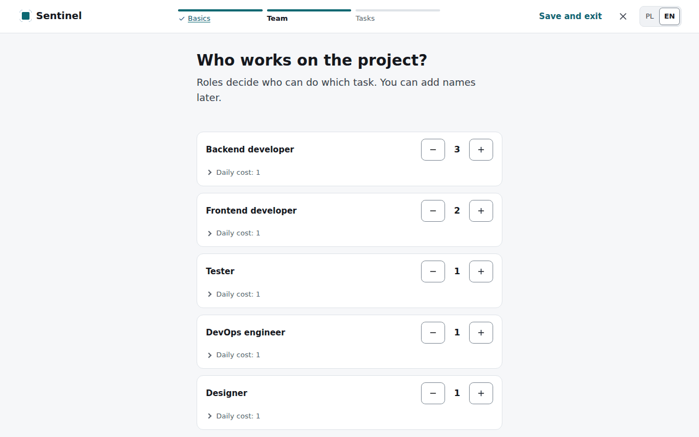

Add roles with their number of people (**Add a role**, then **−** and **+** beside the role). Names
can come later: without them Sentinel calls people after their role, e.g. "Tester 1". Have a list?
Click **Paste a list of people** and paste, e.g. from a spreadsheet, one person per line:
`Ada Turner, Backend developer`. Correct names and roles under **Names of people**. Roles are free
text; case, spacing and a final plural *s* do not matter ("Tester" and "testers" are the same role).
The order matters: when work is assigned, Sentinel picks the people higher up the list first.

### Step 3: Tasks

You can enter the tasks in three ways (three cards at the top):

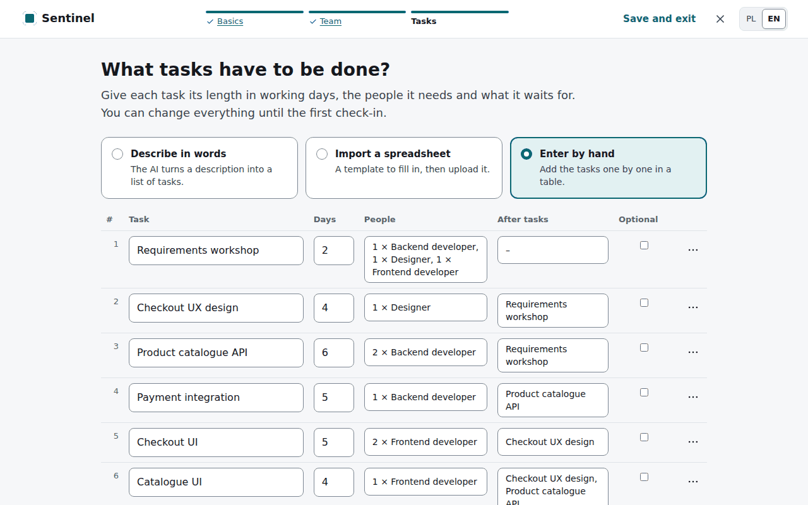

1. **Describe in words**: write in your own words what has to be done, by whom and for how
   long; the AI reads the tasks and the team, and you check them before using them (needs an
   AI to be set up). The AI uses the role names of step 2: a role nobody in the team has is named
   above the list and marked *(nobody in the team)* in the table, and the plan waits until you
   change those people or add the role to the team. A local model may need a minute or two; the
   page updates by itself.
2. **Import a spreadsheet**: download the **tasks template (CSV)**, fill it in with Excel,
   LibreOffice or Google Sheets and upload it. One row is one task:

   | id | name | duration_days | predecessors | optional | crew:Backend developer | crew:Tester |
   | --- | --- | --- | --- | --- | --- | --- |
   | T1 | Design the payment API | 3 | | no | 1 | 0 |
   | T2 | Build the payment API | 5 | T1 | no | 2 | 0 |
   | T3 | Test the payment API | 2 | T2 | no | 0 | 1 |

   `duration_days` are working days, `predecessors` the ids of the tasks that must finish first
   (several separated by spaces or commas), `optional` = `yes` for a task that may be dropped,
   and the `crew:` columns say how many people of a role are needed (role names as in step 2).
   Problems are listed with their row numbers; save the file as CSV (UTF-8).
3. **Enter by hand**: a table of name, working days, **People** (click to give the number per
   role), **After tasks** (click and tick tasks by name), and whether it is optional; removing is
   in the **⋯** menu at the end of a row. Problems (a loop of dependencies, too few people in a
   role, a deadline before the shortest possible duration) are listed at once, in plain words.

Below the table is a summary to check, with **Change** links. Click **Create the plan and calculate
the chance**. Sentinel lays out a plan that finishes early for your team and opens the project's
overview.

## 3. Reading the overview

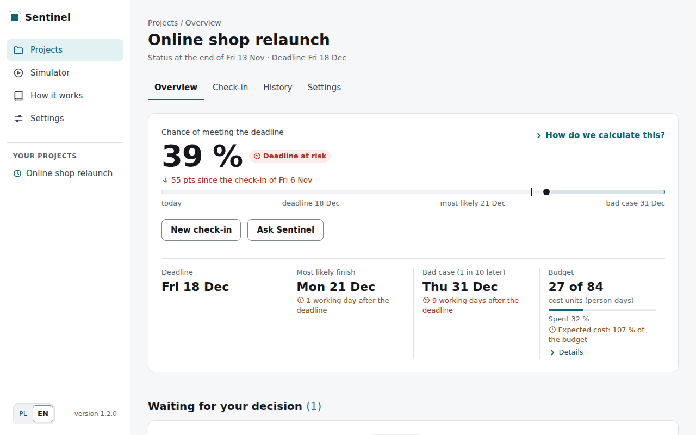

- **Chance of meeting the deadline** with a rating: *On track* (80 % or more), *Needs attention*
  (50–79 %), *Deadline at risk* (below 50 %). The arrow below shows the change since the previous
  check-in, and the strip shows today, the most likely finish, the deadline and the bad case on
  one line. **How do we calculate this?** explains the number.
- **Deadline**, **Most likely finish** (half of the futures end earlier, half later) and **Bad
  case (1 in 10 later)**, each with its distance from the deadline in working days.
- **Budget**, e.g. "27 of 84 cost units (person-days)", how much is spent and the expected cost as a
  share of the budget. Under **Details**: the expected total cost and the chance of staying within
  the budget. A cost unit is a person-day by default; if you enter daily rates in the project
  settings (e.g. in euros), costs are in your unit.
- **Waiting for your decision**: recommendations that need your approval (section 5), with **Review
  and decide**. That is then the only highlighted button on the page; with nothing waiting, **New
  check-in** is.

Further down:

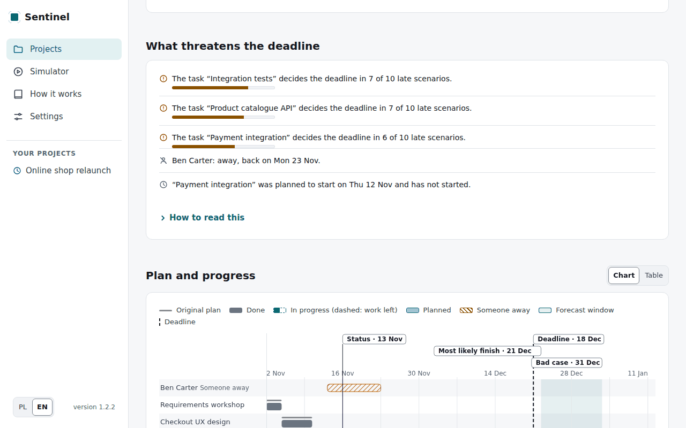

- **What threatens the deadline**: for every unfinished task, Sentinel compares across 1,000
  futures, the first 200 being those behind the chance, how long the task takes, growth included,
  with the project's finish date (a rank correlation). Listed are the tasks with a value of at least
  0.2, at most three, the strongest first, e.g. "Task “Product catalogue API”. The longer this task
  takes, the later the project usually finishes". The bar shows the strength. This list is
  calculated in the background after a check-in, so it can appear a moment after the chance, which
  does not wait for it, and neither does a recommendation. A task that varies little, such as a short
  go-live, is rarely listed, even if it sets the finish date in most futures. If no task qualifies,
  Sentinel says that the risk is spread across the plan. A value close to 0.2 remains uncertain, so
  such a task can leave the list at the next check-in though nothing changed in the project; a task
  far above the line, such as one that has just grown a lot, is the stronger signal. Below the list:
  who is away and which tasks have not started as planned.
- **What moved the chance** (since 1.4.0): when a check-in moved the chance by 5 points or more, up
  to three causes appear under it, e.g. "Without the absence of Tom Lee the chance would be 41 %"
  or "Had the work progressed as planned since 20 Nov, the chance would be 44 %". Each is the chance
  of the same check-in without that one event, on the same futures, so the effects do not add up
  exactly.
- **Plan and progress**: the original plan (a thin grey line), done (grey), in progress (dark teal,
  with a dashed outline of the work left), planned (light teal) and absences (hatched), with the
  status at the check-in's date, today, the deadline and the forecast window. The planned dates are
  the current plan without disruptions, from the latest check-in with every dependency kept. Its
  end is usually before the forecast window, which counts on the usual overruns and absences, and a
  line under the chart says so. The same plan goes into the CSV export and the HTML report. Hover over or tap a task's name for its dates
  and people. **Chart | Table** shows the same as a table; on a phone the chart scrolls sideways and
  the names stay in place.

**Recalculate now** starts a new analysis at any time (e.g. after you changed the deadline in the
settings).

**Calendar.** Working days are Monday to Friday without the Polish public holidays (24–26 December,
Easter Monday, Corpus Christi and the others) and without the company days off you list in the
project settings. After the first check-in the calendar stays as it is.

**Corrections after the start.** After the first check-in the team and the started or finished
tasks stay as they are. For a task not started yet you can correct the estimate, the people, its
dependencies and whether it is optional: **Project settings → Correct the tasks not started yet**.
Each correction goes into the history and the forecast is worked out again.

## 4. Check-ins

A check-in tells Sentinel what happened. Once a week is enough (e.g. on Friday), and at once
when something important changes. Click **New check-in**.

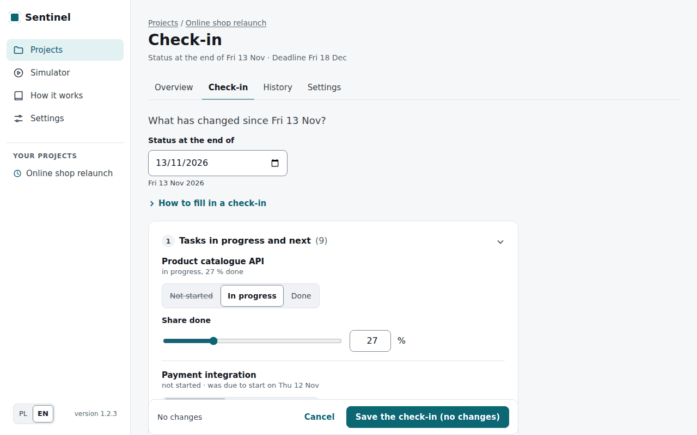

1. **Status at the end of**: the day the check-in describes (usually today), echoed in words below
   the field. A date more than a week from today needs a confirmation: check-ins follow each other,
   so a mistyped year would block the next ones. A date before the project's start gets a note, but
   the check-in can be saved.
2. With the AI on: **Write in your own words** the whole report, e.g. "The client workshop
   finished yesterday. The API is halfway. Ada is away from tomorrow until Wednesday.", and click
   **Process the message**. The AI understands progress ("about 15 % done", "halfway"), a finish
   with its date ("finished yesterday"), a start ("started on Monday"), absences, growing tasks
   and new tasks. The app, not the AI, works out the dates on the project's calendar with its
   holidays: "from tomorrow" is the next working day, "until Wednesday" means away through
   Wednesday and back on the next working day, "back on Wednesday" means back that day. An
   absence announced for later (a holiday in two weeks) counts in the forecast at once, from its
   first day. Task
   names may be inflected or in lower case. Under **This is how I read it:** you see the items to
   confirm, e.g. "Bartosz Kowalski: away from Thu 5 Nov, back on Mon 16 Nov (6 working days)";
   the ticked tasks fill their rows of the form at once, where you can change them. When a
   weekday does not match its date ("Monday 3 November", a Tuesday), a date falls on a day off,
   or "from Monday" can mean two Mondays, the page asks instead of guessing; it also asks when a
   person is not in the team or several tasks fit. Pick the answer or **Skip it**. It also shows
   the parts of the message it turned into nothing ("Not turned into a change"). An absence of
   somebody the message does not name, and a date nothing in the message confirms, are left
   unticked with a note. Only the ticked items are saved; a reason for an absence written in the
   message is left out and never stored. If the AI cannot answer, the page says why (e.g. no
   connection or no answer in time) and you fill in the form by hand.
   - **Record by voice** (with a Groq key on Settings): click, speak (at most 90 seconds; a
     counter shows the time), click **Stop**. The text appears in the box shortly after: read it,
     correct it, and only then click **Process the message**; nothing is processed before that.
     The recording goes to Groq (USA), which writes it out; Sentinel keeps neither the recording
     nor its text. The browser asks for the microphone; recording works on an https page or on
     the same computer (localhost). The description of a project can be recorded the same way
     under **Describe in words**.
3. **Tasks in progress and next**: for each, *Not started*, *In progress* with the share done
   (a slider or a number, in per cent) or *Done* with its finish date. Progress is kept in whole
   days of work, so the slider says what is saved, e.g. "60 % → saved as 67 %, 2 of 3 days". The
   finish date follows the check-in's date until you change it. Optionally, when the task
   started and who works on it (by default Sentinel assumes the plan and free people). Tasks you say
   nothing about stay as they are.
4. **Absences** (**Add**): the person, from when and (if known) when they are back. **Only when, never
   why**: there is no place for the reason of an absence.
5. **Tasks that grew** (**Add**): how many more working days a task in progress needs, including
   one you mark as *In progress* in this check-in. For a task not started yet it is a new, larger
   estimate. The default budget stays as it was.
6. **New task** (**Add**): its name, working days, what it comes after and what it must be done
   before.

The bar at the bottom counts the changes. Click **Save the check-in** (with no change the button says
**Save the check-in (no changes)**, which is a useful report too). After a few seconds the overview
shows the new chance and, if a change is needed, a recommendation. A check-in with no progress on
any task in progress asks first: "Has nothing moved on since <date>?". Answer **Yes, no progress**
or **Add the progress**. If you leave an unfinished
check-in (a tab, the menu, the language), the browser asks first.

> **Tip:** when a substitute takes over a task, part of their time goes into getting up to
> speed. Sentinel counts that time cautiously while the task runs, so the estimate of the work
> left improves when you mark the task as *Done*.

## 5. Recommendations and autonomy

After every check-in Sentinel tries the possible changes and picks the best: first the chance of
meeting the deadline, then the expected delay, the budget and how little the plan changes. A
recommendation shows:

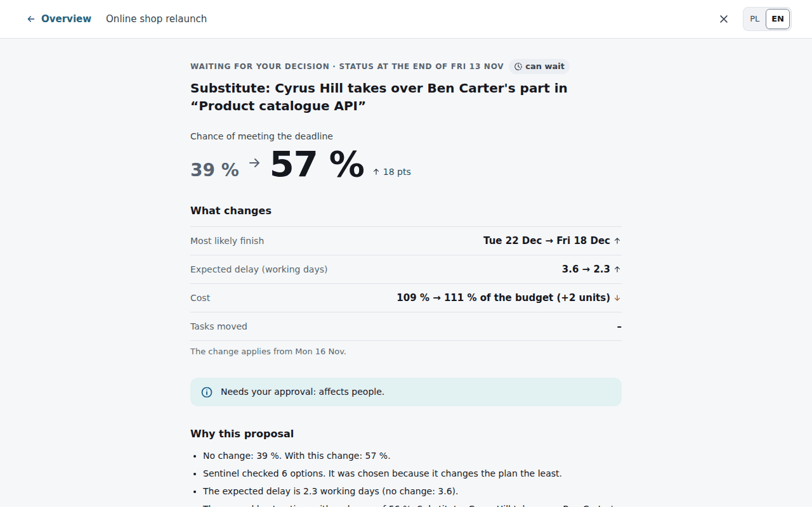

- the **action** in plain words, e.g. "Substitute: Cyrus Hill takes over Ben Carter's part in
  “Product catalogue API”"; above it the day whose status it reads (*status at the end of*, from the
  check-in), and under **What changes** the first day the change applies to,
- its **effect** compared with no change: the chance ("39 % → 57 %") and, under **What changes**, the
  most likely finish, the expected delay, the cost ("109 % → 111 % of the budget (+2 units)") and how
  many tasks have their dates moved. Since 1.4.0 every option is worked out as approving it applies
  it, at once and on the same futures. After an approval the overview therefore shows exactly the
  promised chance, dates and cost. If something changed after the recommendation (e.g. the
  deadline), the overview says so in one sentence. When the chance does not move, the card says
  what improves, e.g. the expected delay,
- **whether it needs your approval** (*affects people*, *costs money*, *changes scope* or *changes
  the plan more than your setting allows*) and **why this proposal**,
- under **Compare all the options**: a table with the recommended one first and "No change" last as
  the reference point. Each is tried on the same 200 futures as the forecast on the overview, so "No
  change" has exactly the overview's chance. An option worse than "no change" is labelled so:

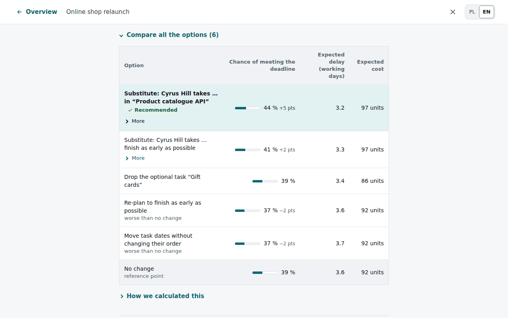

The decision and both explanations rest on these same figures. When chances are similar, the
next criterion decides, e.g. how many dates change. If another option in the table then shows a
higher chance (in whole per cent) than the recommended one, the page explains it in one sentence,
e.g. "Similar chance (the difference is within the uncertainty); the option that changes fewer
dates was chosen".

With the AI on, **Explain in other words (AI)** asks the model to retell the recommendation in
its own words, in the page's language and in plain words. A text with an internal term is asked for
once more, and if it still has one, the page shows the explanation above alone. The text is
checked against the same figures and marked *checked
against the data* or *not confirmed by the data*; it never changes the decision. If the model
gave no usable explanation, the button lets you ask again.

A recommendation opens on its own page without the menu: the page is the review before the decision.
You decide at the bottom: the approve button names the change (e.g. **Approve the substitute**),
**Reject** asks once more, and **Decide later** keeps the proposal under "Waiting for your
decision" until the next check-in, which works everything out again. An
approved change goes into the plan at once (e.g. the substitute joins the task, a temporary person is
hired for the stated number of days). **Can wait** means there are still a few days before the risk
becomes real. "No change — the plan is still the best" means no change checked helps clearly more
than the current plan. The overview says whether no change is needed or Sentinel checked N options
and none helps enough (with a link to the comparison). After a change of the autonomy the message
says what Sentinel will do alone from the next analysis and what it will ask about, and the history
records the old and the new level.

**Autonomy.** In the project's **Settings** you choose **what Sentinel may do on its own**:

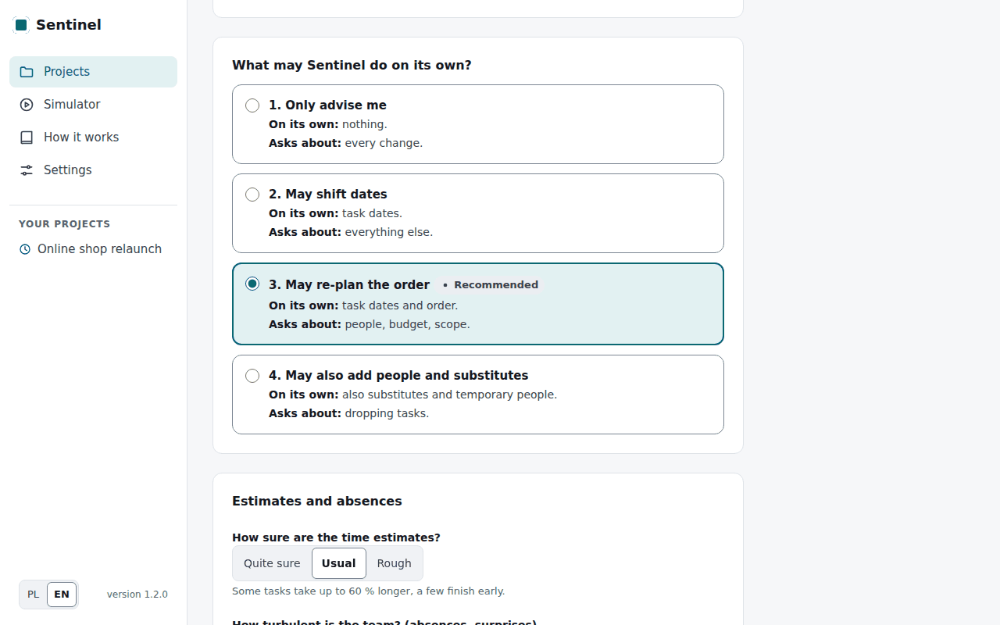

| Setting | On its own | Asks about |
| --- | --- | --- |
| Only advise me | nothing | every change |
| May shift dates | moving dates without changing the order | the rest |
| May re-plan the order (recommended) | also a new order of tasks | people, budget, scope |
| May also add people and substitutes | also substitutes and temporary people | dropping a task |

A change applied automatically is shown on the overview; new dates or a new order have an
**Undo** button while nothing has happened after them. If the project's settings changed after you
opened the page (say, in another tab), the page asks before you replace them.

**History.** The **History** tab shows the chart **Chance over time** (one point per check-in) and a
timeline of every check-in, recommendation, decision and change, with the change of the chance and a
filter at the top. When Sentinel proposes no change after a check-in, a line in that check-in says so
instead of an entry of its own.

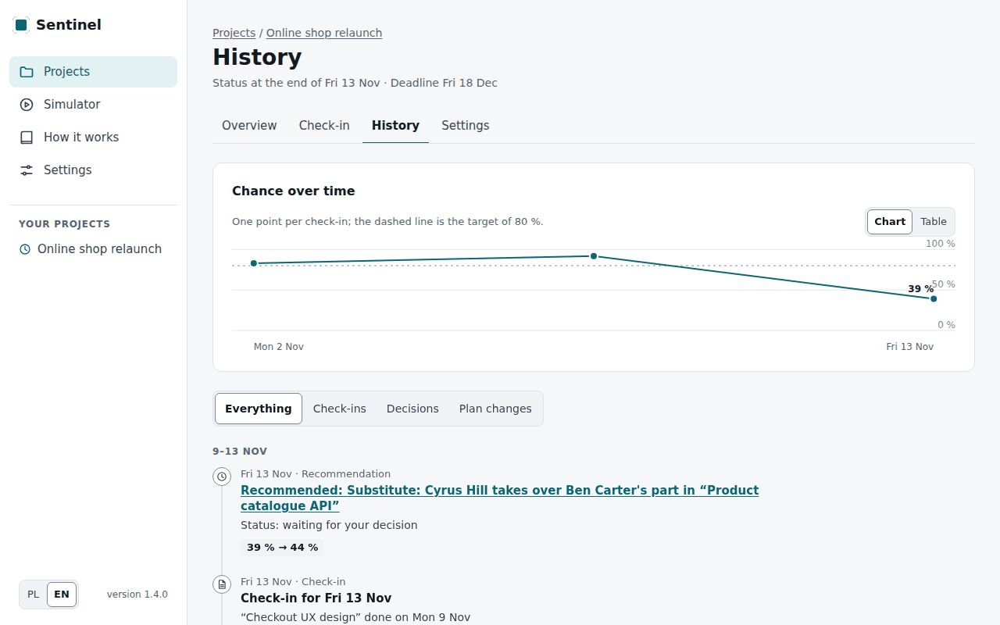

## 6. The simulator

The simulator shows Sentinel at work without a real project: choose an example project (small:
30 tasks, medium: 60 tasks), how turbulent the team is and who manages the project,
**Sentinel** or **Nobody reacts**. Click **Start the simulation**, then move on by **+1 day**, **+5
days**, **+10 days** or **To the end** (that run can be stopped with **Cancel**, and you can leave the
page while it goes on).

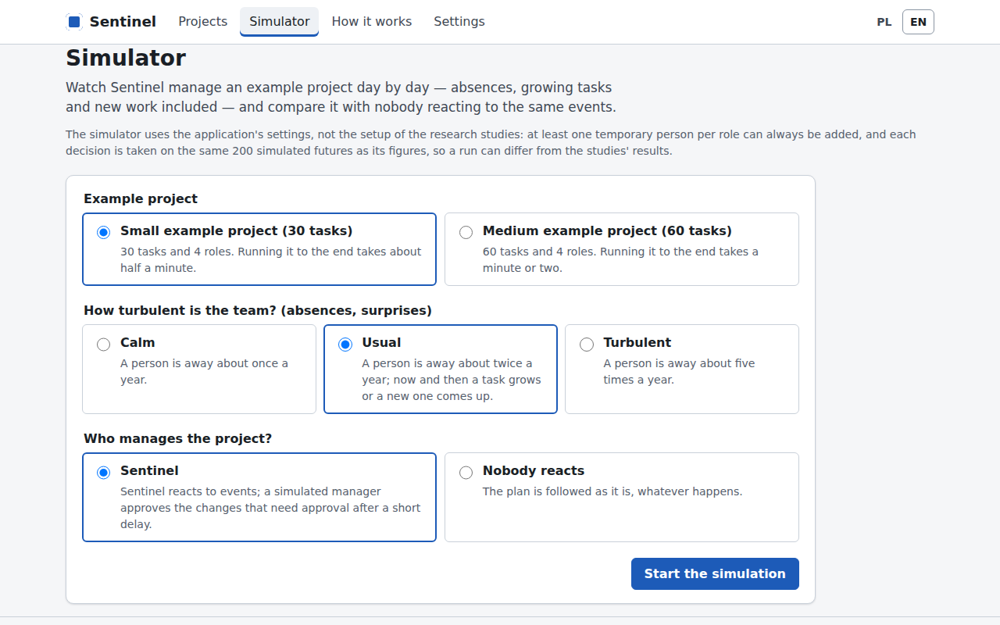

At the end, **How it ended** says in one sentence how Sentinel did, and a table compares the same
project with the same events (absences, growing tasks, new tasks) run by Sentinel and with nobody
reacting: the finish date, the delay, the cost, plan changes, temporary people and substitutions,
with a **Difference** column. Beside the chart, **What happened** shows what happened and what
Sentinel did.

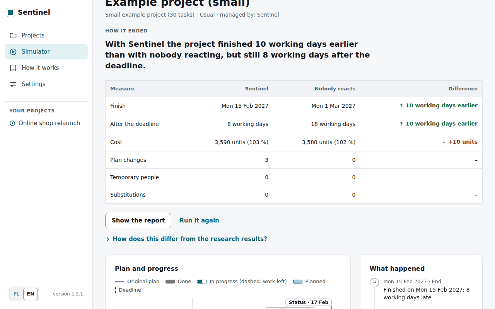

The simulator uses the application's settings (e.g. at least one temporary person per role can
always be added), not the setup of the research studies, so its results can differ from
theirs. One run is one possible fate of the project; chance plays a part, so try a few.

## 7. Privacy

- Sentinel stores only people's **availability** (from when until when someone is away), **never
  the reason** for an absence: there is no field for it (GDPR, Art. 9).
- The project's data stay on the server where Sentinel runs (your computer or the company's
  server). Without AI, nothing leaves it.
- AI is optional. A **local model (Ollama)** runs on your own hardware and sends nothing out;
  cloud models (Groq, OpenRouter) receive only the text they read. AI answers on real projects
  are remembered without the messages (only the words of dates and the names of tasks stay).
- **Voice recordings** go to Groq (USA), as a typed message goes to a cloud model; Sentinel keeps
  neither the recording nor its text (only the report with the items you confirm is saved). In
  the public demo the request log notes only that a recording was written out, and its length.
- The public demo: every visitor gets an own sandbox that nobody else sees; it is deleted with
  its projects after 24 hours. For the usability test the demo also notes in the sandbox which
  pages were opened and when, and whether a form was refused (never an address or what a form
  held); the note goes with the sandbox.

## 8. The new look (v2)

At `/v2` a new look runs on the same data (the link "Nowy wygląd (v2)" on the start page;
"Previous look" in the menu goes back). A project opened in one look is seen in the other.
Colours show the state, always with an icon and a word; the chance is given as "39 in 100" with
a 10 × 10 dot grid.

- **Start** — every decision to make, sorted by its validity date, the project tiles and the
  recent events.
- A project's **Overview** — the verdict ("Late without changes · about 2 working days late"),
  the chance of the deadline, the project end and the budget in work-days, and below them the
  decision to make.
- **Report** — describe or dictate what happened (🎤) and Sentinel turns it into cards to
  confirm; "Progress as planned" and "Fill in the form" are the other ways. "Effect on the
  project" shows the result before anything is saved.
- **Decision** — the effect, the reasoning, who is affected and the cost of delay; "Approve",
  "Reject" (with a reason), "Adjust" or "Postpone". **You approve every change**: in the new look
  Sentinel changes nothing by itself.
- **Log** — who (you or Sentinel) did what, day by day, with filters; expand an entry (▸) to see
  the decision as it was and its fate; the "Chance over time" chart and "Download the log
  (CSV)".
- **Plan** — "Schedule" (a Gantt chart with today, the deadline and the forecast's band; tasks
  of the main risks in amber, absences hatched), "Tasks" (a task not started yet is corrected
  with "Adjust") and "Team" (absences, current and next tasks, next week's workload — **never a
  rating of anyone's work**).
- **Lab** — "What if?" tries an absence, a longer task or a new task on a chosen project and
  saves nothing; "Add to report" carries these changes to a report. "Simulator" runs an example
  project day by day: Sentinel beside the same project with no reaction, "+1 day", "+5 days" or
  "To the end", and one sentence with the result at the end.
- **On a phone or a tablet** the new look fits the screen: the menu is on top, cards one
  under another, tables and tabs scroll sideways. On a large monitor the view grows.
- **Settings** — appearance (light, dark, system), language and the AI model ("Cloud
  (recommended)" or "Local"; keys only in your own installation). **Project settings** — the
  basics, the team, company days off, the **calendar**, the report reminder (Thursday 17:00 by
  default), exports and "Delete project".
- **Calendar** — "Create the calendar link" gives a secret link to add in Google Calendar
  ("Other calendars" → "+" → "From URL") or iCloud (File → New Calendar Subscription). The
  calendar shows the deadline, task starts and ends, absences (dates only, never a reason),
  decision validity dates and the report reminder. **Whoever has the link sees people's names and
  the dates of their absences** — "Revoke the link" switches it off at once.

### Version 3: AI rules, Reports and Finance (from 2.0.0)

The menu has three groups: **Work** (Start, Projects, Reports, Finance), **AI rules** (Boundary
map, AI permissions, People, Sources) and **Other**. Every feature that rests on a design
decision has a point **ⓘ N**: it opens the "Evidence" panel with that decision and the studies
for and against it (a quote is shown only when code found it in its source).

- **Reports** — "New report": paste or dictate the text (🎤), choose the audiences ("Editing
  only", "Board", "Finance", "Team") and click "Edit". AI writes a version for each audience.
  **Code computes the changes, not AI**: deleted words are red and struck through, added ones
  green and underlined; you accept (✓) or reject (✕) each change, or all at once. Beside it the
  **"Fact guard"** checks numbers, percentages, amounts, dates (also "tomorrow", "by 16
  November"), people, tasks and projects: ✓ "unchanged", ⚠ "changed" (with both values),
  "omitted", and "New in this version" lists facts your text did not have. When a version has a
  ⚠ or a new fact, "Save" and the export ask you to confirm. Export: Markdown, a page for
  printing, the clipboard. **A report stays in Sentinel only when you click "Save"**; until
  then the draft lives in the server's memory only. The text goes to the AI provider chosen in
  Settings. Numbers written in words are not checked.
- **Finance** — the portfolio in work-days: budget, spent, forecast at the end, deviation and
  state ("Within budget", "At risk", "Over budget without changes", "Over budget"), all
  computed by code. "Summary for the board (AI)" is written from a fact sheet that code computed
  and checked by the fact guard; it is never stored. **"Move budget"** creates a request ("AI has
  no right to approve"); only when you click "Approve the request" and confirm do both budgets
  change, and Dziennik records it. A request that cannot be applied (e.g. the source has spent
  more than it would keep) is recorded as "approved, not applied" with the reason.
- **Boundary map** — twelve company processes in three zones ("AI alone", "AI with a person",
  "person only") by six criteria. After the survey is imported (`docs/research/survey.md`) a
  switch "Our map" / "What people answered (N = …)" shows the answers and the agreement with our
  map (an opinion poll, a convenience sample).
- **AI permissions**, **People**, **Sources** — what AI may and may not do (with an attack
  test), what Sentinel deliberately lacks (e.g. performance scores) and every source with
  filters.

## 9. Frequently asked questions

**How does Sentinel know how long tasks take?** From your estimates and how sure they are
(step 1). In each future a task takes a little less or more, as in real life.

**Why did the chance change although I reported nothing?** It does not change without a
check-in or a change of the settings: the same data always give the same numbers. If time has
passed and tasks have not started, report that in a check-in.

**Do I have to approve recommendations?** No. You can reject them or leave them for later.
Sentinel changes nothing about people, money or scope without your approval.

**What is a person-day?** One person working for one day. It is the default cost unit; a
temporary person costs one and a half person-days a day. Set your own rates in the project
settings (**Cost of a working day**).

**Can I change the team or the tasks after the first check-in?** Names, the deadline, the budget
and the settings, always. After the first check-in the plan's structure changes through
check-ins (new tasks, longer tasks, absences) and approved recommendations.

**How do I get my data out?** In the project settings: the plan as CSV, the whole project as
JSON and a report for the team: one page with the forecast, the plan and the history, to print or
send.

**Can the AI change anything by itself?** No. The AI only reads text (which you check anyway)
and explains a decision; the explanation is marked with whether it agrees with the data.

## 10. Installation for IT

Details, backups and the public demo: [deploy.md](deploy.md).

**Important:** the application has no user accounts: everybody who can open its address sees
every project. Serve it only inside the company network (VPN) or behind a proxy that signs
people in.

**Company server (Docker):**

```bash
git clone https://github.com/Embedded-Embodied-Intelligence/sentinel.git && cd sentinel
docker compose up -d --build          # the app on the server's http://127.0.0.1:8000
docker compose ps                     # after about 30 s: (healthy)
```

The data (projects, settings, the AI key) are in the `sentinel-data` volume; to upgrade:
`git pull && docker compose up -d --build`. The simulator's example projects (once):
`docker compose run --rm sentinel python /app/scripts/fetch_psplib.py --sets j30 j60 --root /data/psplib`.

**Laptop (without Docker):** install [uv](https://docs.astral.sh/uv/), then `uv sync` and
`uv run sentinel ui` → http://127.0.0.1:8000.

**AI: options and costs** (chosen on the app's **Settings** page; the key stays on the server
and is never shown again):

| Option | Cost | Do data leave the company? |
| --- | --- | --- |
| No AI | free | no; everything but reading text and AI explanations works |
| Local model (Ollama) | free; a graphics card with 6 GB or more (or slower on the processor) | no; `docker compose --profile ollama up -d` and `docker compose --profile ollama exec ollama ollama pull qwen2.5:7b` |
| Groq (cloud) | a free plan with daily limits | yes, to Groq (US); a key from console.groq.com |
| OpenRouter (cloud) | pay per use (prices on openrouter.ai) | yes, to OpenRouter and the model's host |
| Voice recordings (Groq Whisper) | Groq's free tier with limits; beyond it about 0.04 USD an hour of recordings | yes, the recording to Groq (USA); a Groq key on Settings (**Groq key for recordings**, unless Groq is the AI provider); **Test recordings** checks it |

The cloud model (gpt-oss-120b, the default with Groq and OpenRouter) reads messages and writes
explanations more accurately than the local one. For messages about real people's absences, use
the local model or a provider that does not retain data.
