# Sentinel — przewodnik dla kierownika projektu

Sentinel pilnuje terminu i budżetu Twojego projektu. Po każdym raporcie statusu sprawdza,
czy termin jest zagrożony, i jeśli tak, proponuje konkretną zmianę: zastępstwo, osobę
tymczasową, przesunięcie terminów albo nową kolejność zadań. Zanim cokolwiek zaproponuje,
sprawdza każdą możliwość na setkach symulowanych scenariuszy przyszłości projektu. Zmiany,
które dotyczą ludzi, pieniędzy albo zakresu, zawsze czekają na Twoją decyzję.

Przewodnik jest dla osoby, która prowadzi projekt. Instalacja dla działu IT jest na
[końcu](#10-instalacja-dla-działu-it). Wersja angielska: [user-guide-en.md](user-guide-en.md).

**Spis treści:**
[1. Czym jest Sentinel](#1-czym-jest-sentinel) ·
[2. Pierwszy projekt](#2-pierwszy-projekt) ·
[3. Jak czytać przegląd](#3-jak-czytać-przegląd) ·
[4. Raport statusu](#4-raport-statusu) ·
[5. Rekomendacje i autonomia](#5-rekomendacje-i-autonomia) ·
[6. Symulator](#6-symulator) ·
[7. Prywatność](#7-prywatność) ·
[8. Nowy wygląd (v2)](#8-nowy-wygląd-v2) ·
[9. Najczęstsze pytania](#9-najczęstsze-pytania) ·
[10. Instalacja dla działu IT](#10-instalacja-dla-działu-it)

## 1. Czym jest Sentinel

Projekt rzadko idzie zgodnie z planem: ktoś choruje, zadanie okazuje się większe, pojawia się
nowa praca. Sentinel bierze Twój plan i to, co zgłaszasz w raportach statusu, i odgrywa
**200 możliwych przyszłości projektu** — z nieobecnościami i niespodziankami w takim tempie,
jakie wybierzesz przy zakładaniu projektu. Z tych scenariuszy wynika:

- **szansa na dotrzymanie terminu** (np. „39 %”: w 78 z 200 scenariuszy projekt kończy się w
  terminie),
- **najbardziej prawdopodobna data zakończenia** i **zły scenariusz** (jeden na dziesięć kończy
  się jeszcze później),
- **co zagraża terminowi** — zadania, których czas trwania najwyraźniej idzie w parze z datą
  zakończenia, najwyżej trzy, sprawdzone na 1000 scenariuszach, z których pierwsze 200 to właśnie te,
- **rekomendacja**: najlepsza zmiana, sprawdzona na tych samych scenariuszach co prognoza.

Sentinel nie zgaduje i nie „czuje”: każda liczba na ekranie pochodzi z tych samych symulacji,
więc „bez zmian” na rekomendacji to dokładnie szansa z przeglądu. Sztuczna inteligencja (AI)
jest opcjonalna: może odczytać opis projektu albo wiadomość od zespołu i objaśnić decyzję
własnymi słowami, ale nigdy nie podejmuje decyzji.

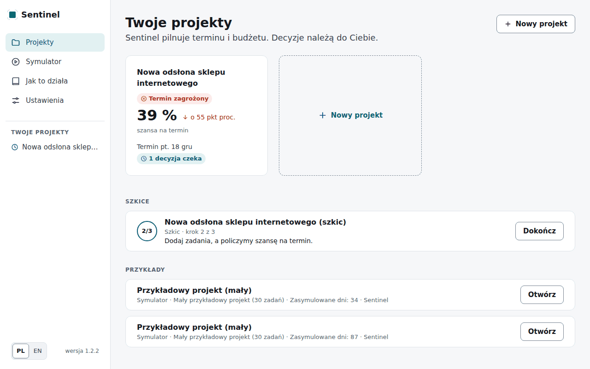

*Strona startowa: Twoje projekty z szansą na dotrzymanie terminu i decyzjami, które na Ciebie
czekają (one są pierwsze), niżej szkice i przykłady. Menu po lewej zawsze pokazuje też Twoje
projekty ze stanem; na telefonie otwierasz je przyciskiem **Menu**.*

## 2. Pierwszy projekt

Kliknij **Nowy projekt** (przy pierwszym projekcie **Utwórz projekt**). Kreator ma trzy kroki i
na ten czas chowa menu; zespół i zadania zapisują się na bieżąco, więc możesz przerwać
przyciskiem **Zapisz i wyjdź** i wrócić przyciskiem **Dokończ** w sekcji *Szkice* na stronie
startowej.

### Krok 1: Podstawy

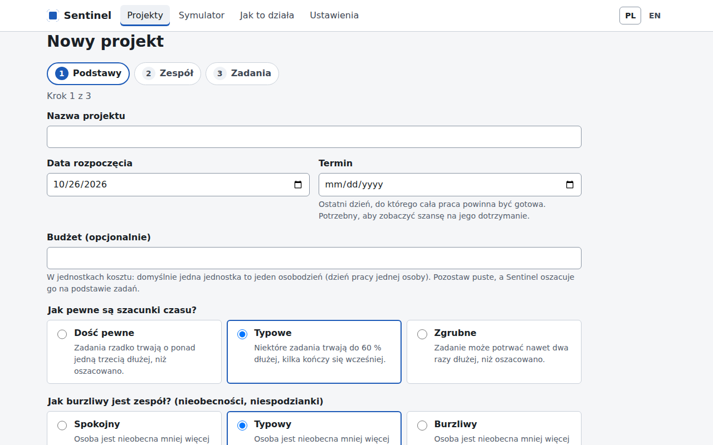

- **Nazwa projektu**, **Data rozpoczęcia** i **Termin** — ostatni dzień, do którego cała praca
  ma być gotowa. Bez terminu Sentinel pokaże prognozę dat, ale nie szansę ani rekomendacje.
- **Budżet (opcjonalnie)** w jednostkach kosztu: domyślnie jedna jednostka to jeden
  osobodzień (dzień pracy jednej osoby). Pozostaw puste, a Sentinel oszacuje budżet z zadań
  (z zapasem 10 %).
- Pod **Więcej ustawień** (zwykle nie trzeba ich zmieniać):
  - **Jak pewne są szacunki czasu?** *Dość pewne*, *Typowe* albo *Zgrubne* — im mniej pewne, tym
    szerzej rozrzucone są czasy zadań w scenariuszach.
  - **Jak burzliwy jest zespół?** *Spokojny*, *Typowy* albo *Burzliwy* — jak często zdarzają się
    nieobecności i niespodzianki.

Pod datami od razu widać, czy termin wypada po starcie i ile to tygodni.

### Krok 2: Zespół

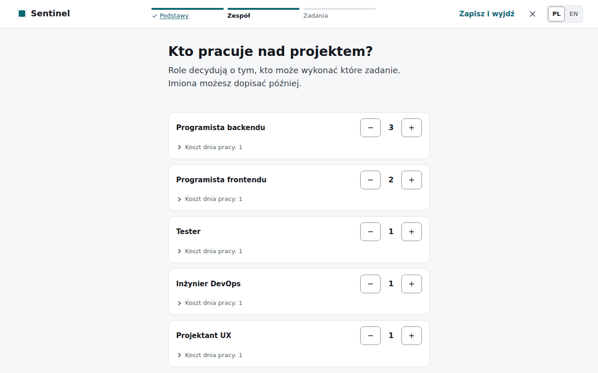

Dodaj role z liczbą osób (**Dodaj rolę**, a potem przyciski **−** i **+** przy roli). Imiona można
dopisać później: bez nich Sentinel nazwie osoby od roli, np. „Tester 1”. Masz listę osób? Kliknij
**Wklej listę osób** i wklej np. z arkusza po jednej osobie w wierszu:
`Anna Nowak, Programista backendu`. Imiona i role poprawisz pod **Imiona i nazwiska**. Role to
dowolny tekst; wielkość liter i odstępy nie mają znaczenia („Tester” i „tester” to ta sama rola).
Kolejność ma znaczenie: przy przydzielaniu pracy Sentinel wybiera najpierw osoby z góry listy.

### Krok 3: Zadania

Zadania możesz wprowadzić na trzy sposoby (trzy karty u góry):

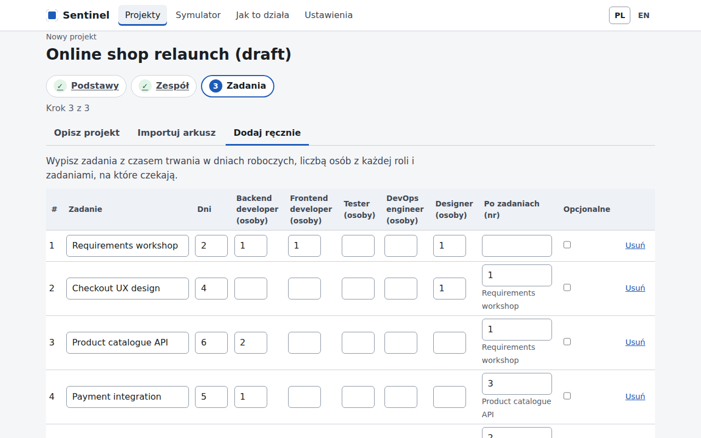

1. **Opisz słowami** — napisz własnymi słowami, co trzeba zrobić, kto i jak długo; AI
   odczyta zadania i zespół, a Ty je sprawdzisz przed użyciem (wymaga skonfigurowanego AI).
   AI używa nazw ról z kroku 2: rola, której nikt w zespole nie ma, jest wymieniona nad listą i
   oznaczona w tabeli *(nikt w zespole)*, a plan powstanie dopiero, gdy zmienisz te osoby albo
   dodasz rolę do zespołu. Model lokalny może potrzebować minuty lub dwóch; strona odświeży się
   sama.
2. **Zaimportuj arkusz** — pobierz **szablon zadań (CSV)**, wypełnij go w Excelu, LibreOffice albo
   Arkuszach Google i wgraj. Jeden wiersz to jedno zadanie:

   | id | name | duration_days | predecessors | optional | crew:Programista backendu | crew:Tester |
   | --- | --- | --- | --- | --- | --- | --- |
   | T1 | Projekt API płatności | 3 | | no | 1 | 0 |
   | T2 | Budowa API płatności | 5 | T1 | no | 2 | 0 |
   | T3 | Testy API płatności | 2 | T2 | no | 0 | 1 |

   `duration_days` to dni robocze, `predecessors` to identyfikatory zadań, które muszą się
   skończyć wcześniej (kilka oddziel spacją lub przecinkiem), `optional` = `tak` (albo `yes`)
   dla zadania, z którego można zrezygnować, a kolumny `crew:` mówią, ile osób z danej roli potrzeba (nazwy ról jak w kroku
   2). Błędy są wypisane z numerami wierszy; zapisz plik jako CSV (UTF-8).
3. **Wpisz ręcznie** — tabela: nazwa, dni robocze, **Osoby** (kliknij, aby podać liczbę osób z
   każdej roli), **Po zadaniach** (kliknij i zaznacz zadania po nazwach), czy opcjonalne; usuwanie
   jest w menu **⋯** na końcu wiersza. Problemy (np. pętla zależności, za mało osób w roli, termin
   wcześniejszy niż najkrótszy możliwy czas) są wypisane od razu, zwykłym językiem.

Pod tabelą jest podsumowanie do sprawdzenia, z linkami **Zmień**. Kliknij **Utwórz plan i policz
szansę**. Sentinel układa plan, który przy Twoim zespole kończy się możliwie wcześnie, i otwiera
przegląd projektu.

## 3. Jak czytać przegląd

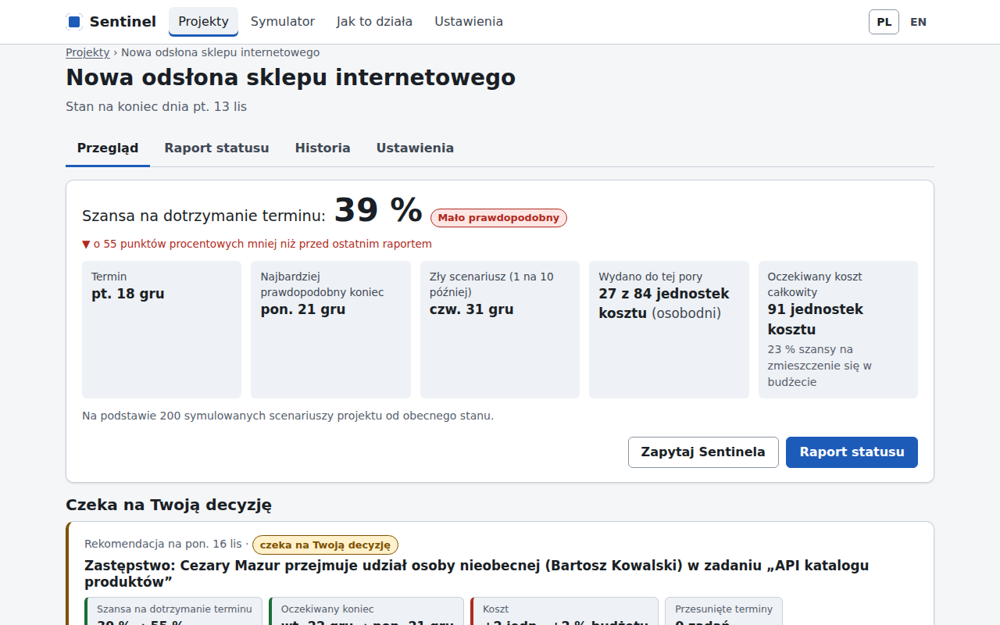

- **Szansa na dotrzymanie terminu** z oceną: *Na dobrej drodze* (80 % i więcej), *Wymaga uwagi*
  (50–79 %), *Termin zagrożony* (poniżej 50 %). Strzałka pod spodem pokazuje zmianę od
  poprzedniego raportu statusu, a pasek — dziś, najbardziej prawdopodobny koniec, termin i zły
  scenariusz na jednej osi. **Jak liczymy?** wyjaśnia, skąd bierze się ta liczba.
- **Termin**, **Najbardziej prawdopodobny koniec** (połowa scenariuszy kończy się wcześniej,
  połowa później) i **Zły scenariusz (1 na 10 później)**, każdy z odległością od terminu w dniach
  roboczych.
- **Budżet** — np. „27 z 84 jednostek kosztu (osobodni)”, ile wydano i jaki jest oczekiwany koszt
  w procentach budżetu. Pod **Szczegóły**: oczekiwany koszt całkowity i szansa na zmieszczenie się
  w budżecie. Jednostka kosztu to domyślnie osobodzień; jeśli w ustawieniach projektu podasz
  dzienne stawki (np. w złotych), koszty są w Twojej jednostce.
- **Czeka na Twoją decyzję** — rekomendacje, które wymagają zgody (rozdział 5), z przyciskiem
  **Przejrzyj i zdecyduj**. Jest to wtedy jedyny wyróżniony przycisk na stronie; gdy nic nie czeka,
  wyróżniony jest **Nowy raport statusu**.

Niżej:

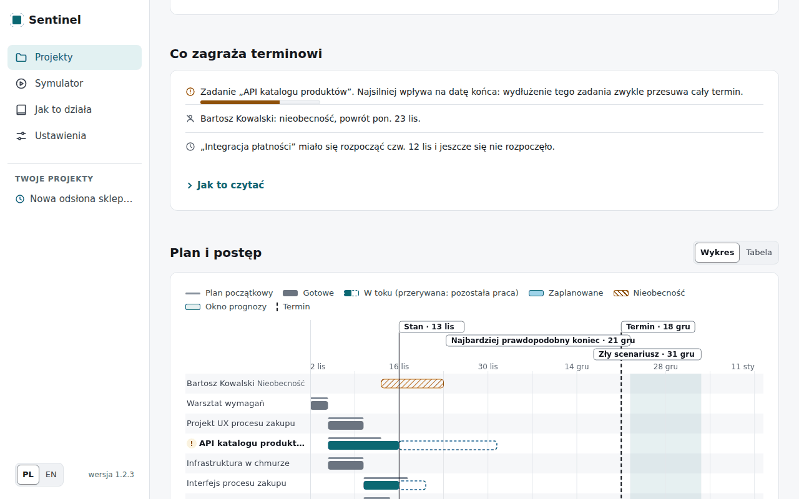

- **Co zagraża terminowi**: dla każdego niezakończonego zadania Sentinel porównuje w 1000
  scenariuszach (pierwsze 200 to te, z których liczymy szansę) czas jego trwania, razem z
  wydłużeniami, z datą zakończenia projektu (korelacja rang). Wymieniamy zadania o wartości co
  najmniej 0,2, najwyżej trzy, od najwyższej, np. „Zadanie „API katalogu produktów”. Im dłużej trwa
  to zadanie, tym później zwykle kończy się projekt”. Pasek pokazuje siłę tego związku. Tę listę
  Sentinel liczy w tle po raporcie, więc może pojawić się chwilę po szansie, która na nią nie czeka;
  rekomendacja też nie. Zadanie o małej zmienności, np. krótkie uruchomienie produkcyjne, rzadko
  trafia na listę, nawet jeśli w większości scenariuszy wyznacza datę zakończenia. Jeśli żadne
  zadanie nie spełnia tego warunku, Sentinel pisze, że ryzyko rozkłada się na cały plan. Wartość
  bliska 0,2 pozostaje niepewna, więc takie zadanie może zniknąć z listy przy następnym raporcie,
  choć w projekcie nic się nie zmieniło; zadanie wyraźnie powyżej tej wartości, np. takie, które
  właśnie mocno się wydłużyło, to mocniejszy sygnał. Pod listą: kto jest nieobecny i które zadania
  nie zaczęły się zgodnie z planem.
- **Skąd ta zmiana** (od wersji 1.4.0): gdy raport zmienił szansę o co najmniej 5 punktów, pod
  szansą pojawiają się do trzech przyczyn, np. „Bez nieobecności osoby Tomasz Lis szansa byłaby
  41 %” albo „Gdyby od 20 lis prace posuwały się zgodnie z planem, szansa byłaby 44 %”. Każda
  przyczyna to szansa tego samego raportu bez jednego zdarzenia, policzona na tych samych
  scenariuszach. Dlatego skutki nie sumują się dokładnie.
- **Plan i postęp**: plan początkowy (cienka szara linia), gotowe (szare), w toku (ciemny morski,
  z przerywanym obrysem pozostałej pracy), zaplanowane (jasny morski) i nieobecności (kreskowanie),
  ze stanem na dzień raportu, dzisiejszym dniem, terminem i oknem prognozy. Zaplanowane daty to
  bieżący plan bez zakłóceń, liczony od ostatniego raportu z zachowaniem wszystkich zależności.
  Jego koniec jest zwykle wcześniejszy niż okno prognozy, bo prognoza uwzględnia typowe wydłużenia
  i nieobecności, co wyjaśnia zdanie pod wykresem. Ten sam plan trafia do eksportu CSV i raportu HTML. Po najechaniu albo dotknięciu nazwy
  zadania widać jego daty i osoby. Przełącznik **Wykres | Tabela** pokazuje to samo w tabeli; na
  telefonie wykres przewija się w bok, a nazwy zadań zostają na miejscu.

Przycisk **Przelicz teraz** uruchamia nową analizę w dowolnej chwili (np. po zmianie terminu w
ustawieniach).

**Kalendarz.** Dni robocze to poniedziałek–piątek bez polskich świąt ustawowych (m.in. 24–26
grudnia, Poniedziałek Wielkanocny, Boże Ciało) i bez dni wolnych firmy, które podasz w
ustawieniach projektu. Po pierwszym raporcie kalendarza nie można już zmieniać.

**Poprawki po starcie.** Po pierwszym raporcie zespół i zadania rozpoczęte lub gotowe zostają bez
zmian. W zadaniu, które się jeszcze nie zaczęło, możesz poprawić szacunek, osoby, zależności i to,
czy jest opcjonalne: **Ustawienia projektu → Popraw zadania, które się jeszcze nie zaczęły**. Każda
poprawka trafia do historii, a prognoza liczy się od nowa.

## 4. Raport statusu

Raport statusu mówi Sentinelowi, co się wydarzyło. Wystarczy raz w tygodniu (np. w piątek), a
w razie ważnej zmiany od razu. Kliknij **Nowy raport statusu**.

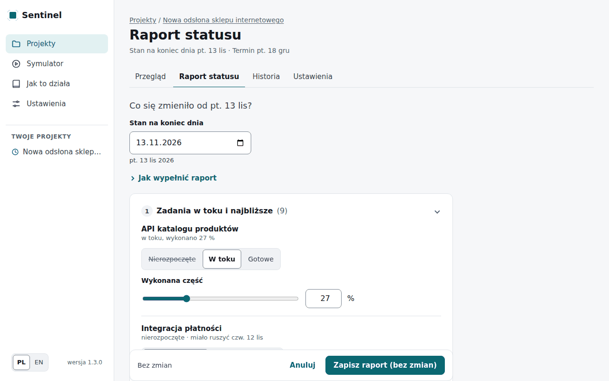

1. **Stan na koniec dnia** — dzień, którego dotyczy raport (zwykle dziś). Pod polem widać datę
   słownie. Data ponad tydzień od dziś wymaga potwierdzenia: raporty następują po sobie, więc
   pomyłka w roku zablokowałaby kolejne. Przy dacie sprzed startu projektu strona o tym
   przypomina, ale raport można zapisać.
2. Jeśli AI jest włączone: **Napisz własnymi słowami** cały raport, np. „Warsztat z klientem
   skończył się wczoraj. Baza danych i API jest w połowie. Ania od jutra do środy ma urlop.”, i
   kliknij **Przetwórz wiadomość**. AI rozumie postęp („zrobiono około 15 %”, „w połowie”),
   zakończenie z datą („skończył się wczoraj”), rozpoczęcie („ruszyło w poniedziałek”),
   nieobecności, wydłużone i nowe zadania. Daty liczy aplikacja według kalendarza projektu (ze
   świętami), nie AI: „od jutra” to następny dzień roboczy, „do środy” — nieobecność przez całą
   środę i powrót w następnym dniu roboczym, „wraca w środę” — powrót tego dnia. Nieobecność
   zapowiedziana na później (np. urlop za dwa tygodnie) liczy się w prognozie od razu, od swojego
   pierwszego dnia. Nazwy zadań
   mogą być odmienione i pisane małą literą („z bazy danych i API”). Pod **Tak to rozumiem:**
   widać pozycje do potwierdzenia, np. „Bartosz Kowalski: nieobecność od czw. 5 lis, wraca pon.
   16 lis (6 dni roboczych)”; zaznaczone zadania od razu wypełniają swoje wiersze formularza,
   gdzie możesz je poprawić. Gdy dzień tygodnia nie pasuje do daty („w poniedziałek 3 listopada”,
   a to wtorek), gdy data wypada w dzień wolny albo „od poniedziałku” może znaczyć dwa różne
   poniedziałki, strona pyta zamiast zgadywać; pyta też, gdy osoby nie ma w zespole albo do opisu
   pasuje kilka zadań. Wybierz odpowiedź albo **Pomiń**. Pokaże też części wiadomości, z których
   nic nie zrobiło („Tego nie zamieniłem na zmianę”). Nieobecność osoby, której wiadomość nie
   wymienia, i data, której nic w wiadomości nie potwierdza, są odznaczone z dopiskiem. Zapisują
   się tylko zaznaczone pozycje; powód nieobecności napisany w wiadomości jest pomijany i nigdzie
   nie zostaje zapisany. Jeśli AI nie odpowie, strona powie dlaczego (np. brak połączenia albo
   brak odpowiedzi na czas), a formularz wypełnisz ręcznie.
   - **Nagraj głosem** (gdy w Ustawieniach jest klucz Groq): kliknij, mów (najwyżej 90 sekund,
     licznik pokazuje czas), kliknij **Zatrzymaj**. Po chwili tekst pojawi się w polu: przeczytaj
     go, popraw i dopiero wtedy kliknij **Przetwórz wiadomość** — wcześniej nic nie jest
     przetwarzane. Nagranie trafia do Groq (USA), który zamienia je na tekst; ani nagrania, ani
     tekstu Sentinel nie zapisuje. Przeglądarka zapyta o zgodę na mikrofon; nagrywanie działa na
     stronie https albo na tym samym komputerze (localhost). Tak samo można nagrać opis projektu
     przy **Opisz słowami**.
3. **Zadania w toku i najbliższe** — przy każdym: *Nierozpoczęte*, *W toku* z wykonaną częścią
   (suwak albo liczba, w procentach) albo *Gotowe* z datą zakończenia. Postęp zapisuje się w
   pełnych dniach pracy, więc przy suwaku widać, co się zapisze, np. „60 % → zapisze się 67 %, 2 z
   3 dni”. Data zakończenia podąża za datą raportu, dopóki jej nie zmienisz. Opcjonalnie: kiedy zadanie
   się zaczęło i kto nad nim pracuje (domyślnie Sentinel przyjmuje plan i wolne osoby). Zadań, o
   których nic nie piszesz, nie trzeba ruszać.
4. **Nieobecności** (**Dodaj**) — osoba, od kiedy i (jeśli wiadomo) kiedy wraca. **Tylko kiedy, nigdy
   dlaczego**: nie ma tu miejsca na powód nieobecności.
5. **Zadania, które urosły** (**Dodaj**) — ile dodatkowych dni roboczych potrzebuje zadanie w toku,
   także takie, które w tym raporcie oznaczasz jako *W toku*. Dla zadania nierozpoczętego to nowy,
   większy szacunek. Budżet domyślny zostaje bez zmian.
6. **Nowe zadanie** (**Dodaj**) — nazwa, dni robocze, po czym następuje i przed czym musi być
   gotowe.

Na dole widać liczbę zmian. Kliknij **Zapisz raport** (bez żadnej zmiany przycisk mówi **Zapisz
raport (bez zmian)** — taki raport też ma sens: znaczy, że nic się nie zmieniło). Po kilku sekundach
przegląd pokazuje nową szansę, a jeśli potrzebna jest zmiana — rekomendację. Raport, w którym
żadne zadanie w toku nie ma postępu, najpierw pyta: „Czy od <data> nic się nie posunęło?”.
Odpowiedz **Tak, brak postępu** albo **Uzupełnij postęp**. Gdy wyjdziesz z
nieskończonego raportu (zakładka, menu, zmiana języka), przeglądarka najpierw zapyta, czy na pewno.

> **Dobra rada:** jeśli zastępca przejął zadanie, część jego czasu idzie na wdrożenie się.
> Sentinel liczy ten czas ostrożnie, dopóki zadanie trwa, więc szacunek pozostałej pracy
> poprawia się, gdy oznaczysz zadanie jako *Gotowe*.

## 5. Rekomendacje i autonomia

Po każdym raporcie Sentinel sprawdza możliwe zmiany i wybiera najlepszą: najpierw liczy się
szansa na dotrzymanie terminu, potem oczekiwane opóźnienie, budżet i to, jak mało zmienia się
plan. Rekomendacja pokazuje:

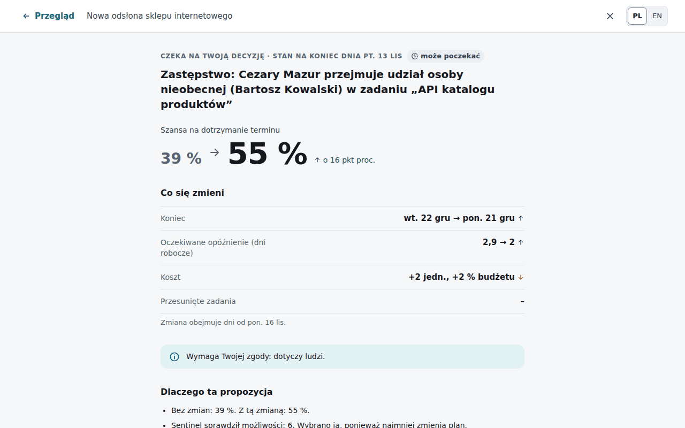

- **działanie** zwykłymi słowami, np. „Zastępstwo: Cezary Mazur przejmuje udział osoby
  nieobecnej (Bartosz Kowalski) w zadaniu „API katalogu produktów””; nad nim dzień, którego stan
  czyta (*stan na koniec dnia* z raportu), a pod **Co się zmieni** pierwszy dzień, który zmiana
  obejmuje,
- **efekt** w porównaniu z brakiem zmian: szansa („39 % → 57 %”), a pod **Co się zmieni**:
  najbardziej prawdopodobny koniec, oczekiwane opóźnienie, koszt („109 % → 111 % budżetu (+2
  jedn.)”) i liczba zadań, których terminy się przesuwają. Od wersji 1.4.0 każda możliwość jest
  liczona tak, jak zastosuje ją zatwierdzenie: od razu i na tych samych scenariuszach. Po
  zatwierdzeniu przegląd pokazuje więc dokładnie obiecaną szansę, daty i koszt. Jeśli coś zmieniło
  się po rekomendacji (np. termin), przegląd mówi to jednym zdaniem. Gdy szansa się nie zmienia,
  karta mówi, co się poprawia, np. oczekiwane opóźnienie,
- **czy potrzebna jest Twoja zgoda** (*dotyczy ludzi*, *kosztuje*, *zmienia zakres* albo *zmienia
  plan bardziej, niż pozwala Twoje ustawienie*) i **dlaczego ta propozycja**,
- pod **Porównaj wszystkie możliwości**: tabela, w której polecana jest pierwsza, a „Bez zmian” jest
  ostatnie jako punkt odniesienia. Każda możliwość jest sprawdzona na tych samych 200 scenariuszach
  co prognoza na przeglądzie, więc „Bez zmian” ma dokładnie szansę z przeglądu. Możliwość gorsza
  niż „bez zmian” ma taką etykietę:

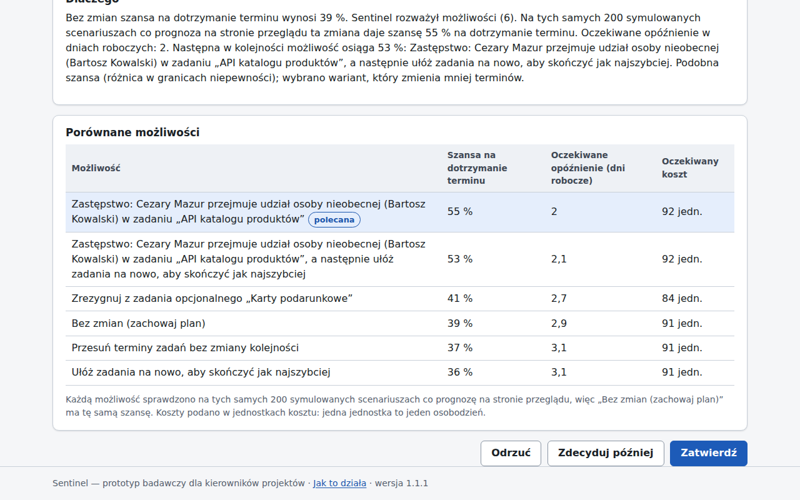

Na tych samych liczbach opiera się decyzja i oba wyjaśnienia. Gdy szanse są podobne, decyduje
kolejne kryterium, np. to, ile terminów się zmienia. Jeśli inna możliwość w tabeli ma wtedy wyższą
szansę (w pełnych procentach) niż polecana, strona wyjaśnia to jednym zdaniem, np. „Podobna szansa
(różnica w granicach niepewności); wybrano wariant, który zmienia mniej terminów”.

Gdy AI jest włączone, **Wyjaśnij innymi słowami (AI)** prosi model, by opowiedział rekomendację
własnymi słowami, po polsku i bez żargonu. Tekst z pojęciami wewnętrznymi AI poprawia raz, a jeśli
nadal je zawiera, strona pokazuje tylko wyjaśnienie powyżej. Tekst jest sprawdzany z tymi samymi
liczbami i oznaczony jako
*sprawdzone z danymi* albo *niepotwierdzone przez dane*; nigdy nie zmienia decyzji. Jeśli model nie
podał użytecznego wyjaśnienia, ten sam przycisk pozwala zapytać ponownie.

Rekomendacja otwiera się na osobnej stronie bez menu: ta strona jest przeglądem przed decyzją.
Decydujesz na dole: przycisk zatwierdzania nazywa zmianę (np. **Zatwierdź zastępstwo**), **Odrzuć**
pyta jeszcze o potwierdzenie, a **Zdecyduj później** zostawia propozycję w części „Czeka na Twoją
decyzję” do następnego raportu, który liczy wszystko od nowa.
Zatwierdzona zmiana od razu trafia do planu (np. zastępca do zespołu zadania, osoba tymczasowa na
wskazaną liczbę dni). Oznaczenie **może poczekać** znaczy, że do realnego ryzyka zostało jeszcze
kilka dni. Rekomendacja „Bez zmian — plan wciąż jest najlepszy” znaczy, że żadna sprawdzona zmiana
nie pomaga wyraźnie bardziej niż obecny plan. Przegląd mówi wtedy wprost, czy zmiana nie jest
potrzebna, czy też Sentinel sprawdził N możliwości i żadna nie pomaga wystarczająco (z linkiem do
porównania). Po zmianie autonomii komunikat mówi, co Sentinel od następnej analizy zrobi sam, a o
co zapyta, a Historia zapisuje stary i nowy poziom.

**Autonomia.** W **Ustawieniach** projektu wybierasz, **co Sentinel może robić sam**:

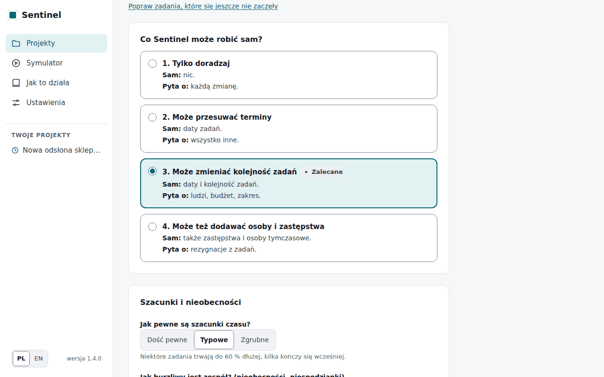

| Ustawienie | Sam | Pyta o |
| --- | --- | --- |
| Tylko doradzaj | nic | każda zmiana |
| Może przesuwać terminy | przesunięcie terminów bez zmiany kolejności | reszta |
| Może zmieniać kolejność zadań (zalecane) | także nowa kolejność zadań | ludzi, budżet, zakres |
| Może też dodawać osoby i zastępstwa | także zastępstwa i osoby tymczasowe | rezygnacja z zadania |

Zmiana zastosowana automatycznie jest widoczna na przeglądzie; nowe terminy albo nowa
kolejność zadań mają przycisk **Cofnij**, dopóki po nich nic się nie wydarzyło. Jeśli ustawienia
projektu zmieniły się po otwarciu strony (np. w innej karcie), strona pyta, zanim je zastąpisz.

**Historia.** Zakładka **Historia** pokazuje wykres **Szansa w czasie** (jeden punkt na raport) i
oś czasu: każdy raport, rekomendację, decyzję i zmianę, ze zmianą szansy i filtrem u góry. Gdy po
raporcie Sentinel nie proponuje zmian, mówi o tym wiersz w tym raporcie, a nie osobny wpis.

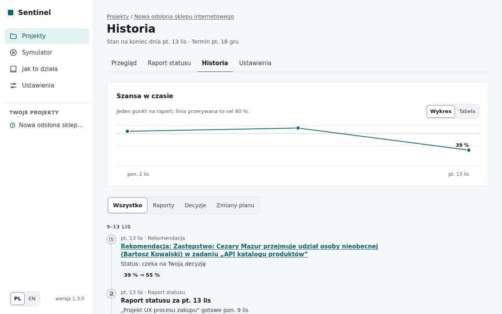

## 6. Symulator

Symulator pozwala zobaczyć Sentinela w działaniu bez prawdziwego projektu: wybierz przykładowy
projekt (mały: 30 zadań, średni: 60 zadań), to, jak burzliwy jest zespół, i kto zarządza
projektem — **Sentinel** albo **Nikt nie reaguje**. Kliknij **Rozpocznij symulację**, a potem
przewijaj o **+1 dzień**, **+5 dni**, **+10 dni** albo **Do końca** (ten bieg można przerwać
przyciskiem **Anuluj**; możesz też opuścić stronę, a przebieg trwa dalej).

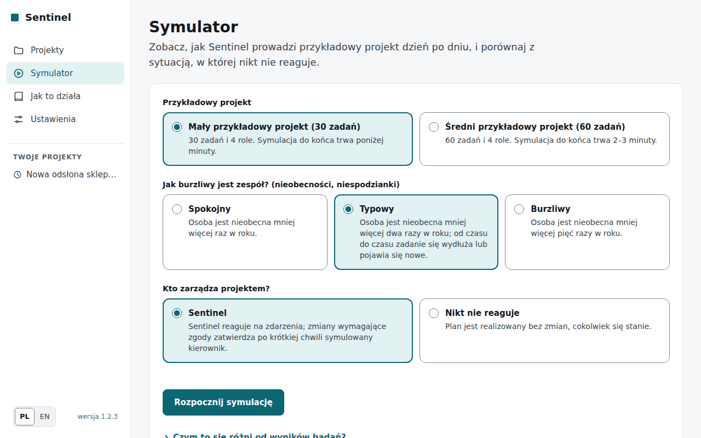

Na końcu **Jak się skończyło** mówi jednym zdaniem, jak Sentinel wypadł, a tabela porównuje ten sam
projekt z tymi samymi zdarzeniami (nieobecności, wydłużone zadania, nowe zadania) prowadzony przez
Sentinela i bez żadnej reakcji: datę zakończenia, opóźnienie, koszt, zmiany planu, osoby tymczasowe i
zastępstwa, z kolumną **Różnica**. Obok wykresu **Co się wydarzyło** pokazuje, co się działo i co
zrobił Sentinel.

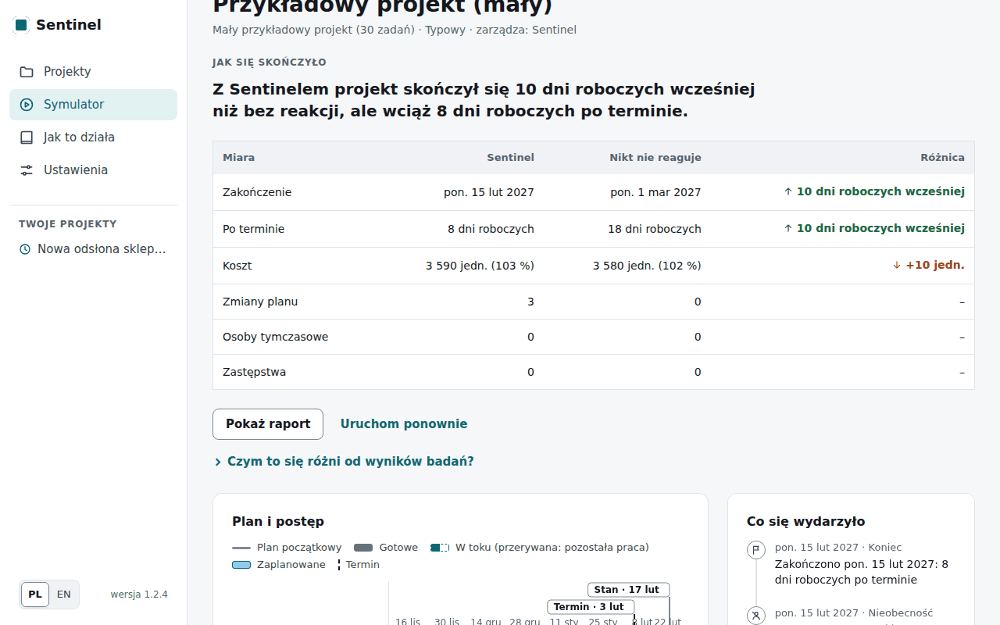

Symulator używa ustawień aplikacji (np. zawsze można dodać co najmniej jedną osobę tymczasową
w każdej roli), a nie ustawień badań naukowych, więc jego wyniki mogą się od nich różnić. Jeden
przebieg to jeden możliwy los projektu; przypadek też ma znaczenie, więc warto spróbować kilku.

## 7. Prywatność

- Sentinel zapisuje tylko **dostępność** ludzi (od kiedy do kiedy ktoś jest nieobecny), **nigdy
  powodu** nieobecności — nie ma na niego pola (RODO, art. 9).
- Dane projektu są na serwerze, na którym działa Sentinel (Twój komputer albo serwer firmy).
  Bez AI nic go nie opuszcza.
- AI jest opcjonalne. **Model lokalny (Ollama)** działa na Waszym sprzęcie i nic nie wysyła na
  zewnątrz; modele w chmurze (Groq, OpenRouter) otrzymują tylko tekst, który odczytują.
  Odpowiedzi AI z prawdziwych projektów są zapamiętywane bez treści wiadomości (zostają tylko
  słowa dat i nazwy zadań).
- **Nagrania głosowe** idą do Groq (USA), tak jak wpisana wiadomość idzie do modelu w chmurze;
  Sentinel nie zapisuje ani nagrania, ani jego tekstu (zapisuje się tylko raport z pozycjami,
  które potwierdzisz). W wersji demonstracyjnej dziennik zapytań notuje jedynie, że nagranie
  przepisano, i jego długość.
- Wersja demonstracyjna w internecie: każdy odwiedzający dostaje własną piaskownicę, której nikt
  inny nie widzi; po 24 godzinach jest usuwana razem z projektami. Na potrzeby testu
  użyteczności wersja demonstracyjna zapisuje też w piaskownicy, które strony i kiedy otwarto
  oraz czy formularz został odrzucony (nigdy adresu ani treści formularza); zapis znika razem z
  piaskownicą.

## 8. Nowy wygląd (v2)

Pod adresem `/v2` działa nowy wygląd na tych samych danych (link „Nowy wygląd (v2)” na stronie
startowej; „Poprzedni wygląd” w menu wraca do dotychczasowego). Projekt otwarty w jednym
wyglądzie widać w drugim. Kolory pokazują stan, ale zawsze z ikoną i słowem; szansę podajemy
jako „39 na 100” z siatką 10 × 10 kropek.

- **Start** — wszystkie decyzje do podjęcia, ułożone według daty ważności, kafelki projektów
  i ostatnie zdarzenia.
- **Pulpit** projektu — werdykt („Nie zdążymy bez zmian · Spóźnimy się o ok. 2 dni robocze”),
  szansa na termin, koniec projektu i budżet w dniach pracy, a pod spodem decyzja do podjęcia.
- **Raport** — opisz lub podyktuj, co się wydarzyło (🎤), a Sentinel zamieni to na karty do
  potwierdzenia; „Postęp zgodny z planem” albo „Wypełnij formularz” to inne drogi. „Wpływ na
  projekt” pokazuje skutek, zanim cokolwiek zapiszesz.
- **Decyzja** — skutek, uzasadnienie, kogo dotyczy i koszt zwłoki; „Zatwierdź”, „Odrzuć” (z
  powodem), „Popraw” albo „Odłóż decyzję”. **Każdą zmianę zatwierdzasz Ty**: w nowym wyglądzie
  Sentinel niczego nie zmienia sam.
- **Dziennik** — kto (Ty albo Sentinel) i co zrobił, dzień po dniu, z filtrami; rozwiń wpis
  (▸), by zobaczyć decyzję w tamtej chwili i jej los; wykres „Szansa w czasie” i „Pobierz
  dziennik (CSV)”.
- **Plan** — „Harmonogram” (wykres Gantta z dniem dzisiejszym, terminem i pasem prognozy;
  zadania z głównych ryzyk na pomarańczowo, nieobecności zakreskowane), „Zadania” (zadanie,
  które się jeszcze nie zaczęło, poprawisz przyciskiem „Popraw”) i „Zespół” (nieobecności,
  bieżące i następne zadania, obciążenie w przyszłym tygodniu — **nigdy ocena czyjejś pracy**).
- **Laboratorium** — „Co jeśli?” sprawdza na wybranym projekcie nieobecność, dłuższe zadanie
  albo nowe zadanie i niczego nie zapisuje; „Dodaj do raportu” przenosi te zmiany do raportu.
  „Symulator” pokazuje przykładowy projekt dzień po dniu: Sentinel obok tego samego projektu
  bez reakcji, „+1 dzień”, „+5 dni” albo „Do końca”, a na końcu jedno zdanie z wynikiem.
- **Na telefonie i tablecie** nowy wygląd mieści się na ekranie: menu jest u góry, karty jedna
  pod drugą, tabele i zakładki przewija się w bok. Na dużym monitorze widok się powiększa.
- **Ustawienia** — wygląd (jasny, ciemny, systemowy), język i model AI („Chmura (zalecany)”
  albo „Lokalny”; klucze tylko we własnej instalacji). **Ustawienia projektu** — podstawy,
  zespół, dni wolne w firmie, **kalendarz**, przypomnienie o raporcie (domyślnie czwartek
  17:00), eksport i „Usuń projekt”.
- **Kalendarz** — „Utwórz link do kalendarza” daje tajny link, który dodasz w Kalendarzu Google
  („Inne kalendarze” → „+” → „Z adresu URL”) albo w iCloud (Plik → Nowa subskrypcja
  kalendarza). Kalendarz pokaże termin, początki i końce zadań, nieobecności (same daty, nigdy
  powód), daty ważności decyzji i przypomnienie o raporcie. **Kto ma ten link, widzi imiona
  osób i daty nieobecności** — „Unieważnij link” natychmiast go wyłącza.

## 9. Najczęstsze pytania

**Skąd Sentinel wie, ile potrwają zadania?** Z Twoich szacunków i z tego, jak pewne one są
(krok 1). W każdym scenariuszu zadanie trwa trochę krócej albo dłużej, tak jak w życiu.

**Dlaczego szansa zmieniła się, choć nic nie zgłosiłem?** Nie zmienia się bez raportu albo
zmiany ustawień: te same dane dają zawsze te same liczby. Jeśli minął czas, a zadania się nie
zaczęły, zgłoś to w raporcie statusu.

**Czy muszę zatwierdzać rekomendacje?** Nie. Możesz je odrzucić albo zostawić na później.
Sentinel niczego nie zmienia w ludziach, pieniądzach ani zakresie bez Twojej zgody.

**Co oznacza „osobodzień”?** Dzień pracy jednej osoby. To domyślna jednostka kosztu; osoba
tymczasowa kosztuje półtora osobodnia dziennie. Własne stawki ustawisz w ustawieniach
projektu (**Koszt dnia pracy**).

**Czy mogę zmienić zespół albo zadania po pierwszym raporcie?** Nazwy, termin, budżet i
ustawienia — zawsze. Strukturę planu po pierwszym raporcie zmieniają raporty statusu (nowe
zadania, dłuższe zadania, nieobecności) i zatwierdzone rekomendacje.

**Jak pobrać dane?** W ustawieniach projektu: plan w CSV, cały projekt w JSON i raport dla
zespołu: jedna strona z prognozą, planem i historią, do druku albo wysłania.

**Czy AI może coś zmienić samo?** Nie. AI może tylko odczytać tekst (który i tak sprawdzasz)
i objaśnić decyzję; objaśnienie ma oznaczenie, czy zgadza się z danymi.

## 10. Instalacja dla działu IT

Szczegóły, kopie zapasowe i wersja demonstracyjna: [deploy.md](deploy.md) (po angielsku).

**Ważne:** aplikacja nie ma kont użytkowników — każdy, kto otworzy jej adres, widzi wszystkie
projekty. Udostępniaj ją tylko w sieci firmowej (VPN) albo za serwerem pośredniczącym z
logowaniem.

**Serwer firmowy (Docker):**

```bash
git clone https://github.com/Embedded-Embodied-Intelligence/sentinel.git && cd sentinel
docker compose up -d --build          # aplikacja na http://127.0.0.1:8000 serwera
docker compose ps                     # po ok. 30 s: (healthy)
```

Dane (projekty, ustawienia, klucz AI) są w wolumenie `sentinel-data`; aktualizacja:
`git pull && docker compose up -d --build`. Przykładowe projekty symulatora (jednorazowo):
`docker compose run --rm sentinel python /app/scripts/fetch_psplib.py --sets j30 j60 --root /data/psplib`.

**Laptop (bez Dockera):** zainstaluj [uv](https://docs.astral.sh/uv/), potem
`uv sync` i `uv run sentinel ui` → http://127.0.0.1:8000.

**AI — możliwości i koszty** (wybór na stronie **Ustawienia** aplikacji; klucz zostaje na
serwerze i nie jest więcej wyświetlany):

| Możliwość | Koszt | Czy dane wychodzą z firmy? |
| --- | --- | --- |
| Bez AI | bezpłatnie | nie; wszystko poza odczytem tekstu i objaśnieniami AI działa |
| Model lokalny (Ollama) | bezpłatnie; karta graficzna od 6 GB pamięci (albo wolniej na procesorze) | nie; `docker compose --profile ollama up -d` i `docker compose --profile ollama exec ollama ollama pull qwen2.5:7b` |
| Groq (chmura) | bezpłatny plan z dziennymi limitami | tak, do Groq (USA); klucz z console.groq.com |
| OpenRouter (chmura) | płatność za użycie (cennik na openrouter.ai) | tak, do OpenRouter i dostawcy modelu |
| Nagrania głosowe (Groq Whisper) | bezpłatny plan Groq z limitami; poza nim ok. 0,04 USD za godzinę nagrań | tak, nagranie do Groq (USA); klucz Groq w Ustawieniach (**Klucz Groq do nagrań**, chyba że dostawcą AI jest Groq), **Sprawdź nagrania** testuje |

Model w chmurze (gpt-oss-120b, domyślny przy Groq i OpenRouter) dokładniej niż lokalny czyta
wiadomości i pisze wyjaśnienia. Do wiadomości o nieobecnościach prawdziwych osób używaj modelu
lokalnego albo dostawcy, który nie przechowuje danych.
